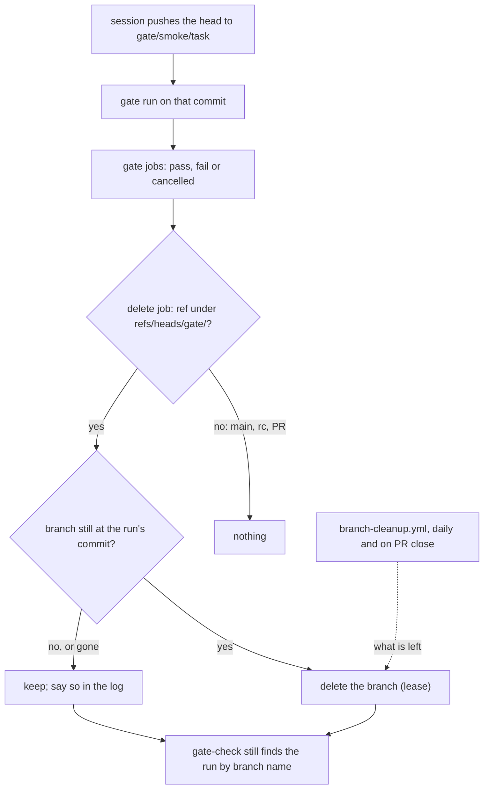

# ADR-049: A gate run deletes its own gate branch when it ends, pass or fail

- **Status:** Proposed
- **Date:** 2026-10-13
- **Related:** ADR-030, ADR-032, ADR-038, ADR-039, ADR-040, ADR-047

## Context

Kade asked (#106) that a gate workflow delete its gate branch once it has a result, whether
the run passed or failed.

**Today (ADR-032):** `branch-cleanup.yml` deletes `gate/<gate>/<task>` only once no other
branch has the task and no open PR has it. While `claude/<task>` exists, its gate branches
stay, so a session can re-push them for the next commit. On 2026-10-13 five gate branches
existed: three for `failover-harness`, two for `batch-roll-fixture`.

**What depends on a gate branch after its run:**
- **gate-check (ADR-039)** takes the latest successful run of each gate from
  `GET /repos/{repo}/actions/runs?branch=<gate branch>`. That listing keeps a run after its
  branch is deleted. ADR-032 says so; on 2026-10-13, `gate/smoke/lakehouse-session-resume-cip73u`
  was gone and its run 38341762476 (success, `4452990`) was still listed by that branch.
- **The run's commit** is the PR's head or an ancestor of it, pushed from `claude/<task>`
  (ADR-038), so it stays reachable without the gate branch.
- **The run's logs and artifacts** belong to the run, not the branch.
- **A re-run** ("Re-run jobs") runs the run's own commit and does not need the branch.

**Two runs on one branch:** a newer push to a gate branch cancels the older run (ADR-038,
ADR-040). A cancelled run that deleted the branch by name would delete the newer commit's
branch while the newer run uses it.

**A lease makes the delete exact:** `git push --force-with-lease=refs/heads/<b>:<sha> <remote>
:refs/heads/<b>` deletes the branch only while it points at `<sha>`. Tried on a local bare
repository: with the branch at the run's commit it was deleted; with the branch at a newer
commit, and with the branch already gone, the push was refused as `stale info`.

**A run's conclusion is the conclusion of all its jobs.** A delete job that failed would turn
a passing gate red, and gate-check would no longer find it.

## Decision

### 1. Each gate run deletes its branch at the end

- **A gate workflow is any workflow that a push to `gate/**` triggers**, whatever its type.
  Today that is `dry-run.yml`, `smoke.yml` and `log-batch.yml`; ADR-047's `failover.yml` when
  it lands, and any later type, are gate workflows the same way.
- **Every gate workflow ends with a job that deletes the run's branch.**
- **It runs whatever the result:** after the gate's jobs, with `if: always()`, so after a
  pass, a failure or a cancellation.
- **Only gate branches:** the job runs only when `github.ref` starts with `refs/heads/gate/`.
  Smoke's nightly run on `main` and the release gate's calls from a PR into `rc` (ADR-033)
  delete nothing.

### 2. It deletes only its own commit's branch, and never fails the gate

- **The branch is deleted only while it points at the run's commit** (`github.sha`), with
  the lease above.
  - Branch already gone: nothing to do, said in the job's log.
  - Branch at another commit: a newer push owns it, so it is kept, and the log says so.
- **The job never changes the run's conclusion.** Its steps report a failed delete as a
  warning and exit 0. `branch-cleanup.yml` then deletes the branch later.

### 3. One reusable workflow

- **`.github/workflows/delete-gate-branch.yml`**, on `workflow_call` only, holds the job.
  Each gate workflow calls it as its last job.
- **Permissions:** `permissions: {}` at the top. Only that job has `contents: write`, which
  the calling job grants. It needs no checkout.
- **A test in `scripts/`** reads every workflow in `.github/workflows/`. Each one whose
  `on.push.branches` names a `gate/` pattern is a gate workflow (§1), and the test fails if one
  lacks the call, its `always()` and `refs/heads/gate/` guard, or its `contents: write`. It
  keeps no list of types, so a new gate workflow without the job fails the static gate.

### 4. The cleanup workflow stays (amends ADR-032)

- ADR-032's sentence "While `claude/<task>` or `kade/<task>` exists, its gate branches stay,
  so a session can re-push them for the next commit" is replaced:
  - **a gate branch is deleted when its run ends** (§1);
  - **a session pushes it again** for the next commit, which creates it again.
- **`branch-cleanup.yml` stays the backstop.** It deletes what a run did not: a branch whose
  run never reached its last job (a lost runner), whose delete failed, or that was pushed with
  no run.
- **`scripts/branch_cleanup.py` covers every type:** any `gate/<type>/<task>` name follows
  ADR-032's rule for `gate/dry-run/<task>` and `gate/smoke/<task>`, so a new type needs no
  change there. Today it names three types and keeps every other `gate/` name, so a lost
  `gate/failover/<task>` would stay for good. A `gate/` name without both segments is still
  kept.
- **ADR-038 is unchanged:** gate branches stay throwaway, and the cleanup workflow still
  deletes those that remain.

## Diagram

## Alternatives considered

- **The cleanup workflow on `workflow_run: completed`:** one workflow, no change to the
  gates. But a `workflow_run` workflow is read from `main` only and starts after the run, so
  a newer push in between makes it delete the wrong commit's branch unless it repeats the
  lease anyway.
- **Delete by name, without the lease:** simpler, but a cancelled run deletes the branch of
  the run that cancelled it.
- **A delete step inside each gate job:** no extra job, but the whole gate job, which runs
  this commit's code, would hold `contents: write`, and three workflows would carry the same
  steps.
- **Delete only after a pass:** a failed gate keeps its branch for inspection, but Kade asked
  for both, and nothing needs the branch to read a failure.
- **Keep ADR-032 as it is:** gate branches stay until their task's PR is merged, as now.

## Consequences

- **Gate branches exist only while their run does,** plus the few that a lost run leaves to
  the daily cleanup.
- **Pushing the same commit again starts a new run,** because the push creates the branch.
  Before, the same commit pushed to an existing branch started nothing.
- **Each gate run takes one more short job,** about ten seconds of runner time.
- **gate-check and `scripts/gate_check.py` are unchanged.** Which gates a PR needs stays
  ADR-039's and ADR-040's decision.
- **Amends ADR-032** (§4). Code follows once this ADR is Accepted:
  - `delete-gate-branch.yml`, and its call in `dry-run.yml`, `smoke.yml` and `log-batch.yml`;
  - the test in `scripts/`;
  - `scripts/branch_cleanup.py` for every `gate/<type>/<task>`, with its tests;
  - `CLAUDE.md`'s workflows row.
- **That PR changes `.github/workflows/`**, so it is a draft Kade merges (ADR-030). It changes
  `dry-run.yml` and `smoke.yml`, so gate-check needs passing dry-run and smoke on its head.
  Those runs carry the new job, so they also prove the delete before the merge.
