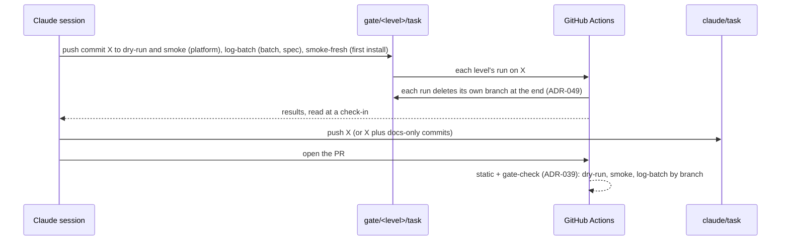

# ADR-050: Gates run from throwaway `gate/*` branches before the PR opens; `smoke-fresh` installs a commit from nothing

- **Status:** Amended by ADR-055
- **Date:** 2026-10-13
- **Related:** ADR-000, ADR-016, ADR-017, ADR-021, ADR-032, ADR-033, ADR-038, ADR-039, ADR-040, ADR-048, ADR-049

## Context

ADR-038 puts the kind gates on throwaway `gate/*` branches that a session pushes before it
opens the PR. ADR-040 §5 amended it with the log-batch level. Issue #109 needs a new level,
so ADR-038 is superseded whole (ADR-000): this ADR restates it with ADR-040's level and adds
one.

**The gap (#109):**
- The release gate runs three gates on every PR into `rc` (ADR-033): dry-run, smoke upgrade,
  and smoke with `fresh`, which installs this commit's release alone.
- A session can push two of them before a PR opens: `gate/dry-run/<task>` and
  `gate/smoke/<task>`. Both upgrade from the last release (ADR-021). `fresh` runs only when
  `release-gate.yml` calls `smoke.yml`.
- So a change that breaks a first install is found at release time at the earliest. #103 is
  that case: with network policies, a fresh install never made polaris-pg's replicas. Dry-run
  and smoke passed on the same commit, and the release gate's fresh smoke had not run since
  #94. The failover measurement's own fresh install found it.
- ADR-048 adds `rebuild-replica` to every smoke run. That covers the replica join, not the
  rest of what a first install creates: the order of `install/release.py`, a new chart, a new
  Secret, a resource an upgrade only patches.

**What `smoke.yml` already has:** a `fresh` input, used by `workflow_call` only, and a
concurrency group that names the ref and `fresh`. One run took 16 minutes on 2026-10-13
(run 38341762476).

## Decision

### 1. The levels

| Level | Runs on | What |
|---|---|---|
| **static** | every push to `claude/**`, every PR | lint, `helm template`, kubeconform with the CRD schemas in use (CNPG), rendered-output assertions (ADR-016), unit tests, repository checks |
| **dry-run** | push to `gate/dry-run/<task>` | kind (ADR-017); install the last release (ADR-021); server-side dry-run of the upgrade |
| **smoke** | push to `gate/smoke/<task>`; nightly on `main` | kind; install the last release; real upgrade; wait for readiness; smoke tests |
| **smoke-fresh** (new) | push to `gate/smoke-fresh/<task>` | kind; this commit's release alone, from nothing; wait for readiness; the same smoke tests |
| **log-batch** | push to `gate/log-batch/<task>`; Create Fixtures monthly on `main` | Create Fixtures when the spec changed; the Log Batch Gate (from ADR-040 §5) |

- **Which of these block a merge, and how, is ADR-039's** (amended by ADR-040). smoke-fresh
  blocks nothing: gate-check reads smoke's runs on `gate/smoke/<task>` only, so a
  smoke-fresh run never stands in for smoke, and ADR-039 is unchanged.
- **The release gate** still calls dry-run and smoke, upgrade and fresh, on PRs into `rc`
  (ADR-033).

### 2. smoke-fresh is `smoke.yml` with `fresh`

- **No new workflow:** `smoke.yml` also runs on a push to `gate/smoke-fresh/**`, and `fresh`
  is true when the input says so or the ref starts with `refs/heads/gate/smoke-fresh/`.
- **Every step is smoke's,** ADR-048's `rebuild-replica` included. Only the install differs:
  `gate.py install --fresh`.

### 3. When a session pushes smoke-fresh

- **When the PR changes what a first install creates:** it changes `install/` or
  `scripts/init_env.py`, or adds or removes a file under `charts/` (a chart or a template).
  Such a PR opens only once smoke-fresh passed too, with its run under *Verified*.
- **Any other PR may push it,** with the reason under *Verified*.
- **A PR that should have pushed it and did not** names it under *NOT VERIFIED*. gate-check
  does not enforce this rule; the session and Kade's reading of the PR do.

### 4. The branches and the flow (restated from ADR-038 and ADR-040)

- `<task>` matches `claude/<task>`. A session pushes **the same commit** it opens the PR from,
  for example `git push origin HEAD:refs/heads/gate/dry-run/<task>`.
- **`gate/*` branches are throwaway:** force-push and deletion are allowed there; they are
  never opened as a PR or merged. Each is deleted by its own run when the run ends (ADR-049),
  and otherwise by the cleanup workflow (ADR-032).
- **A newer push to a gate branch cancels the older run.**
- **Gate workflows:** `permissions: {}` at the top, `contents: read` per job, `actions: read`
  only for a job that downloads an artifact, no repository secrets, actions pinned to a major
  version with `persist-credentials: false`. ADR-049's delete job is the one job with
  `contents: write`.
- **Flow:** push commit X to each gate the PR needs: dry-run and smoke for platform files,
  log-batch for batch and spec files (ADR-039, ADR-040), smoke-fresh under §3. Wait with a
  scheduled check-in. On a failure, fix and push again, at most two self-corrections. Once all
  have passed, push `claude/<task>` and open the PR, or push the new head of a PR already open,
  with each gate's commit and run link under *Verified*. A later docs-only commit needs no new
  gate run (ADR-039).
- **Supersedes ADR-038.**

## Diagram

## Alternatives considered

- **Every `gate/smoke/**` push also runs fresh:** a first install is proven on every platform
  PR, but each one costs a second 16-minute run, and most platform PRs do not change what a
  first install creates.
- **gate-check requires smoke-fresh for §3's files:** enforced rather than a rule, but it
  changes ADR-039 and `scripts/gate_check.py` (a path Kade merges by hand) for a gate that
  most PRs will not need. It can follow if the rule is missed.
- **A new workflow `smoke-fresh.yml`:** its own name in the checks, but a copy of smoke's
  steps that would drift from them.
- **`workflow_dispatch` with `fresh` on the PR branch:** no new branch type, but it needs the
  API, and ADR-038 chose a push so that any session that can push can run a gate.
- **Rely on the release gate:** what happened before #103: found at release time at best.

## Consequences

- **A first-install bug is found before its PR opens,** when the session pushes smoke-fresh
  under §3.
- **A PR under §3 opens one smoke run later,** about 16 minutes of runner time; the two smoke
  runs can run at the same time.
- **The rule depends on the session,** not on gate-check; *NOT VERIFIED* makes a skipped run
  visible.
- **ADR-049 is accepted first:** §4 relies on its delete job, and its test finds smoke-fresh's
  trigger as a gate workflow's.
- Code follows once this ADR is Accepted:
  - in `smoke.yml`: `gate/smoke-fresh/**` among the push branches, and `fresh` from the input
    or the ref;
  - `CLAUDE.md`'s gates paragraph: the level and §3's rule.
- **That PR changes `.github/workflows/`**, so it is a draft Kade merges (ADR-030). It
  changes `smoke.yml`, so gate-check needs passing dry-run and smoke on its head, and it also
  pushes smoke-fresh to prove the new level.
