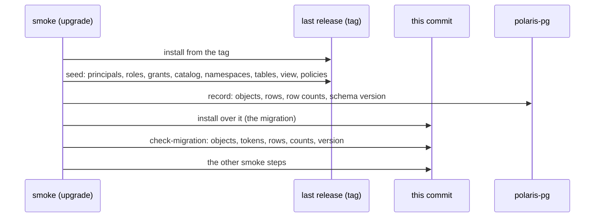

# ADR-051: Gates upgrade from the last release over seeded data, and check every seeded object after the upgrade

- **Status:** Proposed
- **Date:** 2026-10-13
- **Related:** ADR-000, ADR-002, ADR-004, ADR-009, ADR-015, ADR-016, ADR-017, ADR-021, ADR-026, ADR-030, ADR-031, ADR-033, ADR-039, ADR-043, ADR-050

## Context

ADR-021 has gates rebuild the last release from its tag and upgrade it to the commit under
test, with no machine snapshots. ADR-033 amended it. Kade set a new rule (2026-10-13, #112):
Polaris holds operational data in its database, so **a version upgrade must be gated by a
migration test**. ADR-021 is superseded whole (ADR-000): this ADR restates it with ADR-033's
change and adds that test.

**What the upgrade path migrates today:**
- `gates/gate.py install` installs the last release from its tag. Its bootstrap writes the
  schema and the realm's root principal, and nothing else.
- It then installs this commit's release over it at once.
- Catalogs, namespaces, tables and principals are written only after the upgrade, by
  `check-iceberg`.
- So the upgrade runs over an almost empty metastore. ADR-021 said so ("Data-dependent
  migrations stay unproven until data snapshots exist") and deferred data to "the first change
  that touches stored data or the metastore schema". Polaris 1.7.0 is that change.

**What Polaris does with its schema** (source at tags `apache-polaris-1.6.0` and
`apache-polaris-1.7.0`):
- 1.6.0 ships `postgres/schema-v4.sql`; 1.7.0 adds `schema-v5.sql`. v5 makes
  `events.catalog_id` nullable and leaves `idempotency_records` out.
- **Polaris runs no automated schema migration** (1.7.0 `CHANGELOG.md`, "Upgrade notes";
  `metastores/relational-jdbc.md`, "Schema upgrades"). The server reads the version from
  `polaris_schema.version` at startup and keeps working on v3 or v4. Moving to v5 is three SQL
  statements an operator runs by hand.
- The admin tool's `bootstrap` keeps the current version when realms already exist
  (`JdbcBootstrapUtils.getRealmBootstrapSchemaVersion`). A fresh install gets the latest. 1.7.0
  removes its `--schema-version` option; `install/release.py` does not pass it.
- So after a 1.7.0 release, **an upgraded cluster stays on v4 and a fresh one starts on v5**.
- **ADR-009 §4** says a schema change "is applied by Polaris's own migration, never by hand".
  Polaris has none, so that rule cannot hold as written (§5).

**What Polaris stores in PostgreSQL** (`schema-v4.sql`): `entities` (catalogs, namespaces,
tables, views, policies, principals, roles), `grant_records`,
`principal_authentication_data`, `policy_mapping_record`, `events`, `idempotency_records` and
`version`. Table data and metadata files are in S3, not in PostgreSQL.

## Decision

### 1. Rebuild from the tag (restated from ADR-021 and ADR-033)

- **The dry-run and smoke gates and the release gate** install the latest release tag
  reachable from the commit, from a checkout of that tag, then upgrade to the commit under test.
- **No tag yet,** or smoke-fresh (ADR-050): a fresh install, and the summary says so.
- **Speed comes from caching** pulled images keyed by the tag's image list, never from
  machine snapshots. Hosted runners cannot boot a custom image, and a self-hosted runner does
  not belong on a public repository.

### 2. Seed before the upgrade

On every smoke run that upgrades (`gate/smoke/<task>`, nightly on `main`, the release gate's
upgrade run), between the last release's install and this commit's:
- **`gate.py seed`**, from a check pod like `check-iceberg`'s, writes a known set through the last
  release's Polaris API, as root and as the seeded principals:
  - two principals with credentials, principal roles and catalog roles, and grants between
    them;
  - a catalog on the S3 stand-in, with nested namespaces carrying properties;
  - tables with rows over at least two snapshots and one schema change, and a view if the pinned PyIceberg can create one;
  - a Polaris policy attached to the catalog, a namespace and a table.
- **It records what it wrote:**
  - every seeded object as the API returns it;
  - the tables' rows;
  - from polaris-pg, read with `psql` as `check-restore` does (ADR-043): the row count of each
    table in `polaris_schema`, and the schema version.

  The record stays on the runner, in the job's workspace.
- **The seed is this commit's code** running against the last release. If it uses an API that
  release lacks, the seed fails: the seed may use only what the last release serves.

### 3. `check-migration` after the upgrade

A smoke step right after the install, before any other step changes the data:
- **Every seeded object reads back as recorded.** A field that is missing or has another value
  fails; a field the new version adds is allowed and listed.
- **The seeded principals get tokens** with their recorded credentials, so their
  authentication data survived.
- **The tables return the recorded rows** at each recorded snapshot, and a new append works.
- **No table in `polaris_schema` has fewer rows** than recorded.
- **The schema version before and after** is printed. A change is reported, not failed by
  itself; which version must hold is §5's.
- **On a fresh install** nothing was seeded: `check-migration` says so and passes.

### 4. What enforces it

- **A Polaris version change is a change under `charts/`** (image, chart) or `install/` (the
  admin tool). gate-check already requires a passing smoke on the head for those (ADR-039). So
  no version change merges without `check-migration` passing on it. gate-check and
  `scripts/gate_check.py` are unchanged.
- **The dry-run seeds nothing:** its upgrade is server-side and changes no data.

### 5. Schema upgrades are a separate decision

- **How a target cluster moves from schema v4 to v5,** if it does, is decided by its own ADR
  before the PR that changes Polaris to 1.7.0. ADR-009 §4 is amended by that ADR, not by this
  one. The choices include staying on v4, which 1.7.0 supports, and a step in
  `install/release.py` that runs upstream's SQL.
- **Whatever it decides, `check-migration` proves it** on the seeded data. smoke-fresh
  (ADR-050) proves the fresh schema.

### 6. Data snapshots stay deferred

- **A snapshot of seeded data per release tag** waits until an upgrade that skips a release,
  or a data volume, needs proving. Until then the seed is written again on every run.
- **A copy of a target cluster's data** is never used: target clusters are never reached from
  here (ADR-004), and the repository is public (ADR-002).

## Diagram

## Alternatives considered

- **A data snapshot per release tag** (option B): frozen at release time, and it can prove an
  upgrade that skips a release. But it needs storage and retention, and in a public
  repository the dump would publish principal secret hashes unless secrets were rewritten
  first. Deferred (§6).
- **A target cluster's data** (option C): never reachable from here (ADR-004, ADR-002).
- **Seed with SQL instead of the API:** faster, but it writes rows Polaris may not write the
  same way, so it proves the migration of data no release made.
- **Compare database dumps before and after:** catches every change, but a new column or
  default makes noise. The API is what Polaris's clients rely on; row counts and the version
  cover what the API hides.
- **The seed in the dry-run too:** its upgrade changes nothing, so there is nothing to check.
- **Keep ADR-021 as is:** a version change would be gated over an almost empty metastore,
  against Kade's rule.

## Consequences

- **Every upgrading smoke run, nightly included, proves that what the last release stored
  survives this commit,** for every object type the seed covers.
- **The seed grows with Polaris:** a feature that stores new state adds itself to the seed in
  the PR that enables it.
- **The data is synthetic:** sizes and real-world shapes are not proven (§6).
- **Smoke takes the seed and the check longer,** about a minute; the first run gives the number.
- **Supersedes ADR-021,** with ADR-033's amendment of it restated in §1. ADR-009's 1.7.0
  checklist step 3 now runs over seeded data. Code follows once this ADR is Accepted:
  - `gates/seed.py`, the seed and its record, with unit tests for what it writes and how it
    compares;
  - `gate.py seed` and `gate.py check-migration`; `install` runs the seed between the two
    installs, and only when it upgrades;
  - the `check-migration` step in `smoke.yml`.
- **That PR changes `smoke.yml`,** so it is a draft Kade merges (ADR-030), with passing dry-run
  and smoke on its head (ADR-039).
- **Before the 1.7.0 PR:** §5's ADR on schema v5.
