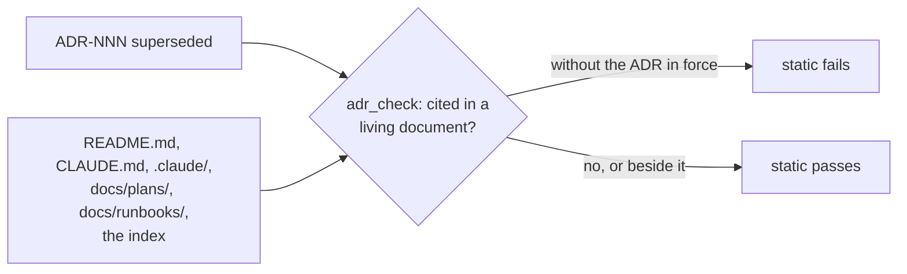

# ADR-052: Runbooks are living documents and cite only ADRs in force

- **Status:** Proposed
- **Date:** 2026-10-14
- **Related:** ADR-000, ADR-043

## Context

ADR-000 rule 9 names the living documents: `README.md`, `CLAUDE.md`, `.claude/`,
`docs/plans/` and the ADR index. They must never cite a superseded ADR, and
`scripts/adr_check.py` checks exactly those paths.

The first runbook entered `docs/runbooks/` in #139: `restore-polaris-pg.md`, which ADR-043 §4
asks for. A runbook is read and followed as current instructions, as `CLAUDE.md` and the plans
are. It cites ADRs for why its steps are what they are: ADR-002, ADR-005, ADR-043 and ADR-048.
When one of them is superseded, nothing flags the runbook today. Someone following it would
then act on a decision no longer in force.

Kade's choice (2026-10-14): option A of #125's follow-up, an ADR that amends rule 9.

## Decision

- **Amends ADR-000 rule 9:** the living documents are `README.md`, `CLAUDE.md`, `.claude/`,
  `docs/plans/`, `docs/runbooks/` and the index. None of them cites a superseded ADR.
- **`scripts/adr_check.py` checks `docs/runbooks/`** as it checks `docs/plans/`: every `.md`
  file under it. A line that also names the ADR now in force still passes.
- **Unchanged from ADR-000:** every other rule, and rule 11, *Not ADRs*: runbooks stay outside
  `docs/adr/`.

## Diagram

## Alternatives considered

- **Leave runbooks out of rule 9:** a stale citation in a runbook is caught only in review,
  if at all. Runbooks are run rarely, so a stale one would be found when it is needed most.
- **Check every `.md` file in the repository:** ADRs, measurements and contracts cite
  superseded ADRs on purpose, as history or evidence. Each would need an exception.

## Consequences

- **A PR that supersedes an ADR** also updates every runbook that cites it, or static fails,
  as for `docs/plans/` today.
- **Code follows once this ADR is Accepted:** `docs/runbooks` joins `LIVING_DIRS` in
  `scripts/adr_check.py`, test first, and its docstring names it. `CLAUDE.md`'s list of
  living documents follows.
- ADR-000 becomes "Amended by ADR-052" when this ADR is accepted.
