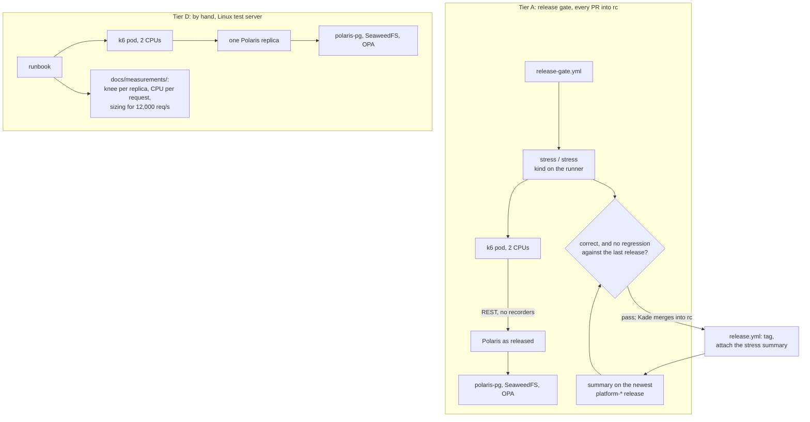
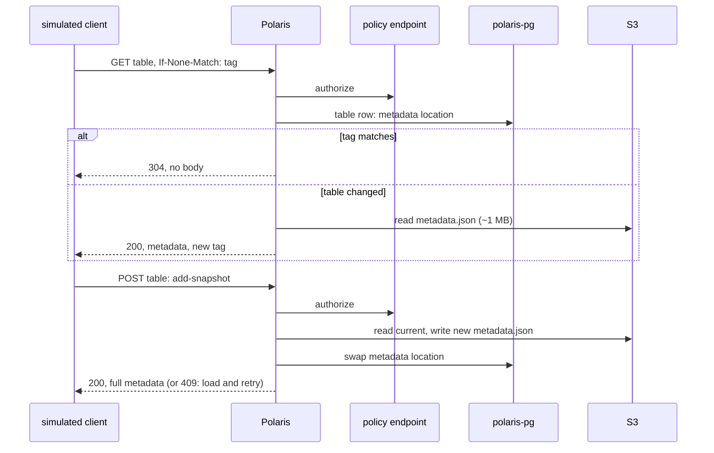

# ADR-053: Release candidates are stress-tested with k6 on the release gate, and one Polaris's capacity is measured on a Linux test server

- **Status:** Amended by ADR-054
- **Date:** 2026-10-14
- **Related:** ADR-000, ADR-002, ADR-003, ADR-004, ADR-005, ADR-015, ADR-017, ADR-026, ADR-028, ADR-030, ADR-031, ADR-033, ADR-034, ADR-039, ADR-046, ADR-047, ADR-048, ADR-049, ADR-050, ADR-052

## Context

Issue #142 (Kade, 2026-10-14): the release gate has no stress test. Kade's answers on
2026-10-14, numbers only:

- **The load:** the target clusters' Polaris serves **6,000–8,000 HTTP requests per second**
  at peak. Most are reads from users' Iceberg queries. Spark ETL jobs commit steadily. The
  peaks are two windows of about 2 hours a day.
- **The tables:** about **100**, with `metadata.json` typically about **1 MB**.
- **Headroom:** **1.5×** today's top, so **12,000 req/s**.
- **Where:** the release gate on `rc` (ADR-033), not every PR. For absolute capacity, a
  Linux test server with 8 cores, 16 threads and 64 GB, which Kade runs.
- **The tool:** k6, the brief's recommendation.
- **A shared dev cluster** is left to an ADR of its own. Its object store and its policy
  server's interface differ from this repository's stand-ins (ADR-031).

**What a request costs Polaris 1.6.0**, read in its source at tag `apache-polaris-1.6.0`
on 2026-10-14:

- **`loadTable` answers with the whole table metadata**, about 1 MB here, read from S3.
- **Every 200 from `loadTable` carries a weak `ETag`**, a hash of the table's metadata file
  location (`IcebergHttpUtil`).
- **A request whose `If-None-Match` matches gets a 304 with no body.**
  `IcebergCatalogHandler.loadTable` compares the tag with the location stored in PostgreSQL
  *before* it reads `metadata.json`, so a 304 skips both the S3 read and the 1 MB of JSON.
- **Authorization still runs first.** A 304 still costs one call to the policy endpoint
  (ADR-026) and a lookup of the table's row in PostgreSQL.
- **Polaris's only cache is its entity cache, in each replica's heap** (`InMemoryEntityCache`,
  about 100 MB by default, `ENTITY_CACHE_WEIGHER_TARGET`). It needs no external service, and
  it does not cache `metadata.json`. Each request still checks its cached entities against
  PostgreSQL in one batched version query. None of this differs in 1.7.0, 1.8.0 or upstream's
  `main` of 2026-10-14.
- **A commit always pays in full:** Polaris reads the current metadata, writes a new
  `metadata.json` to S3, swaps the location in PostgreSQL, and returns the full metadata.

**Which clients send `If-None-Match`**, read in Apache Iceberg's source the same day:

- **Iceberg Java 1.11.0** (Spark): yes. `RESTSessionCatalog` keeps a table cache per
  session, 5 minutes and 100 tables by default (`rest-table-cache.*`).
- **Iceberg Java 1.10.2 and older:** no; every load is a full 200.
- **A commit changes the tag**, so the next load of that table by every client is a full 200.
- **Which client versions run against the target clusters is not known.** Their Polaris
  metrics would show it: the rates of `status="304"` and `status="200"` on the table-load
  endpoint. The question stays open on #142.

**What the existing environments can reach:**

- **The gate** is kind with three nodes on a standard GitHub-hosted runner, 4 vCPU and 16 GB
  (ADR-017). Polaris, polaris-pg's three instances, the stand-ins and the load generator
  would share those four CPUs. 12,000 req/s is out of reach there; what it can show is a
  change from one release to the next.
- **On the gate, Polaris reaches PostgreSQL, S3 and the policy endpoint through the
  recorders** (ADR-034), Python processes that would cap and distort any rate.
- **Kade's Linux test server** is a Linux test cluster in ADR-004's sense: Kade runs it, and
  no CI reaches it. Full 1 MB responses at 12,000 req/s would need tens of cores for the JSON
  alone, so the server measures what one Polaris replica serves, and the target's replica
  count follows from it.

## Decision

### 1. Two tiers

| | Tier A: regression | Tier D: capacity |
|---|---|---|
| **Runs** | On every PR into `rc`, as a required check of the release gate | By hand from a runbook, by Kade |
| **Where** | kind on the GitHub-hosted runner (ADR-017) | Kade's Linux test server, kind built by the gate's own scripts |
| **Polaris** | As released (`values-lakehouse.yaml`) | One replica; a size change only (ADR-017) |
| **Proves** | The candidate is correct under contention, and not slower than the last release | What one Polaris replica serves, and the target's replica count for 12,000 req/s |
| **Records** | A summary attached to the release (§6) | `docs/measurements/` (ADR-003) |

- **Both tiers run the same scenario** (§3) with the same tool (§2). Only the rates, the step
  lengths and the hold differ.
- **Neither tier reaches a target cluster** (ADR-004). The shared dev cluster is out of
  scope (Context).

### 2. The tool: k6

- **k6 runs as a pod** from the official image, pinned by digest in `gates/pins.json`, as the
  stand-ins are (ADR-031). It is never part of a release.
- **The pod is limited to 2 CPUs** and carries the gate's check label
  `lakehouse-gate/check: "true"`, so ADR-048 §5 admits it to Polaris.
- **The scenario is our own JavaScript** under `gates/stress/`, speaking the Iceberg REST API
  directly. Rates are open-model (`constant-arrival-rate`, `ramping-arrival-rate`), so a slow
  Polaris shows as dropped requests rather than a slower client.
- **The driver is Python** under `gates/stress/`: it seeds the tables, starts k6, reads the
  results and checks every table after the run. Its arithmetic (knee, percentiles,
  comparisons, lost commits) is unit-tested in the static gate.
- **k6 is AGPL-3.0.** This repository runs its image and distributes nothing built from it.

### 3. The scenario

**The data, seeded before each run:**

- **One catalog with 100 tables in 10 namespaces**, on the S3 stand-in.
- **Each table carries snapshot history** until its `metadata.json` is about 1 MB. The
  seeding sends batched `add-snapshot` updates, a few requests per table.
- **Every snapshot names one small manifest list** written once to the S3 stand-in.

**The requests:**

| Kind | Request | Notes |
|---|---|---|
| **Conditional load** | `GET` table, with the tag the client last got | As Iceberg Java 1.11: a 304 while the table is unchanged; a full 200 after a commit, or after the client's 5-minute expiry |
| **Unconditional load** | `GET` table, no `If-None-Match` | As Iceberg Java 1.10 and older: always a full 200 |
| **Commit** | `POST` table: `add-snapshot` and `set-snapshot-ref` on `main`, with `assert-ref-snapshot-id` | On a 409, load and retry, up to 4 times, as Iceberg's client does |
| **Other** | Token, `config`, list namespaces and tables, `HEAD` table | Small responses |

- **Commits are spread over 90 tables.** The other 10 are a **hot set**, each with 4
  concurrent writers, so commits collide and the 409 path is exercised.
- **Each simulated client keeps its own tags**, so a commit sends that table's readers back
  to a full load, as on the target.

**The profiles:**

| Profile | Mix | What it finds |
|---|---|---|
| **commits** | Commits only | The maximum commit rate |
| **queries-conditional** | Conditional loads and other requests | The maximum query rate for 1.11 clients |
| **queries-full** | Unconditional loads and other requests | The maximum query rate for older clients |
| **mixed** | 85% conditional loads, 10% other, 5% commits | The maximum for the target's shape |

- **The mixed profile's shares are an assumption** until the target's metrics give the real
  ones (Context). They are a tuning value in `gates/stress/`'s config (ADR-000 rule 11),
  changed there with the evidence in the PR.

### 4. Ramps, the knee, and what makes a run valid

- **Each profile is a step ramp:** the rate rises by a fixed step, held at each step, until a
  step fails. **The knee** is the last step that passes, which is the maximum for that
  profile.
- **A step passes** when all three hold:
  - Polaris answered at least 95% of the requests offered (k6 dropped at most 5%);
  - errors are at most 0.1%, a 409 on the hot set not counted;
  - p99 latency is within a cap per request kind.

  The caps, the step size and the step length are tuning values in `gates/stress/`'s config.
- **A run measures Polaris only if nothing else is the limit.** k6, the policy stand-in and
  the S3 stand-in each run with a CPU limit. The driver samples each container's CPU from
  the kubelet's cAdvisor endpoint through the API server. A knee reached while any of the
  three is at its limit is reported as that component's, not Polaris's, and the run is not a
  measurement.
- **Polaris connects to the stand-ins directly, never through the recorders** (ADR-034), as
  ADR-047's probe does. A stress install writes its own `.env` with the stand-ins'
  endpoints. Smoke keeps the recorders.
- **Server-side figures come from Polaris's own metrics** on 8182 (ADR-046): request
  durations per endpoint and status, and the JVM's CPU and memory.

### 5. Tier A: the release gate

- **`stress.yml`** is a reusable workflow, called by `release-gate.yml` as the job `stress`.
  Its check is **`stress / stress`**.
  - It also runs on a push to `gate/stress/<task>` and on `workflow_dispatch`, for
    calibration. ADR-050's and ADR-049's rules for `gate/*` branches apply.
  - It is not a gate level for PRs into `main`: gate-check does not require it (ADR-039).
  - It follows the gate workflows' rules: `permissions: {}`, `contents: read` per job, no
    repository secrets; the gate's own Secrets only.
- **What it runs:** kind as smoke builds it (`gates/gate.py up`), the candidate installed
  fresh, the stand-ins without recorders, the seeding, the four ramps, then a **hold of the
  mixed profile at 70% of its knee for 10 minutes**.
- **What fails it:**
  1. **Correctness**, from the first run:
     - any 5xx;
     - any failure other than a 409 on the hot set;
     - a commit answered 200 that is missing from its table's snapshot list after the run,
       or present twice;
     - a restart of a Polaris or polaris-pg container.
  2. **Regression against the last release's summary** (§6):
     - a profile's knee below the baseline's by more than the noise margin;
     - the hold's p99 above the baseline's by more than the noise margin.

     Until a release carries a summary, only (1) applies, and the run records its numbers.
- **The noise margin comes from calibration**, before the job joins the release gate:
  - the same commit runs 5 times from `gate/stress/<task>`;
  - the margin is set above the spread between those runs, so the runner's own variance
    cannot fail a candidate;
  - the calibration is recorded in `docs/measurements/`, and the margin, the caps and the
    steps go in `gates/stress/`'s config with that evidence.
- **The job's time is measured in calibration.** The target is under 45 minutes, running in
  parallel with the release gate's other jobs.

### 6. The baseline lives on the release

- **`release.yml`** attaches the release gate's stress summary (JSON: knees, hold
  percentiles, versions, the run link) to the GitHub release it creates (ADR-033).
- **Tier A reads its baseline** from the newest `platform-*` release that carries one.
- Releases are never moved or deleted (ADR-033), so the baseline cannot expire as a workflow
  artifact does.

### 7. Tier D: one Polaris on a Linux test server

- **The cluster:** kind with three nodes, built on the server by the gate's own scripts at
  the gate's pins, so it differs from the gate in size only. Polaris has one replica;
  polaris-pg has its three instances; the stand-ins are SeaweedFS and OPA (ADR-031); k6 runs
  in the same cluster, limited to 2 CPUs.
- **Polaris's CPU and memory are set explicitly**, requests equal to limits, a size change
  only (ADR-017). Neither upstream's chart nor `values-lakehouse.yaml` sets them, so without
  this the JVM would size its heap from the server's memory. The values are tuning values in
  the runbook.
- **What it runs:** the four ramps with longer steps, then **a hold of the mixed profile at
  80% of its knee for 2 hours**, the length of one of the target's peak windows. The hold
  looks for what only time shows: memory growth, pool exhaustion, garbage-collection pauses.
- **What it reports**, for each profile:
  - the knee, in req/s for one Polaris replica;
  - Polaris's and polaris-pg's CPU-seconds per request at the knee;
  - the hold's p50, p95 and p99, and its error rate.
  - Polaris's CPU and memory limits, its maximum heap, and its heap used after garbage
    collection over the hold.
- **The sizing for 12,000 req/s** follows from it:
  - Polaris replicas: 12,000 ÷ the mixed knee;
  - polaris-pg cores: 12,000 × polaris-pg's CPU-seconds per request, because every replica
    shares one primary;
  - both are estimates for the target's hardware, to be checked against #9's answers.
- **The runbook** is `docs/runbooks/stress-capacity.md` (ADR-052). The issue carrying a run
  is labelled `cmd:verify-needs-linux`.
- **Results:** `docs/measurements/stress-capacity-<date>.md`, with the run's JSON beside it,
  in the PR that took them (ADR-003). They name the versions measured and describe the
  server by cores, threads and memory only (ADR-002).
- **When it runs:** when a release changes Polaris's or PostgreSQL's version or settings, and
  when the target sizing changes. It is not a check the release workflow reads.

### 8. The release gate's checks

- **Amends ADR-033:** the release gate's fixed checks are six, adding `stress / stress`. The
  `rc` ruleset requires it, `install/release_tag.py`'s `REQUIRED_CHECKS` names it, and
  `release.yml` requires it to have succeeded on the PR's head, like the other five.

## Diagram

## Alternatives considered

**Where it runs:**

| Option | Why not |
|---|---|
| **A GitHub-hosted runner sending the load to Kade's server** (Kade's first proposal) | Every response crosses the internet and the home connection's upload link, which becomes what is measured. The server would accept connections from GitHub's whole address range; its address would appear in public Actions logs (ADR-002); and the job would need a Polaris credential as a repository secret, which ADR-017 rules out. |
| **Kade's server as a self-hosted runner** | GitHub warns against self-hosted runners on public repositories: a fork's PR could run code on the machine. ADR-017 rejected it for the same reason. |
| **A larger GitHub-hosted runner** | Billed per minute even on public repositories, and offered only to organizations on paid plans. One kernel and one disk would still hold every component. |
| **A temporary cloud cluster per run** | A cost per run, cloud credentials as a secret, and a teardown to maintain. |
| **Tier A only** | It finds regressions but never answers whether the target holds 12,000 req/s. |
| **The Mac on Kade's LAN as the load source** | macOS is outside ADR-004, and full 1 MB responses over a 1 or 2.5 GbE link cap the rate at the network. Kept for a later ADR if calibration shows k6 on the server is the limit. |

**The tool:**

| Option | Why not |
|---|---|
| **PyIceberg**, already pinned for the smoke tests | Tens of requests per second per process, with its own file writes; the load generator would take the CPU it measures. |
| **Our own Python client on the standard library** | No new dependency, but open-model rates, percentiles and dropped-request accounting would all be ours to write and keep correct. |
| **polaris-tools' Gatling benchmarks**, at the commit ADR-028 pins | Upstream-maintained, but its commits are property updates, not snapshots, so metadata never grows; appends would be a patch we carry. It adds a JDK and Gradle, whose dependencies are fetched without hashes. |
| **Locust** | Python, a few hundred to a thousand requests per second per worker, and a pip dependency with gevent. |

## Consequences

- **New dependency, gate and Tier D only:** the k6 image, pinned by digest in
  `gates/pins.json`. It never reaches a release.
- **The release gate grows a sixth required check.** Kade adds `stress / stress` to the `rc`
  ruleset when the job joins the release gate.
- **Code follows once this ADR is Accepted**, in this order:
  1. `gates/stress/` with its unit tests, the pin, and `stress.yml` on `gate/stress/<task>`
     and `workflow_dispatch` only. The PR adds a workflow, so it is a draft Kade merges
     (ADR-030); being under `gates/`, it needs dry-run and smoke (ADR-039).
  2. The calibration: 5 runs of one commit, recorded in `docs/measurements/`, and the config's
     margins, caps and steps.
  3. `release-gate.yml` calling `stress.yml`, `REQUIRED_CHECKS`, and `release.yml` requiring
     the check and attaching the summary. A draft Kade merges (ADR-030), then the `rc`
     ruleset.
  4. The Tier D runbook, then its first run on Kade's server.
- **Disk is a limit on the runner.** Every commit writes a new `metadata.json` of about 1 MB
  to the S3 stand-in. The calibration measures the run's disk use, and the commit rate and
  the hold's length are set so a run fits the runner's disk.
- **The mixed profile is an assumption** until the target's metrics give the shares of 304,
  200 and commits at peak (#142).
- **The 12,000 req/s figure is checked on paper, not run.** Tier D measures one replica; the
  sizing divides. The shared dev cluster's own ADR is where several replicas are measured
  together.
- **Client-side caching is the clients' choice.** If the target's metrics show few 304s, the
  query rate depends on clients moving to Iceberg 1.11 or later; this repository can measure
  both profiles but not change the clients.
