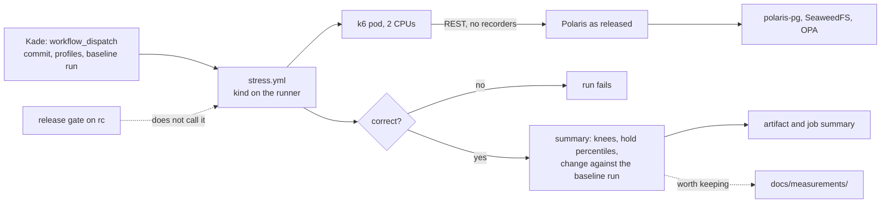

# ADR-054: The stress test runs only when Kade starts it, not in the release gate

- **Status:** Proposed
- **Date:** 2026-10-14
- **Related:** ADR-003, ADR-030, ADR-033, ADR-049, ADR-053

## Context

ADR-053 (accepted 2026-10-14) made Tier A of the stress test a required check of the release
gate: `stress / stress` on every PR into `rc`, failing a candidate on a correctness fault or on
a regression against the last release's summary, which `release.yml` would attach to each
release. None of that is built yet: only the stand-ins' direct mode and the `gate_stress`
principal exist (step 1a of ADR-053's Consequences).

Kade changed the plan on 2026-10-14: **the stress test runs only when he starts it by hand,
never in the release gate.**

## Decision

**Amends ADR-053.** It replaces §1's Tier A row, §5, §6 and §8, and the Consequences that
follow from them. ADR-053's §2 (k6), §3 (the scenario), §4 (ramps, the knee, validity, direct
mode) and §7 (Tier D) stand unchanged.

### 1. Tier A runs by hand (replaces ADR-053 §1's Tier A row and §5)

| | Tier A |
|---|---|
| **Runs** | Only when Kade starts `stress.yml` by hand (`workflow_dispatch`) |
| **Where** | kind on the GitHub-hosted runner (ADR-017), as ADR-053 §5 built it |
| **Polaris** | As released (`values-lakehouse.yaml`), the commit Kade picks |
| **Proves** | The commit is correct under contention, and how fast it is next to an earlier run |
| **Records** | The run's summary as a workflow artifact and in its job summary |

- **`stress.yml` has one trigger, `workflow_dispatch`.** It is not called by the release gate
  and not triggered by a push to `gate/*`, so it is not a gate workflow under ADR-049 and has
  no delete job.
  - It follows the gate workflows' rules all the same: `permissions: {}`, `contents: read`
    per job, no repository secrets; the gate's own Secrets only.
- **Claude sessions start it only when Kade asks in that session,** as with releases
  (ADR-033).
- **What it runs is unchanged:** kind as smoke builds it, the chosen commit installed fresh,
  the stand-ins in direct mode, the seeding, the ramps and the 10-minute hold (ADR-053 §5).
- **Inputs:** the profiles to run (all four by default), and optionally an earlier run's id
  to compare against.

### 2. What fails a run (replaces ADR-053 §5's failure rules)

- **Only correctness fails a run:**
  - any 5xx;
  - any failure other than a 409 on the hot set;
  - a commit answered 200 that is missing from its table's snapshot list after the run, or
    present twice;
  - a restart of a Polaris or polaris-pg container.
- **Speed is reported, never judged.** The summary gives each profile's knee and the hold's
  percentiles. With a baseline run named, it also gives each one's change against that run.
- **No calibration is a precondition.** ADR-053 §5's five calibration runs existed to set the
  noise margin a release candidate would be failed on; nothing fails on a margin now. A
  repeat of one commit stays useful for reading a comparison, and is recorded as a
  measurement when it is run (ADR-003).

### 3. The baseline is an earlier run (replaces ADR-053 §6)

- **A comparison reads the baseline from that run's summary artifact,** or from a summary
  committed to `docs/measurements/` with its versions (ADR-003). Artifacts expire; a result
  worth keeping is committed.
- **`release.yml` attaches nothing.**

### 4. The release gate keeps its five checks (replaces ADR-053 §8)

- **ADR-053's amendment of ADR-033 is withdrawn.** The release gate's fixed checks are the five
  ADR-033 names; the `rc` ruleset, `install/release_tag.py`'s `REQUIRED_CHECKS` and
  `release.yml` do not change.

### 5. What follows (replaces ADR-053's Consequences, items 1 to 3)

1. `gates/stress/` with its unit tests, the k6 pin, and `stress.yml` on `workflow_dispatch`.
   The PR adds a workflow, so it is a draft Kade merges (ADR-030); being under `gates/`, it
   needs dry-run and smoke (ADR-039).
2. The Tier D runbook, then its first run on Kade's server (ADR-053 §7, unchanged).

ADR-053's other Consequences stand: the k6 image as a gate-only dependency, the disk limit on
the runner, the mixed profile as an assumption, the 12,000 req/s figure checked on paper, and
client-side caching as the clients' choice.

## Diagram

## Alternatives considered

- **ADR-053 as accepted, a required check in the release gate:** every candidate pays about
  45 minutes and fails on a noise margin that needs calibrating first. Kade chose a run he
  starts when a change warrants it.
- **Supersede ADR-053 whole:** its tool, scenario, validity rules and Tier D all stand, so a
  restatement would repeat them unchanged. An amendment names only what moves.
- **Keep the regression check, but in a manual run:** a margin still needs calibration to
  mean anything, and a manual run has a person reading its numbers.

## Consequences

- **Less to build:** no release-gate job, no `REQUIRED_CHECKS` or `release.yml` change, no
  `rc` ruleset change, no calibration before the first useful run.
- **A release candidate is no longer proven under load by the release gate.** Load is
  checked when Kade runs Tier A or Tier D, which ADR-053 §7 already ties to changes of
  Polaris, PostgreSQL or their sizing.
- **ADR-053's step 1a stands as built:** the stand-ins' direct mode and the `gate_stress`
  principal serve both tiers.
- **On acceptance:** ADR-053 becomes `Amended by ADR-054`, and ADR-033 returns to `Accepted`.
