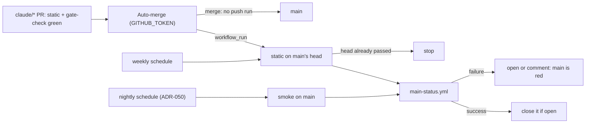

# ADR-055: `main` is re-tested after Claude's merges and weekly, and a red run on `main` opens an issue

- **Status:** Accepted
- **Date:** 2026-10-14
- **Related:** ADR-000, ADR-003, ADR-022, ADR-030, ADR-049, ADR-050

## Context

The daily drift run filed #122 (MG-03): `main` is not re-tested after merges made with
`GITHUB_TOKEN`.

- **`auto-merge.yml` merges with `GITHUB_TOKEN`,** and such a merge starts no `push` run on
  `main`. ADR-022 accepted this: "The PR's own runs are the gate."
- **The PR's runs test its head, not the merge result.** Two PRs can each pass against an older
  `main` and break it together, for example one that supersedes an ADR and one that cites the
  superseded ADR in a living document. Nothing would see it until the next PR's static run
  failed for a reason that is not that PR's.
- **What `main` gets today:**
  - `static.yml` runs on a push to `main`, so only Kade's own merges re-test it;
  - `smoke.yml` runs nightly on `main` (ADR-050 §1), the platform only: not the unit tests,
    the ADR check, the repository check or the CLAUDE.md limits.
- **A red run on `main` leaves no trace.** The nightly smoke on `main` failed on 2026-10-12 (run
  38239860699) and 2026-10-13 (run 38385377721) and passed on 2026-10-14. Neither failure
  became an issue, yet state lives in issues (ADR-003). A scheduled run's failure mail goes to
  whoever last edited its cron, which is not state either.
- **ADR-022 cannot be amended again:** it is already Amended by ADR-030, and ADR-000 rule 6
  supersedes an amended ADR whole. Static's triggers are ADR-050 §1's static row, which this
  ADR amends.
- **GitHub chains `workflow_run` at most three levels deep.** Static, then Auto-merge, then
  Labels already uses all three (`docs/plans/roadmap.md`, *Risks to verify*). A workflow
  triggered at a fourth level never starts.

## Decision

**Amends ADR-050.** It replaces §1's static row. The rest of ADR-050 stands, the other rows of
§1 included. ADR-022 and `auto-merge.yml` are unchanged.

### 1. static also runs on `main` (replaces ADR-050 §1's static row)

| Level | Runs on | What |
|---|---|---|
| **static** | every push to `claude/**` and `main`, every PR; on `main` after each successful Auto-merge run and weekly | unchanged |

- **After Auto-merge:** `static.yml` gets a `workflow_run` trigger on `Auto-merge`, as
  `labels.yml` has. A `workflow_run` run checks out `main`'s head.
  - Auto-merge runs once per Static or Gate check run on a `claude/*` PR, and most of those
    runs merge nothing. So the job first asks the API whether `main`'s head commit already
    has a successful Static run, and stops there if it has (`actions: read`).
  - Static's concurrency group names the ref, so repeats on `main` collapse into the newest.
  - Auto-merge acts only on runs whose event is `pull_request`, so these runs never start a
    merge.
  - **This run is the third level:** Static or Gate check, then Auto-merge, then Static, as
    Labels is. Nothing chains after it, and nothing needs to: §2's job is a called workflow
    (`workflow_call`), which is part of the run, not a level.
- **Weekly:** a `schedule` on Monday mornings UTC. It catches what changes without a commit:
  a pinned download that disappears, a runner image's Python.

### 2. A red run on `main` is an issue

- **Who:** static's and smoke's runs on `main` from a `schedule` or a `workflow_run`. A push to
  `main` is Kade's own merge, which he watches; a run on any other branch has its PR.
- **How:** a reusable workflow, `.github/workflows/main-status.yml` (`workflow_call`), which
  each of them calls as its last job with `if: always()` and `issues: write` on that job only.
  It is the same shape as `delete-gate-branch.yml` (ADR-049).
  - On a failure, it opens the issue `main is red: <workflow>`, with the run's link and the
    commit, or comments on that issue if it is already open.
  - On a success, it closes that issue if one is open, with the run's link.
  - The issue carries no label: it is work, found by its title, and a session reads it at
    start (ADR-003).
- **In smoke,** `delete-gate-branch` stays the last job and also needs the new one, as
  `scripts/test_gate_workflows.py` requires.

## Diagram

## Alternatives considered

- **`auto-merge.yml` dispatches static after a merge it made:** one run per merge and no API
  check, but it changes the merge workflow, so ADR-022 would be superseded whole (ADR-000
  rule 6) to add one step.
- **Weekly only:** the smallest change, and enough for MG-03. It also leaves the
  `workflow_run` chain at its present depth. But a broken `main` would wait up to a week, with
  every PR in between red for a reason not its own.
- **Dry-run and smoke after each merge too:** about 16 minutes of smoke per merge. The nightly
  smoke and the release gate (ADR-033) already cover the platform on `main`.
- **Record an exception to MG-03 instead:** keeps ADR-022's wording, but leaves the gap the
  control names and the nightly smoke's failures untracked.
- **Rely on GitHub's failure mail:** it reaches one person for scheduled runs and is not state
  in issues (ADR-003).

## Consequences

- **Code follows once this ADR is Accepted, in one PR:**
  - `static.yml`'s triggers, the skip step and the `main-status` job;
  - `smoke.yml`'s `main-status` job;
  - `main-status.yml`;
  - tests in `scripts/test_gate_workflows.py`, written first: smoke's delete job needs the new
    job, and static and smoke call `main-status.yml` with the guard and `issues: write` only.
- **That PR changes `.github/workflows/`,** so it is a draft Kade merges by hand (ADR-030). It
  acts from its merge on: `workflow_run` and `schedule` workflows are read from `main`.
- **Living documents follow in that PR:** `static.yml`'s header and `CLAUDE.md`'s Gates
  paragraph name the new triggers and this ADR.
- **No workflow may start from Static's runs on `main` through `workflow_run`:** they are the
  third level, so it would never start. Auto-merge, which listens to Static, would not run on
  them; it skips them already, since their event is not `pull_request`.
- **Cost:** one static run on `main` per merge that changed it, about 3 minutes; one a week; and
  a skipped run of a few seconds for each Auto-merge run that merged nothing.
- **#122** closes once the drift run sees static's schedule.
- **ADR-050** becomes `Amended by ADR-055` when this ADR is accepted.
