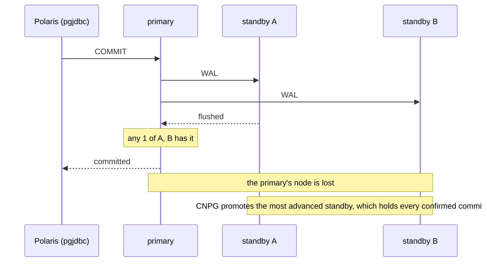

# ADR-056: polaris-pg's commits wait for one of its two standbys; writes stop rather than lose a confirmed one

- **Status:** Accepted
- **Date:** 2026-10-15
- **Related:** ADR-008, ADR-010, ADR-047, ADR-054

## Context

#31's goal is a write outage of 30 s or less, with **no confirmed write lost**. ADR-047 measures
failover on the gate first, then tunes. Its §8 sends synchronous replication in a release to an
ADR of its own, because it trades write latency and availability for writes that are never lost.

`charts/polaris-postgres` runs three instances on three nodes (ADR-010, `podAntiAffinityType:
required`) with CNPG's default, **asynchronous** replication. A commit returns as soon as the
primary has it. A standby promoted after the primary's node is lost may not have it.

**What the harness showed** ([run 38661005496](https://github.com/enjay27/lakehouse/actions/runs/38661005496)
on #150, and [38652896291](https://github.com/enjay27/lakehouse/actions/runs/38652896291) for C0
before it). These are harness runs, not measurements: ADR-047 §7 records measurements only once
C3a reproduces the target. Five runs per failure, the probe writing every 100 ms:

| | Replication | S3 (node paused 120 s): confirmed writes lost | Commit p50, pooled | Commit p99, pooled, worst, S2 and S3 |
|---|---|---|---|---|
| C0 | asynchronous | 25 and 29, in two runs of five | 1 ms | 2 to 3 ms |
| C1 | `any 1`, `dataDurability: required` | 0 in every failure | 1 ms | 12 to 14 ms |

- Every lost write was under S3, 53 of the 54 on the pooled connection: the promoted standby
  had not received what the paused primary had confirmed. S1 and S2 lost none in either setup,
  because the primary shuts down or restarts and its WAL reaches the standbys.
- C1 changes more than replication (its readiness probe, its shutdown timeout, pgjdbc's
  timeouts). None of those decides what the promoted standby holds; replication does.
- On kind the nodes are containers on one host, so a standby is a local round trip away. On a
  target cluster each commit also waits for the network round trip to the nearer standby.
- Polaris on the target clusters serves 6,000 to 8,000 TPS, mostly table commits (#142). What
  synchronous commits do to that throughput has not been measured; the stress test is where it
  would show (ADR-054).

**CNPG 1.30.1's settings** (`.spec.postgresql.synchronous`, from the CRD in the pinned chart):

- `method`: `any` (quorum: any `number` standbys) or `first` (priority, in order).
- `number`: how many standbys a commit waits for.
- `dataDurability: required`: commits **block** while fewer healthy standbys than `number`
  exist. `preferred`: the number **drops** to the standbys available, down to none, so writes
  go on asynchronously.
- `failoverQuorum`: CNPG promotes only when the standbys it can reach are enough to be sure
  one of them holds every synchronously confirmed commit; otherwise it does not promote.

## Decision

1. **`charts/polaris-postgres` replicates synchronously:** `method: any`, `number: 1`,
   `dataDurability: required`, the setting C1 measured. A commit returns once one of the two
   standbys has it.
2. **Writes stop rather than lose a confirmed one.** With both standbys gone, commits wait until
   one is back. Losing the primary or one standby, the case #31 is about, keeps writes going.
3. **Only with three or more instances.** The chart renders the `synchronous` block only when
   `instances` is at least 3. With fewer (ADR-008: an environment that cannot afford more), one
   standby restarting would stop every write, so those environments keep asynchronous
   replication and the loss it allows.
4. **`failoverQuorum` stays off here.** C1 did not run with it. It is measured first as a C1
   variant under S1 to S3 (ADR-047 §1). If it keeps the outages, a later ADR turns it on.
5. **The values are tuning values** (ADR-000 rule 11): `number` and `dataDurability` are values
   with a comment, in the PR that brings this decision's code.
6. **That PR proves it** as ADR-047 §8 asks: `failover.yml` with C0 under S1 to S3 shows no
   confirmed write lost, and outages no longer than C1's.

## Diagram

## Alternatives considered

- **Asynchronous, as today:** the fastest commits and writes never wait for a standby, but C0
  lost 25 and 29 confirmed writes on a node loss. That fails #31's goal.
- **`dataDurability: preferred`:** writes never stop, but when standbys go missing, commits stop
  waiting for them, and a node loss in that state loses confirmed writes again. The goal is no
  confirmed write lost, so `required`.
- **`number: 2`** (both standbys): every commit waits for the slower standby, and a single
  standby restarting stops writes. One of two already holds every confirmed commit.
- **`method: first`:** a fixed standby takes every commit's wait. `any` takes whichever is
  faster, and neither is special.
- **The cluster-wide `minSyncReplicas` and `maxSyncReplicas`:** CNPG's older fields for the same
  thing. The `synchronous` block is the current one and states durability explicitly.

## Consequences

- **Commits get slower:** p99 rose from 2 to 3 ms to 12 to 14 ms on kind, and on a target
  cluster each commit adds a network round trip to the nearer standby. Throughput at the target's
  TPS is unmeasured until the stress test runs (ADR-054, #142, #148). Until then this is a known,
  unquantified cost.
- **Both standbys lost:** Polaris's writes wait, its reads go on. That is an outage of writes
  instead of lost writes, and it lasts until one standby is back.
- **Upgrades:** CNPG restarts standbys one at a time, so one standby always answers and writes
  go on.
- **Environments with one or two instances** keep asynchronous replication. A release notes it,
  and `values.yaml`'s comment says why.
- **#31 is not closed by this:** C3a, C3b and C4, the node grace period, and `failoverQuorum`
  remain.
