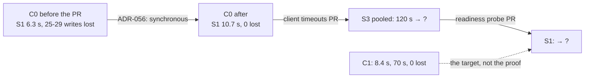

# ADR-057: ADR-056's proof compares the chart with itself before the change; synchronous commits cost S1 about 4 s

- **Status:** Proposed
- **Date:** 2026-10-15
- **Related:** ADR-047, ADR-056

## Context

ADR-056 §6 asked the PR bringing synchronous replication into `charts/polaris-postgres` to show,
with `failover.yml` and C0 under S1 to S3, **no confirmed write lost, and outages no longer than
C1's**. #161 brought it, and its run ([38691418855](https://github.com/enjay27/lakehouse/actions/runs/38691418855))
met the first half and not the second. Outage medians (worst) in seconds, five runs each:

| | S1 | S2 | S3 per write | S3 pooled | Confirmed writes lost |
|---|---|---|---|---|---|
| C0 before #161 (asynchronous; S1 from #158, S2 and S3 from #150) | 6.3 (6.4) | 10.1 (10.9) | 75.3 (77.3) | 120.1 (120.1) | 25 and 29, all S3 |
| **C0 after #161** | **10.7 (11.2)** | **11.2 (13.5)** | **76.3 (120.3)** | **120.6 (120.6)** | **0** |
| C1 (#150) | 8.4 (9.1) | 10.5 (12.7) | 70.2 (76.3) | 70.2 (76.3) | 0 |

- **C1 is more than ADR-056's decision.** It also sets a 1 s readiness probe and pgjdbc's
  connect, socket and login timeouts (`gates/failover/setups.py`). ADR-047 §8 leaves those to
  their own tuning PRs. §6 compared the chart with a setup that holds settings ADR-056 does not
  bring, so it could not be met by ADR-056's code alone.
- **S3's gap to C1 is the client's.** Without a socket timeout, the pooled connection waits out
  the whole 120 s pause, before and after #161 alike.
- **S1 got about 4 s slower and S2 about 1 s.** S1 was 6.3 s before #161 and 10.7 s after.
  With `required`, the new primary's commits wait until the surviving standby follows it.
  ADR-056's *Consequences* do not name this cost.

Kade merged #161 on 2026-10-15 with §6's second half not met. Option (a) on #161 was this
amendment.

## Decision

1. **Amends ADR-056 §6.** The PR that brings ADR-056's code proves it with `failover.yml`, C0
   under S1 to S3: **no confirmed write lost.** It reports every outage against C0 before that
   PR, and names the cause of each one that grew. C1 is not the comparison.
2. **Adds to ADR-056's *Consequences*, from #161's run:**
   - **S1 and S2 take longer:** S1's median went from 6.3 s to 10.7 s, and S2's from 10.1 s
     to 11.2 s. With `required`, the new primary's commits wait until the surviving standby
     follows it.
   - **S3's medians did not move** (75.3 s to 76.3 s per write, 120.1 s to 120.6 s pooled).
     One per-write run in five waited out the whole 120 s pause, as the pooled connection does
     in every run. That is pgjdbc without connect and socket timeouts, which the client
     timeouts PR addresses.
3. **C1 stays the target the tuning PRs aim at** (ADR-047 §8). Each later tuning PR (the
   client timeouts, the readiness probe) reports its outages against C0 before it, as §1 does.
4. **Unchanged from ADR-056:** every other section.

## Diagram

## Alternatives considered

- **Keep §6 and leave #161's proof failed:** the record would say an Accepted decision is not
  met while its code is merged, with nothing to say whether that was intended.
- **Revert #161 until the readiness probe and the client timeouts land:** the chart would lose
  confirmed writes again on a node loss in the meantime, for outages a few seconds shorter.
- **Supersede ADR-056 whole:** only §6 and one consequence change; ADR-000 rule 6 amends a part.

## Consequences

- ADR-056 becomes *Amended by ADR-057* when this is accepted. Read both.
- Tuning PRs compare with the chart before them, so each one's gain is its own and is visible.
- The S1 and S2 costs are named, so a later tuning PR that wins them back can show it.
