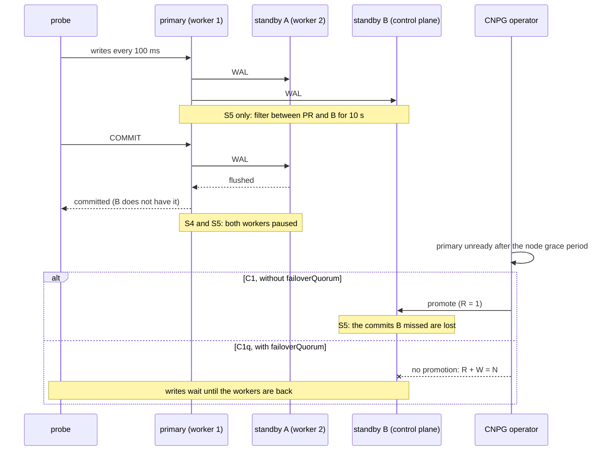
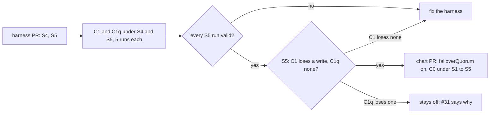

# ADR-058: The primary and a standby lost together are measured, and failoverQuorum enters the chart if it keeps a lagging standby from losing writes

- **Status:** Proposed
- **Date:** 2026-10-15
- **Related:** ADR-016, ADR-030, ADR-039, ADR-047, ADR-056, ADR-057

## Context

#31's goal is a write outage of 30 s or less with **no confirmed write lost**. ADR-056 made
polaris-pg's commits wait for one of its two standbys (`method: any`, `number: 1`,
`dataDurability: required`), and left `failoverQuorum` off (§4): it was to be measured first,
and a later ADR would turn it on.

**What `failoverQuorum` does** (CNPG 1.30.1, `docs/src/failover.md` at `v1.30.1`, read on
2026-10-15):

- Before promoting, the operator checks `R + W > N`:
  - `R`, the standbys that can report their state to the operator;
  - `W`, the standbys a commit waits for (`number`, here 1);
  - `N`, the standbys that may be synchronous (here 2).
- **Only the primary lost:** `R = 2`, and 2 + 1 > 2, so CNPG promotes as it does today.
- **The primary and one standby lost together:** `R = 1`, and 1 + 1 = 2, so CNPG **does not
  promote**. It waits until an instance is back. `kubectl cnpg promote` can still force a
  promotion.
- The documentation's own example is this cluster: with `ANY 1`, a commit waits for the
  primary and one standby. If both are lost, the remaining standby may not hold the last
  confirmed commits, and promoting it loses them.
- The primary keeps the quorum state in a `FailoverQuorum` object. While a configuration change
  is being applied, CNPG resets that object, and no failover happens until the change is in.

**What the harness has shown** ([run 38695636893](https://github.com/enjay27/lakehouse/actions/runs/38695636893)
on #162, a harness run under ADR-047 §7). Median (worst) outages in seconds, five runs each, no
confirmed write lost in either setup:

| | S1 | S2 | S3 |
|---|---|---|---|
| C1 | 8.4 (9.1) | 10.5 (12.7) | 70.2 (76.3) |
| C1q (C1 with `failoverQuorum`) | 9.2 (9.4) | 9.8 (11.9) | 71.2 (77.0) |

- That shows **only `failoverQuorum`'s cost**, about 1 s at most.
- **Its benefit is untested.** S1 to S3 each lose only the primary, so `R = 2` and CNPG promotes
  with or without it. None of ADR-047's failures loses a standby with the primary.
- **Both standbys are equally current on kind.** They are a local round trip from the primary,
  so losing the primary and one standby does not by itself leave the other behind. For a
  promotion to lose writes, the surviving standby must already have been behind when the
  others were lost. On a target cluster that happens when that standby is catching up after a
  restart (an upgrade restarts standbys one at a time) or is cut off by the network.

**What `dataDurability: required` already does here.** If CNPG promotes the surviving standby,
both of its own standbys are gone, so its commits wait until one is back (ADR-056 §2). With or
without `failoverQuorum`, writes wait for an instance to return. The difference is what the
promoted standby holds.

**The kind gate** has three nodes: the control plane and two workers. Every system Deployment,
the stand-ins, the operator and the probe run on the control plane (ADR-047 §3). The three
instances are on three nodes (required anti-affinity), so one of them is on the control plane.

## Decision

### 1. Two failures are added to ADR-047 §3

This amends ADR-047 §3's table.

| | Failure | How |
|---|---|---|
| **S4** | The primary's node and one standby's node are lost together | As S3, with the primary on one worker: `docker pause` of both workers in one command. The standby on the control plane survives. Both are unpaused after the same fixed time as S3. |
| **S5** | S4, with the surviving standby already behind | Before S4, a packet filter on the control-plane node drops traffic between the surviving standby's pod and the primary's, both ways, for 10 s. Commits go on, confirmed by the other standby. Then S4. The filter is removed once both workers are paused, before they are unpaused. |

- **Before S4 or S5** the harness moves the primary to a worker, as before S3. The other worker
  then holds one standby, and the control plane the other.
- **S5's run counts only if the standby fell behind.** Just before the pause the harness reads
  `pg_stat_replication` on the primary. The filtered standby's flushed LSN must be behind the
  primary's, and the other standby's must have kept up. Otherwise the run is reported as
  invalid, not as a result.
- **S4 and S5 run only when named**, as C1q does. `failover.yml`'s default stays S1 to S3, so
  each run of S4 or S5, which takes the node pause and the rejoin, is chosen.
- **They are measured with C1 and C1q.** Those two setups differ only in `failoverQuorum`.
  ADR-047 §3's node grace period job does not run them.

### 2. What is recorded, in addition to ADR-047 §4

This amends ADR-047 §4's table.

| What | From |
|---|---|
| both nodes paused, and the instance left | the harness |
| S5: the filter's start and end | the harness, at the command |
| S5: each standby's flushed LSN and the primary's current LSN, just before the pause | `pg_stat_replication` on the primary |
| S5: writes confirmed after the filter started (at risk) | the probe |
| whether CNPG promoted, which instance, and when | `.status.currentPrimary` and its timestamp, polled each second |

### 3. failoverQuorum enters the chart if S5 shows the loss it prevents

- **The condition:** five runs each of C1 and C1q under S4 and S5, with every S5 run valid
  (§1). In S5, C1 loses at least one confirmed write, and C1q loses none.
- **If it is met,** `charts/polaris-postgres` sets `failoverQuorum: true` in its `synchronous`
  block, which the chart renders only from 3 instances up (ADR-056 §3). This is the later ADR
  that ADR-056 §4 names.
  - The value has a comment, and `gate.py check-polaris-pg` checks the running `Cluster` and
    its `FailoverQuorum` object (ADR-016).
  - The chart PR proves it as ADR-057 §1 asks: `failover.yml` with C0 under S1 to S5, no
    confirmed write lost, and every outage reported against C0 before that PR, with the cause
    of each one that grew.
- **The price is reported, not a condition.** S4's outages and C1q's cost under S1 to S3 are
  stated in the chart PR. ADR-056 §2 already chose writes that stop over writes that are lost,
  and `failoverQuorum` applies the same choice to promotion.
- **If S5 shows C1 losing no write** in valid runs, nothing is concluded about
  `failoverQuorum`. The harness is checked first, as ADR-047 §2 does with C3a, and the findings
  go on #31.
- **If C1q loses a write in S5,** `failoverQuorum` does not enter the chart, and #31 records why.

### 4. Order

1. The harness PR: S4 and S5 in `gates/failover/` with their unit tests, then a run of C1 and
   C1q under S4 and S5, its tables in the PR. `failover.yml` does not change, so it is not a
   draft under ADR-030. It needs dry-run and smoke on its head (ADR-039).
2. If §3's condition is met, the chart PR.

## Diagram

## Alternatives considered

| Option | What it gives | Long-term cost |
|---|---|---|
| **Measure S4 and S5, turn it on if S5 shows the loss** (chosen) | The chart takes `failoverQuorum` only once the gate has shown the loss it prevents, and its cost is reported. | Two failures to keep in the harness, each run pausing two nodes. A packet filter on a kind node. |
| **Turn it on now, from CNPG's documentation** | One small chart PR. | The benefit stays a claim. ADR-047 §1 measures before tuning, and ADR-056 §4 asks for a measurement. |
| **Keep it off** | Nothing to build. Writes go on after a two-node loss once the operator promotes. | Confirmed writes can be lost when the primary and the current standby go together, which #31's goal rules out. |
| **S4 only, with no lagging standby** | No packet filter. | Both standbys are current on kind, so C1 would lose nothing and S4 could not show the benefit, only the cost. |

- **Making the standby fall behind by stopping its WAL receiver** (`SIGSTOP`): no packet filter,
  but the WAL the primary sent waits in the stopped process's socket buffer. Promotion ends the
  receiver, so the standby either takes that WAL in when the process resumes, which hides the
  loss, or stays stopped and promotion waits for it.
- **A `NetworkPolicy` to cut the standby off:** whether kind's network policy stops an
  established connection is not known, and the policy would sit among the ones `check-network`
  tests (ADR-048).
- **Two ADRs, one for S4 and S5 and one for the chart once they have run:** each would follow
  its evidence. This ADR names the chart's condition now, so the harness PR's run settles it
  and the chart PR needs no new decision.

## Consequences

- **ADR-047 becomes *Amended by ADR-058*** when this is accepted (§3 and §4). Read both.
- **A failover.yml run with S4 and S5** takes about 4 to 5 minutes per run. The node pause and
  the rejoin take most of it. Five runs of both failures fit the 180 minutes of a job.
- **If `failoverQuorum` enters the chart:**
  - After the primary and one standby are lost together, CNPG waits for an instance to come
    back. Writes stop until then. With `dataDurability: required` they would also stop after a
    promotion, until a standby rejoined, so the new cost is S4's difference between C1q and
    C1, which the harness PR reports.
  - While a configuration change is being applied, no automatic failover happens.
  - An operator can still force a promotion (`kubectl cnpg promote`). That accepts the loss of
    confirmed writes. A runbook for it waits on a Linux test cluster (ADR-052).
- **#31 is not closed by this.** C3a, C3b and C4 still wait on #31's checklist, and S3's floor
  is the node grace period.
