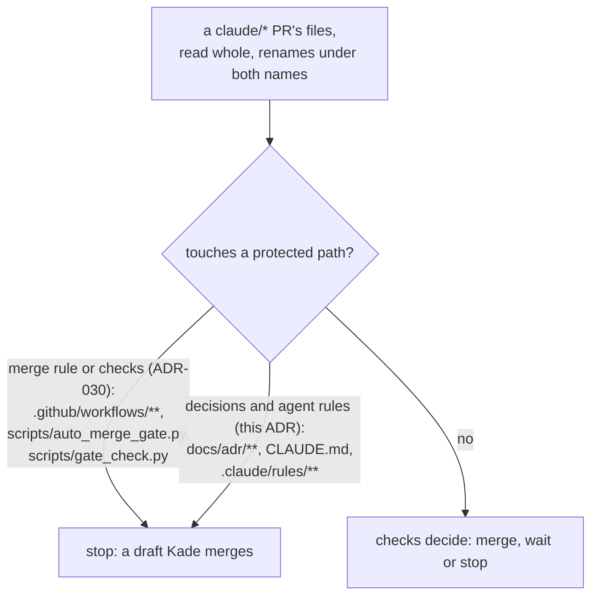

# ADR-059: Auto-merge also leaves ADRs and agent rules to Kade

- **Status:** Accepted
- **Date:** 2026-10-16
- **Related:** ADR-000, ADR-022, ADR-030

## Context

- **ADR-030 protects the merge rule and the checks,** not the decisions or the rules sessions
  follow. Auto-merge answers `stop` only for `.github/workflows/**`,
  `scripts/auto_merge_gate.py` and `scripts/gate_check.py`. Any other green `claude/*` PR
  merges, whatever it changes in `docs/adr/`, `CLAUDE.md` or `.claude/rules/`.
- **Accepting an ADR is Kade's act (ADR-000 rules 4 to 6),** but nothing on GitHub shows it.
  Acceptance commits are written by a session on Kade's word ("Kade accepts ADR-058",
  `0ddcfde`), and `scripts/adr_check.py` checks an ADR's form, not who accepted it. A session
  could mark an ADR Accepted, or change an Accepted one beyond ADR-000 rule 5's typo
  allowance, and auto-merge would merge it once static and gate-check were green.
- **`CLAUDE.md` and `.claude/rules/` steer every later session:** what to build, which gates to
  run, what auto-merge does. A change there acts on the next session without Kade having
  merged it.
- **Issue #172 (governance control MG-05)** records the gap: auto-merge must leave ADRs and
  agent rules to Kade, or the repository must record an exception with its reason. This
  repository has no `AGENTS.md` and no `.agents/rules/`; its agent rules are `CLAUDE.md` and
  `.claude/rules/`.

## Decision

- **Three more protected paths.** To ADR-030's list, auto-merge adds:
  - `docs/adr/**`: every ADR and the index;
  - `CLAUDE.md`;
  - `.claude/rules/**`.

  They are handled as ADR-030's are: read from the whole file list, a rename counted under
  both names, and the answer `stop`.
- **Sessions open a PR that touches any of them as a draft** that Kade merges by hand, as
  ADR-030 says for its paths.
- **Not protected:** the other living documents (`README.md`, `docs/plans/`,
  `docs/runbooks/`), which follow the ADRs and may only cite those in force (ADR-052), and
  `.claude/` outside `rules/`, which holds no tracked rule today.
- **When the agent rules move** to `AGENTS.md` and `.agents/rules/`, the PR that moves them
  adds both to the protected paths. It changes `CLAUDE.md`, so it is already left to Kade.
- **Amends ADR-030:** its list of protected paths gains the three above. The rest of ADR-030
  stands.

## Diagram

## Alternatives considered

- **Record an exception to MG-05:** keeps ADR PRs merging on green and spares Kade a click per
  PR, but leaves an ADR's acceptance resting on a commit message.
- **Stop only on a change to an Accepted ADR's status or text:** fewer hand merges, but the
  gate would parse ADRs and diffs instead of reading a file list, and a new rule in
  `CLAUDE.md` would still merge.
- **Protect all of `.claude/`:** the same today, since `rules/` is the only tracked folder
  there; naming `rules/` keeps the rule to what MG-05 asks.
- **A ruleset with CODEOWNERS review:** rejected by ADR-030 for the same reasons; the rule
  stays in git.

## Consequences

- **More hand merges.** Every PR that proposes, accepts or changes an ADR, or changes
  `CLAUDE.md` or `.claude/rules/`, waits for Kade. ADR-000 rule 8 puts an ADR's change in the
  commit of the code it affects, so most PRs that carry a decision are drafts. PRs that only
  change code under ADRs already Accepted, roadmap or runbook PRs still merge on green.
- **Code follows once this ADR is Accepted, in the PR that proposes it:**
  `scripts/auto_merge_gate.py` gains the three paths, with tests; the header of
  `auto-merge.yml` and `CLAUDE.md`'s Version control section name them. That PR changes
  protected paths of both kinds, so it is a draft Kade merges.
- **It acts only after its own merge:** Auto-merge runs the gate script from `main` (ADR-022).
- **ADR-030 cannot be amended again:** a further change to the protected paths supersedes it
  whole (ADR-000 rule 6).
- **That PR closes #172;** the next drift run then finds the paths in the gate script.
