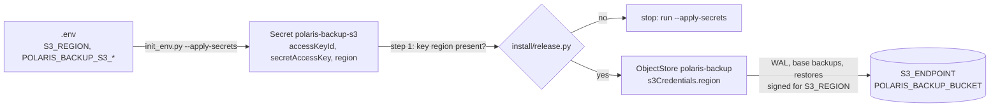

# ADR-060: polaris-pg's backups sign for `S3_REGION`, read from the backup Secret

- **Status:** Accepted
- **Date:** 2026-10-16
- **Related:** ADR-006, ADR-031, ADR-034, ADR-043

## Context

- **ADR-043 §2 sends the backups to `S3_ENDPOINT` with the backups' own key,** and names no
  region. The `ObjectStore` `polaris-backup` in `charts/polaris-postgres` sets the endpoint
  and the key from the Secret `polaris-backup-s3`, and nothing else (#87).
- **Without a region, the plugin's S3 client (boto3) signs for `us-east-1`.** An S3 service
  that checks the signing region refuses such a request. WAL archiving and the daily backup
  would then fail on that target, and the install would still pass: step 1 takes no backup.
- **The plugin reads a region only from a Secret key.** The pinned plugin's `ObjectStore` CRD
  (0.15.1) has `s3Credentials.region`, a reference to a key in a Secret, like the access key
  and the secret key. It takes no plain value.
- **The region is already in `.env`.** `S3_REGION` (ADR-031) is what Polaris signs its own
  S3 requests with.
- **What the gate can show.** The S3 stand-in (SeaweedFS 4.47) signs with whatever region a
  request names, and checks it against no region of its own. The recorder removes the whole
  `Authorization` header from its records (ADR-034). So the gate can show that the region
  reaches the plugin's configuration, and that backups and the restore still work with it.
  It cannot show which region the plugin signs for.
- **Upgrades.** `init_env.py --apply-secrets` creates and updates the Secrets (ADR-006), and
  must run before a release is installed. A target cluster upgraded without it keeps a
  `polaris-backup-s3` without the new key, and today's step 1 checks only that the Secret
  exists.

Kade chose option 1 of #87 (2026-10-16): the region goes through the backup Secret.

## Decision

- **The Secret carries the region.** `init_env.py --apply-secrets` writes `S3_REGION` into
  `polaris-backup-s3` as the key `region`, beside `accessKeyId` and `secretAccessKey`. It stops
  when `S3_REGION` is empty, as for every value a Secret needs.
- **The `ObjectStore` names it.** `polaris-backup`'s `s3Credentials.region` refers to the key
  `region` of the same Secret. The plugin then signs for that region for WAL archiving, base
  backups and restores alike.
- **Install step 1 checks it.** Before installing polaris-pg, `install/release.py` stops when
  `polaris-backup-s3` has no key `region`, and says to run `init_env.py --apply-secrets`. It
  reads the Secret's key names only, never a value.
- **What the gate proves:** the rendered `ObjectStore` refers to the key and passes kubeconform
  against the plugin's CRD; the Secret holds the key on the gate; smoke's backup and restore
  pass with it set. **Not proven on the gate:** the signing region. It is proven only by a
  target S3 service that checks the region.
- **Amends ADR-043 §2:** "with their own key" becomes "with their own key, signed for
  `S3_REGION`". The rest of ADR-043 stands.

## Diagram

## Alternatives considered

- **Leave it until a target's S3 needs it (#87's option 2):** no change now, but the first
  sign of it would be failing WAL archiving on a running cluster.
- **A Secret of its own for the region:** a region is not a credential, but the plugin reads it
  from a Secret either way. Keeping it beside the key it signs with gives one Secret to apply
  and check.
- **Prove the signing region on the gate:** the recorder would have to keep the signature's
  credential scope, which changes ADR-034's records. ADR-034 is already amended, so that means
  superseding it whole, and the gate's region would have to differ from boto3's default. Too
  much for one region value; a region-checking S3 stand-in is a new dependency for the same
  reason.
- **No check in step 1:** a target upgraded without `--apply-secrets` would install, and its
  archiving would fail later.

## Consequences

- **Every install and upgrade needs `S3_REGION` in `.env`** and `--apply-secrets` run with this
  release's `init_env.py`. Step 1 stops otherwise.
- **The gate's region stays `us-east-1`,** the same as boto3's default, so the gate cannot tell
  the configured region from the default.
- **The signing region is NOT VERIFIED** until a target S3 service that checks it is used.
- **Code follows once this ADR is Accepted, in the PR that proposes it:** `scripts/init_env.py`,
  the chart's `ObjectStore`, `install/release.py`'s step 1, their tests, and the comment on
  `S3_REGION` in `.env.template`. The PR touches `charts/` and `install/`, so it needs dry-run,
  smoke and smoke-fresh on its head (ADR-039, ADR-050).
- **#87** closes with that PR.
