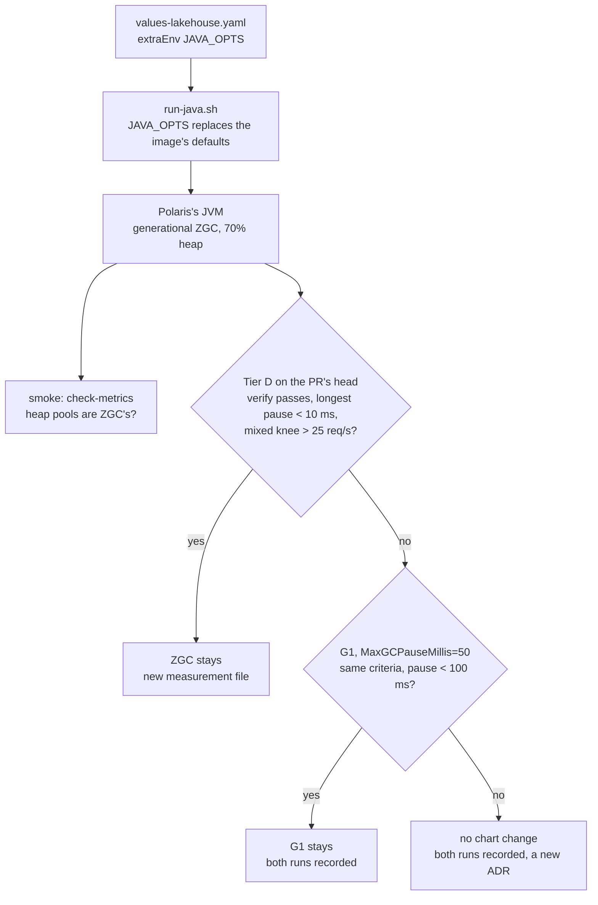

# ADR-061: Polaris runs generational ZGC, set through `JAVA_OPTS`, and keeps it only if Tier D shows its pauses gone

- **Status:** Proposed
- **Date:** 2026-10-17
- **Related:** ADR-003, ADR-009, ADR-015, ADR-016, ADR-028, ADR-039, ADR-046, ADR-053, ADR-054, ADR-059

## Context

**Tier D's first run** (`docs/measurements/stress-capacity-2026-10-16.md`, ADR-053 §7, standing
under ADR-054) measured one Polaris replica at 4 CPUs and 8 GiB:

| Profile | Knee (req/s) | Polaris cores at the knee | What set the knee |
|---|---|---|---|
| commits | 40 | 1.74 | CPU: at 45 req/s it jumped to 3.68 cores and commits ran out of retries |
| queries-conditional | 125 | 1.29 | a p99 over 500 ms at 150 |
| queries-full | 125 | 1.76 | a p99 over 500 ms at 150 |
| mixed | 25 | 0.59 | a p99 of 3,966 ms at 50 |

- **The read and mixed knees are the collector's.** Polaris's full collections (the Parallel
  collector's `PS MarkSweep`, cause "Ergonomics") paused 375 to 404 ms. Each one stalls every
  request in flight. A step passed or failed on whether such a pause landed in it:
  queries-full passed 125 req/s with a p99 of 15 ms, after 100 req/s had 431 ms.
- **The hold** (mixed at 20 req/s, 2 hours) spent 616 s, 8.6% of its time, in 169,247 pauses,
  the longest 404 ms. Heap after GC was 108 to 224 MiB, out of a 6,553.5 MiB maximum. In the
  timeline's 15 s samples over the whole run it was at most 451 MiB. The heap is almost all short-lived garbage.
- **The sizing follows the pauses.** ADR-053 §7's arithmetic gives 480 replicas for 12,000
  req/s (12,000 ÷ 25). At the mixed profile's 16.8 ms of CPU per request, 4 cores would serve
  about 238 req/s, about 51 replicas, if CPU alone limited a replica.

**Where the JVM's options come from.** Neither the upstream chart (1.6.0) nor
`values-lakehouse.yaml` sets any JVM option. The image `apache/polaris:1.6.0` is built on
`ubi9/openjdk-21-runtime` 1.24, and starts Java through that base image's
`/opt/jboss/container/java/run/run-java.sh`. Read from the running pod on 2026-10-17:

- **The options are `${JAVA_OPTS-<debug> <proxy> <defaults> ${JAVA_OPTS_APPEND}}`.** When
  `JAVA_OPTS` is set, it replaces the whole set. The image does not set `JAVA_OPTS_APPEND`.
- **The defaults** come from `java-default-options`:
  - `-XX:MaxRAMPercentage=80.0`, from `JAVA_MAX_MEM_RATIO`;
  - `-XX:+UseParallelGC`, from `GC_CONTAINER_OPTIONS`;
  - always `-XX:MinHeapFreeRatio=10 -XX:MaxHeapFreeRatio=20 -XX:GCTimeRatio=4
    -XX:AdaptiveSizePolicyWeight=90`, each with an environment variable of its own;
  - `-XX:+ExitOnOutOfMemoryError`.
- **They are tuned for footprint, not latency.** `GCTimeRatio=4` lets collection take up to
  20% of the time before the heap grows; the Parallel collector's own default is 99 (1%).
- **Another collector cannot be appended.** `JAVA_OPTS_APPEND=-XX:+UseZGC` would stand beside
  `-XX:+UseParallelGC`, and the JVM refuses to start with two collectors.
- **The JDK is OpenJDK 21.0.11.** At 4 CPUs it runs 4 parallel GC threads. Generational ZGC
  exists in 21 but needs `-XX:+ZGenerational`. It is the default from JDK 23, and the flag is
  obsolete from JDK 24, where it only prints a warning.

**An open question of that measurement.** queries-full cost 13 to 26 ms of Polaris CPU per
request on its last attempt, against 8.4 to 9.6 ms on an earlier one. In the last attempt's
queries-full ramp, the timeline shows GC pause time of 0.13 to 0.17 s every second. With 4 GC
threads busy through each pause, that is 0.5 to 0.66 cores. Subtracting it leaves 8.5 to 9.3 ms
per request, the earlier attempt's range. **So the difference is probably the collector's work,
not the requests'.** This is an estimate, not a measurement: it assumes every GC thread is busy
for the whole pause.

**How Polaris may be changed.** Polaris itself is not modified: no patched image (ADR-009,
ADR-015). The chart stays upstream's, and this repository's settings go in
`values-lakehouse.yaml` (ADR-009, ADR-028). The image's own environment variables are such a
setting.

## Decision

### 1. One environment variable sets every JVM option

- **`values-lakehouse.yaml`'s `extraEnv` sets `JAVA_OPTS`**, replacing the image's defaults
  whole:

  ```
  -XX:MaxRAMPercentage=70.0 -XX:+UseZGC -XX:+ZGenerational -XX:+ExitOnOutOfMemoryError
  ```

- **Every flag Polaris runs with is in that line.** The Parallel-only flags the defaults add go;
  `-XX:+ExitOnOutOfMemoryError` is kept, so an exhausted heap restarts the container instead of
  leaving a broken JVM serving.
- **`charts/test_polaris.py`** checks the rendered value, and that the chart's defaults set no
  `JAVA_OPTS`, as it does for every other setting (ADR-016).

### 2. The collector is generational ZGC

- **Its pauses do not grow with the heap or the live set,** which suits a heap of mostly
  short-lived garbage. It collects concurrently, so a replica that used 0.59 of its 4 cores at
  the mixed knee has the CPU to spare.
- **The heap share is 70%**, down from the image's 80%, for ZGC's own memory outside the heap. At
  8 GiB that is about 5.6 GiB, still more than 12 times the largest heap after GC measured. It
  is a tuning value (ADR-000 rule 11): it lives in the values file's comment with its evidence,
  and changes there.

### 3. Smoke checks the collector Polaris runs

- **`check-metrics` (ADR-046) also fails when a Polaris pod's heap pools are not generational
  ZGC's.** It reads the `id` label of `jvm_memory_used_bytes{area="heap"}`, which is there from
  startup, before any collection. The expected names (for example `ZGC Young Generation`) are
  read from the first gate run and fixed in the check's test.
- **That catches the option being lost silently.** `JAVA_OPTS` belongs to the base image's
  launcher. If a later Polaris image is built on another base, the line would be ignored and
  the JVM would pick its own collector.
- **The expected collector follows the values file.** The test maps the flag in `JAVA_OPTS` to
  the pool names, so a change of collector is a change in one place.

### 4. Tier D decides whether it stays

The PR that sets `JAVA_OPTS` runs Tier D on its head from `docs/runbooks/stress-capacity.md`, at
the first run's size (4 CPUs, 8 GiB) and overlay. ADR-053 §7 already calls for that: the change
is to Polaris's settings. The run is recorded as a new measurement file (ADR-003).

- **ZGC stays when all of these hold:**
  - `verify` passes (ADR-054 §2): no correctness fault, no restart of Polaris or polaris-pg, an
    out-of-memory kill included;
  - the hold's longest pause is under 10 ms;
  - the mixed knee is above 25 req/s.
- **Otherwise G1 replaces it in the same PR** (`-XX:+UseG1GC -XX:MaxGCPauseMillis=50`, the same
  heap share), and Tier D runs again. It stays under the same criteria, with a longest pause
  under 100 ms.
- **If neither meets them,** the PR changes no chart value. It records both runs, and the
  collector goes back to a new ADR.
- **Before the ramps, the run reads which series name the pauses.** Micrometer reports
  concurrent collection under `jvm_gc_concurrent_phase_time_seconds`, and the driver sums
  `jvm_gc_pause_seconds`. If the micrometer that Polaris ships reports ZGC's whole cycles as
  pauses, the driver's numbers would be wrong. Its fix then goes in the same PR, test first.
- **The run also records the collector's CPU per step,** to answer the open question
  directly. The driver reads, from `/proc` in Polaris's container, the CPU time of the threads
  the JVM names for its collector, before and after each step. Each step's CPU per request is
  then reported with and without them. This is a driver and runbook addition, not a change to
  what ADR-053 §7 reports.

### 5. Upkeep

- **A Polaris upgrade (ADR-009's steps) checks the JDK and the base image.**
  - From JDK 24 on, `-XX:+ZGenerational` is dropped from the line.
  - On another base image, smoke's check (§3) fails first, and the PR moves the options to that
    image's own mechanism.
- **Nothing else needs upkeep.** One line, one test, one check.

## Diagram



## Alternatives considered

- **Keep the image's defaults:** nothing to maintain, but the replica count stays the pauses'
  (480 against about 51), and a target sized from it would be oversized almost tenfold.
- **The Parallel collector, retuned** (`GCTimeRatio` 99, no heap shrinking): fewer
  collections. But its full collections stay stop-the-world, and the pause that sets the knee
  remains, only rarer. A rarer pause makes a knee depend more on chance, not less.
- **G1 first:** the JDK's default, with a pause target. That target is a goal, not a bound.
  At a heap of this size G1's regions are 2 MiB, so any object of 1 MiB or more is humongous:
  allocated straight into the old generation, collected at specific points. Whether Polaris
  holds whole metadata files of 1.1 to 3.2 MB as such objects is not measured. G1 is the
  fallback because its risk is that one, and ZGC's is CPU and memory, which the replica has.
- **Shenandoah:** concurrent like ZGC, and in this Red Hat-based image. Its generational mode
  is experimental in JDK 21, and its non-generational mode collects the whole heap every cycle.
- **A smaller heap share alone:** the heap after GC is under 0.5 GiB, so the full collections'
  cost is not the heap's size. A smaller heap means more frequent collections with the same
  collector.
- **The image's own variables** (`GC_CONTAINER_OPTIONS`, `GC_TIME_RATIO`,
  `JAVA_MAX_MEM_RATIO`): they work. But the Parallel-only flags stay in the line, and the
  options are spread over five variables. One `JAVA_OPTS` line is what the JVM runs.
- **`JDK_JAVA_OPTIONS`,** read by the `java` launcher whatever the base image: it is added to
  the image's `-XX:+UseParallelGC`, and the JVM refuses two collectors.
- **A patched image or chart:** ADR-009 and ADR-015 rule both out.

## Consequences

- **Every release's Polaris runs generational ZGC** once the PR merges, if Tier D keeps it.
  Releases set no CPU or memory limits (ADR-053 §7, #9), so the 70% applies to whatever memory
  the container sees: on the gate, the runner's.
- **The gate's runner holds two Polaris replicas under ZGC.** ZGC returns unused heap after a
  delay, and the Parallel collector shrank its heap sooner. Smoke on the PR's head shows
  whether the runner still holds everything; a smoke run that runs out of memory is a finding
  for this PR.
- **The first Tier D measurement stays as it was.** It is the baseline this one is compared
  with, and its sizing is replaced by the new file's, not edited.
- **#179** (the liveness probe restarting an overloaded Polaris) is not changed by this ADR.
  The new run's ramps show whether it still happens at the new knees.
- **Code follows once this ADR is Accepted, in the PR that proposes it** (#182):
  - `values-lakehouse.yaml`'s `JAVA_OPTS` and `charts/test_polaris.py`;
  - `check-metrics`' collector check and its test;
  - the driver's collector CPU per step, and its runbook lines;
  - the Tier D run, recorded under `docs/measurements/`.
- **The PR is a draft Kade merges** (ADR-059). It touches `charts/` and `gates/`, so it needs
  dry-run and smoke on its head (ADR-039).
- **The Tier D run needs the Linux test server for about 6 hours.** Its step 1 deletes the
  kind cluster, which Kade approves when it runs.
