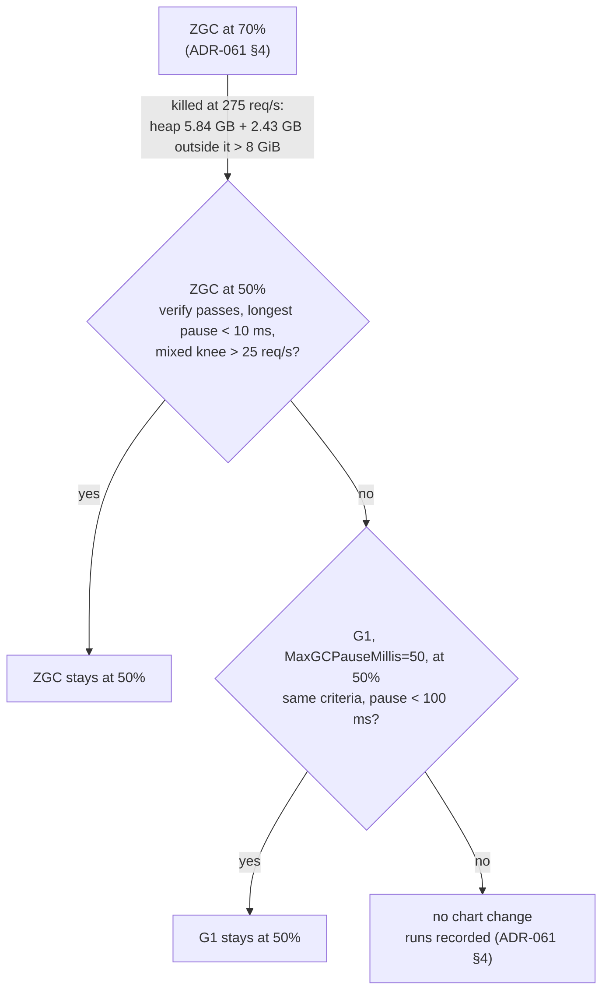

# ADR-062: ZGC is retried at a 50% heap share before G1: its first run was killed by its memory limit, not its pauses

- **Status:** Proposed
- **Date:** 2026-10-17
- **Related:** ADR-053, ADR-054, ADR-061

## Context

**ADR-061 §4's first Tier D run** ran on 2026-10-17 at `13329dc`: one Polaris replica at 4 CPUs
and 8 GiB, with ADR-061's `JAVA_OPTS` (generational ZGC, `-XX:MaxRAMPercentage=70.0`). The run
was stopped in the mixed ramp, after the event below.

| Profile | Knee (req/s) | First run, Parallel collector (2026-10-16) |
|---|---|---|
| commits | 45 | 40 |
| queries-conditional | 250 | 125 |
| queries-full | 200 | 125 |
| mixed | 125 at least: passed, the ramp stopped at 150 | 25 |

- **Up to each knee, p99 stayed flat.** queries-conditional answered every step from 25 to
  250 req/s with a p99 of 12 to 16 ms. The Parallel collector's run had 318 ms at 125. Ordinary
  commits had a p99 of 49 to 288 ms up to 40 req/s, against 520 to 1,557 ms.
- **At 275 req/s of queries-conditional, the memory cgroup killed Polaris** (08:38:48 UTC,
  exit 137; Kubernetes reported the reason as `Error`, the kernel log as an out-of-memory
  kill):
  - shared memory 5.84 GB: ZGC keeps its heap in shared memory, and it had committed all of
    it (the maximum is 5,736 MiB);
  - anonymous memory 2.43 GB outside the heap;
  - together over the 8 GiB limit.
- **What filled the memory outside the heap was the overload.** In that minute Polaris held
  1,590 requests in flight, with a mean latency of 4,959 ms. A full load answers with about
  1.25 MB (Polaris's access log), written through Netty's buffers, which live outside the heap.
  How much of the 2.43 GB they held was not measured. k6 caps the step at 2,000 virtual users,
  so the test cannot hold more than that in flight. A real client can.
- **ADR-061 §4 counts the kill.** ZGC stays only if `verify` passes, and a restart of Polaris,
  an out-of-memory kill included, fails it. As written, G1 at the same heap share is next.
- **G1 at 70% would most likely be killed the same way.** Under this load it would grow its
  heap to the same maximum, 5.6 GiB, and the same memory outside the heap would come on top.
  What the run showed is the heap share, not the collector.
- **How the pauses read under ZGC.** Micrometer records each pause in whole milliseconds,
  so ZGC's pauses read 0 ms (`jvm_gc_pause_seconds_max` 0.0 while their count rose). The
  longest pause is read at 1 ms resolution: a reading of 0 means under 1 ms. The sum of
  pauses reads low for the same reason.

## Decision

**Amends ADR-061 §4.** The rest of ADR-061 stands, its criteria included.

1. **ZGC runs again at a 50% heap share** (`-XX:MaxRAMPercentage=50.0`, the rest of ADR-061's
   `JAVA_OPTS` unchanged), under ADR-061 §4's criteria:
   - `verify` passes (ADR-054 §2), an out-of-memory kill included;
   - the hold's longest pause is under 10 ms, read as above;
   - the mixed knee is above 25 req/s.
2. **At 8 GiB, 50% is a 4 GiB heap.** That is still about 9 times the largest heap after GC
   that the Parallel run measured (451 MiB), and it leaves about 4 GiB for memory outside the
   heap, against the 2.43 GB the kill measured. The share remains a tuning value (ADR-000
   rule 11), set in `values-lakehouse.yaml`'s comment with this evidence.
3. **If ZGC passes, it stays at 50%.**
4. **If it fails, G1 is measured next** (`-XX:+UseG1GC -XX:MaxGCPauseMillis=50`) at the same 50%
   share, not 70%, under the same criteria with a longest pause under 100 ms. If G1 fails
   too, ADR-061 §4's last case applies: no chart value changes, and the runs are recorded.
5. **The stopped run is recorded** in the PR's measurement file as an attempt: its knees up
   to the kill, the kill's numbers and its timeline.

## Diagram

## Alternatives considered

- **G1 at 70%, as ADR-061 §4 says:** it changes the collector when the evidence points at the
  heap share. G1's heap grows to its maximum under this load too, so a kill would teach nothing
  about G1.
- **ZGC at 60%:** about 4.8 GiB of heap and 3.2 GiB outside it. It covers the 2.43 GB measured,
  but with little margin if more requests are held in flight than in this run.
- **A lower share, or a cap on the heap's commit (`-XX:SoftMaxHeapSize`):** ZGC would then
  collect more often for no measured gain. The live heap is small, so 4 GiB is plenty.
- **A larger memory limit:** the 8 GiB is Tier D's size, its tuning values (ADR-053 §7), and it
  is compared with the first run's. Changing both at once would hide which change did what.
- **Limit how many requests Polaris holds in flight:** this addresses the cause, since memory
  outside the heap grows with the backlog. It is Polaris's own configuration and
  overload behaviour, like #179, and a decision of its own; not this ADR.

## Consequences

- **The first ZGC run fails ADR-061 §4,** and is recorded as an attempt, not as the result.
- **A heap share alone cannot bound memory outside the heap.** Its size follows the requests
  in flight, which only k6's 2,000 virtual users bound in Tier D. The measurement file says so,
  beside #179.
- **Code follows once this ADR is Accepted, in PR #183:**
  - `values-lakehouse.yaml`'s `JAVA_OPTS` at 50%, its comment, and the literal in
    `charts/test_polaris.py` and `gates/test_metrics.py`;
  - the stress driver's heap maximum. It adds the heap pools' maxima together, and ZGC's two
    pools each report the whole heap, so it read 11,472 MiB for 5,736 MiB. The fix is test
    first;
  - dry-run, smoke and log-batch again on the new head (ADR-039), then Tier D from step 1.
    Step 1 deletes the kind cluster, which Kade approves when it runs.
- **ADR-061 becomes `Amended by ADR-062`** in the commit that accepts this one.
