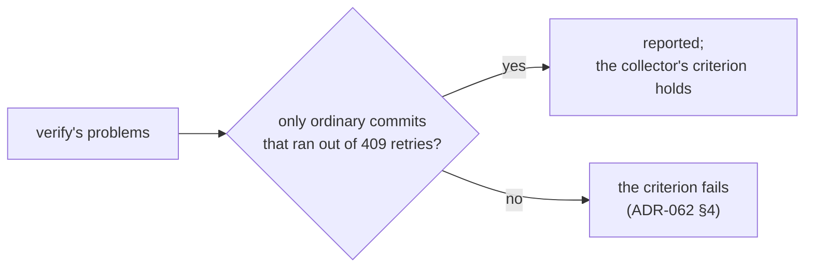

# ADR-063: The collector's criterion leaves out ordinary commits that ran out of 409 retries

- **Status:** Accepted
- **Date:** 2026-10-17
- **Related:** ADR-054, ADR-061, ADR-062

## Context

- **ADR-062 §1's first criterion** for keeping ZGC is that `verify` passes (ADR-054 §2). Under
  ADR-054 §2, any failed request fails a run, except a 409 on the hot set.
- **Tier D at `1918199`** (ZGC at a 50% heap share, 2026-10-17) met the other two criteria: the
  hold's longest pause was 1 ms, and the mixed knee was 75 req/s. `verify` failed on one
  problem only: `commits at 45 req/s: 3 failed request(s), 0 of them 5xx`.
  - The three are ordinary commits that ran out of their 4 retries on 409s. Polaris answered
    that step's commits with 5,877 200s and 275 409s, and nothing else.
  - There was no restart, no 5xx, and no commit answered 200 that was lost or listed twice.
- **The Parallel collector's run failed the same way:** 6 ordinary commits at 35 req/s,
  below its knee of 40 (`docs/measurements/stress-capacity-2026-10-16.md`).
- **A 409 is Iceberg's optimistic concurrency, not a fault.** It says that another commit
  reached the table first. How often a commit runs out of retries depends on the commit rate
  and the scenario's retry count, under either collector.
- **Kade (2026-10-17):** these are commit contention, not a collector fault.

## Decision

**Amends ADR-062 §1's first criterion.** It now reads: `verify` passes (ADR-054 §2), an
out-of-memory kill included, **except for ordinary commits that ran out of their retries on
409s**. Those are reported, with their count and the step they were in, and do not fail the
collector.

- **Everything else in ADR-054 §2 still fails it:** a 5xx, any other failed request, a commit
  answered 200 that is lost or listed twice, and a restart of Polaris or polaris-pg.
- **ADR-054 §2 itself is unchanged.** `verify` still fails such a run; only ADR-062's choice
  of collector reads past it.
- **So ZGC at a 50% heap share stays:** the run at `1918199` meets all three criteria.

## Diagram

## Alternatives considered

- **Keep the criterion and measure G1, as ADR-062 §4 says:** five more hours that would test
  the commit scenario's contention, not the collector.
- **Change ADR-054 §2 for every run:** it would also change what Tier A reports as a fault.
  That is a wider decision than the collector's.
- **Raise the scenario's retry count:** that changes the scenario, and so every comparison with
  earlier runs (ADR-053 §3).

## Consequences

- **The measurement file of 2026-10-17** records ZGC at 50% as kept. It names the 3 commits
  under *Correctness*, beside the Parallel run's 6.
- **A later collector run** reads `verify`'s problems the same way.
- **ADR-062 becomes `Amended by ADR-063`** in the commit that accepts this one.
