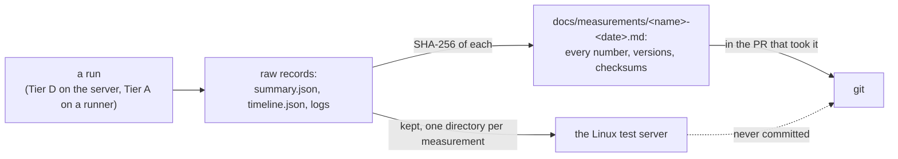

# ADR-064: Measurements keep their raw records on the Linux test server; each file names their checksums and every number it uses

- **Status:** Proposed
- **Date:** 2026-10-17
- **Related:** ADR-000, ADR-002, ADR-003, ADR-047, ADR-053, ADR-054, ADR-058, ADR-065

## Context

**ADR-003** commits measurements "with their evidence" under `docs/measurements/`. Three ADRs
read that evidence as the run's raw records, tracked in git:

| ADR | Its rule | Status |
|---|---|---|
| ADR-053 §7 (Tier D) | `stress-capacity-<date>.md`, "with the run's JSON beside it" | Amended by ADR-054 |
| ADR-054 §3 (Tier A) | A baseline may be "a summary committed to `docs/measurements/`" | Accepted |
| ADR-047 §7 (failover) | `failover-<date>.md`, "with every run's JSON beside it" | Amended by ADR-058 |

**What the first Tier D measurement committed** (`stress-capacity-2026-10-16.md`, PR #181):
- `stress-capacity-2026-10-16.json`, the driver's `summary.json`: 21,692 bytes, 939 lines;
- `stress-capacity-2026-10-16-timeline.json`, the Prometheus stand-in's series every 15 s:
  760,905 bytes, 75,807 lines.

**Nothing reads them from git.** The measurement file carries every number it reports. No code
reads `docs/measurements/*.json`, and `stress.yml` reads a baseline only from an earlier run's
artifact (ADR-054 §3). Pushed history is never rewritten, so every run's records would stay in
every clone of the repository for good.

**Kade (2026-10-17): raw records are not tracked.** The second Tier D measurement
(`stress-capacity-2026-10-17.md`, PR #184) already leaves them out. It names their checksums
and records the departure from ADR-053 §7 under *Deviations*. Its records and the first
measurement's are kept on the Linux test server. On 2026-10-17 the server's copies of the two
tracked files had the same SHA-256 as the files in git.

**Where this can be changed (ADR-000 rule 6):**
- **ADR-003** has not been amended: this ADR amends its measurements bullet.
- **ADR-053** is amended already, so its §7 changes only if ADR-053 is superseded whole. ADR-054
  exists only to change ADR-053, so ADR-065 restates both, with §6's and §7's records under this
  ADR.
- **ADR-047** is amended already, by ADR-058, so changing its §7 means superseding it whole. No
  failover result has been committed yet: ADR-047 §7 commits one only once C3a reproduces the
  target. This ADR leaves ADR-047 as it is until then (§5).

## Decision

**Amends ADR-003.** It replaces ADR-003's bullet on measurements. The rest of ADR-003 stands.

### 1. Raw records are not tracked

- **A raw record** is anything a run writes that a measurement is taken from:
  - the driver's output, `summary.json` included;
  - the Prometheus stand-in's `timeline.json`;
  - k6's console;
  - the run's logs, such as the server's temperature log.
- **None of them is committed**, under `docs/measurements/` or anywhere else in git.

### 2. They are kept on the Linux test server

- **On Kade's Linux test server** (ADR-065 §7), in one directory per measurement named after its
  file, such as `stress-capacity-<date>/`. Each attempt has its own sub-directory.
- **A run on a GitHub-hosted runner** (Tier A, ADR-065 §6): its artifact is copied there
  before it expires, when the run is worth keeping.
- **The repository names no host, address or path on the server** (ADR-002): only "the Linux
  test server".

### 3. What the measurement file carries

- **Every number it uses**: knees, rates, percentiles, CPU, memory, counts, and the inputs to
  any arithmetic it shows. The file stands without its records.
- **Each kept record, by name and full SHA-256** (64 hexadecimal digits), so a copy can be
  checked against the run that was measured.
- **The versions measured**, the server by cores, threads and memory only, and the run links,
  as before (ADR-003, ADR-002).

### 4. ADR-003's bullet now reads

> **Measurements and their numbers** are committed under `docs/measurements/`, in the PR that
> took them, each labelled with the versions measured. Their raw records stay out of git, on
> the Linux test server, named in the file by SHA-256 (ADR-064).

### 5. Which measurements it covers

- **Stress, Tier A and Tier D:** through ADR-065 §6 and §7, which restate ADR-053 and ADR-054
  with these records.
- **Failover:** ADR-047 §7 stands as written until its first result is due. Before that result
  is committed, a new ADR supersedes ADR-047 whole (it is amended by ADR-058) and puts its §7
  under this rule.
- **Every other measurement** follows this ADR from its acceptance.

### 6. The two files already tracked

- **`stress-capacity-2026-10-16.json` and `stress-capacity-2026-10-16-timeline.json` leave the
  tree** in this ADR's PR, once it is accepted. History is not rewritten, so both stay readable
  at `37a6275`. Their SHA-256:
  - `summary.json`:
    `d8a1a1bcad6c4fab62e5518184acb75c5db3fc2ca0fde527bb0a21017b9c5403`;
  - `timeline.json`:
    `a12680bdfad11e2868bf10997f728f892854ad04413952f99794799d386d200d`.
- **`stress-capacity-2026-10-16.md` is not edited.** A measurement is a record (`docs/measurements/README.md`).
  The README says where its records are now.

## Diagram

## Alternatives considered

| Option | Why not |
|---|---|
| **Keep tracking them** (ADR-053 §7 and ADR-047 §7 as written) | Tens of thousands of lines a run stay in every clone for good, and no reader or code uses them from git. |
| **Git LFS** | A new dependency for every clone and for CI, with storage and bandwidth quotas on a personal account. The records would still be public, and still read by nobody from there. |
| **Workflow artifacts or GitHub release assets** | Artifacts expire after at most 90 days. A Tier D run is never a workflow run (ADR-065 §7). Releases are platform releases tagged by `release.yml` (ADR-033), and a measurement is not one. |
| **Track the summary, drop the timeline** | The summary is small (21,692 bytes), but every number in it is already in the measurement file. Having two rules for which record goes where buys nothing. |
| **Compress them in git** | Growth in history is smaller but still permanent, and a binary file cannot be reviewed. |
| **A private repository for the records** | An off-site second copy, at the cost of another repository to keep. Kade chose the server. A later ADR can add a second copy. |

## Consequences

- **The repository grows by measurement files only**, a few hundred lines each.
- **The records exist in one place.** If the server loses them, the measurement's numbers
  stand, but no new number can be computed from that run. Backing up the server is Kade's
  choice, outside this repository.
- **A reviewer cannot recompute a number from the PR alone.** On the server, Kade can check
  each record against its SHA-256 and recompute from it. A session reaches the server only
  through Kade's own access; a cloud session cannot read the records.
- **A Tier A comparison with an expired run** is made by hand, with the driver's `report` on the
  server's copy (ADR-065 §6). `stress.yml` still reads only unexpired artifacts.
- **On acceptance, in this ADR's PR:**
  - ADR-003 becomes `Amended by ADR-064`;
  - `docs/measurements/README.md` states this rule and where the 2026-10-16 records are;
  - `docs/runbooks/stress-capacity.md` step 8 keeps the records on the server and names their
    SHA-256 in the measurement file;
  - the two files of §6 leave the tree.
