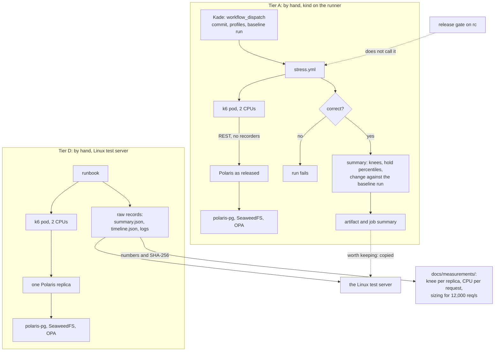
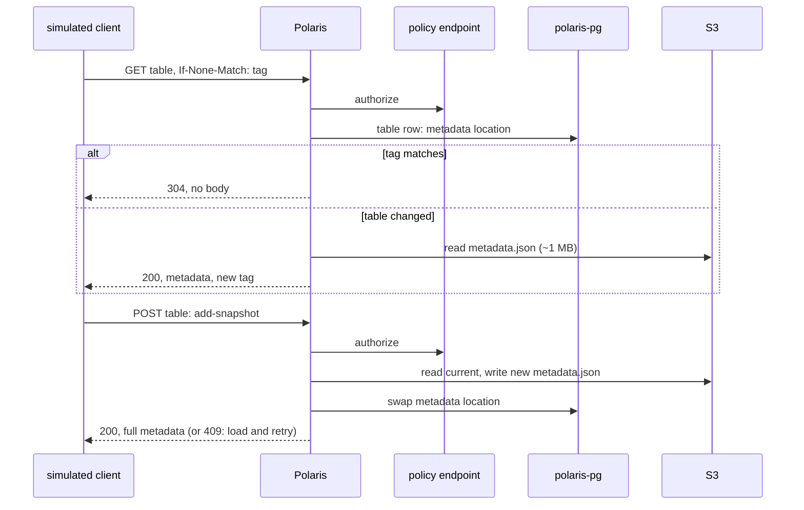

# ADR-065: The stress test runs with k6 only when Kade starts it: Tier A on the gate, Tier D measures one Polaris on a Linux test server

- **Status:** Proposed
- **Date:** 2026-10-17
- **Related:** ADR-000, ADR-002, ADR-003, ADR-004, ADR-005, ADR-015, ADR-017, ADR-026, ADR-030, ADR-031, ADR-033, ADR-034, ADR-039, ADR-046, ADR-047, ADR-048, ADR-049, ADR-050, ADR-052, ADR-053, ADR-054, ADR-064

## Context

**ADR-064 takes measurements' raw records out of git.** Two rules of the stress test track
them:
- ADR-053 §7 commits Tier D's results "with the run's JSON beside it";
- ADR-054 §3 lets a Tier A baseline be "a summary committed to `docs/measurements/`".

**ADR-053 is already amended by ADR-054,** so under ADR-000 rule 6 it changes only by being
superseded whole. ADR-054 exists only to change ADR-053's §1, §5, §6 and §8. This ADR restates
both as they stand together, and changes only the records of §6 and §7.

**Nothing else changes.** Every other rule below is ADR-053's or ADR-054's, restated without
change. The table gives each rule's old place, so citations of the old numbers can be followed:
in code comments, in `stress.yml`, and in ADR-061 to ADR-063.

| Was | Now | Change |
|---|---|---|
| ADR-053 §1, its Tier A row from ADR-054 §1 | §1 | none |
| ADR-053 §2, the tool | §2 | none |
| ADR-053 §3, the scenario | §3 | none |
| ADR-053 §4, ramps, the knee, validity | §4 | none |
| ADR-054 §1 and §2, Tier A by hand and what fails a run (replacing ADR-053 §5) | §5 | none |
| ADR-054 §3, the baseline (replacing ADR-053 §6) | §6 | a summary worth keeping goes to the Linux test server, not to git (ADR-064) |
| ADR-053 §7, Tier D | §7 | its raw records stay on the Linux test server (ADR-064) |
| ADR-054 §4, the release gate's five checks (replacing ADR-053 §8) | §8 | none |

**The figures the decision uses** come from Kade's answers on #142 (2026-10-14). ADR-053's
Context gives their sources and its reading of Polaris's and Iceberg's code:
- the target clusters' Polaris serves 6,000 to 8,000 HTTP requests per second at peak, in two
  windows of about 2 hours a day, mostly reads from users' Iceberg queries, with Spark ETL jobs
  committing steadily;
- about 100 tables, with `metadata.json` typically about 1 MB;
- headroom 1.5× today's top: **12,000 req/s**;
- Kade's Linux test server has 8 cores, 16 threads and 64 GB.

## Decision

**Supersedes ADR-053 and ADR-054.**

### 1. Two tiers

| | Tier A | Tier D: capacity |
|---|---|---|
| **Runs** | Only when Kade starts `stress.yml` by hand (`workflow_dispatch`) | By hand from a runbook, by Kade |
| **Where** | kind on the GitHub-hosted runner (ADR-017) | Kade's Linux test server, kind built by the gate's own scripts |
| **Polaris** | As released (`values-lakehouse.yaml`), the commit Kade picks | One replica; a size change only (ADR-017) |
| **Proves** | The commit is correct under contention, and how fast it is next to an earlier run | What one Polaris replica serves, and the target's replica count for 12,000 req/s |
| **Records** | The run's summary as a workflow artifact and in its job summary (§6) | `docs/measurements/`, its raw records on the server (§7, ADR-064) |

- **Both tiers run the same scenario** (§3) with the same tool (§2). Only the rates, the step
  lengths and the hold differ.
- **Neither tier reaches a target cluster** (ADR-004). A shared dev cluster is left to an ADR
  of its own: its object store and its policy server's interface differ from this repository's
  stand-ins (ADR-031).

### 2. The tool: k6

- **k6 runs as a pod** from the official image, pinned by digest in `gates/pins.json`, as the
  stand-ins are (ADR-031). It is never part of a release.
- **The pod is limited to 2 CPUs** and carries the gate's check label
  `lakehouse-gate/check: "true"`, so ADR-048 §5 admits it to Polaris.
- **The scenario is our own JavaScript** under `gates/stress/`, speaking the Iceberg REST API
  directly. Rates are open-model (`constant-arrival-rate`, `ramping-arrival-rate`), so a slow
  Polaris shows as dropped requests rather than a slower client.
- **The driver is Python** under `gates/stress/`: it seeds the tables, starts k6, reads the
  results and checks every table after the run. Its arithmetic (knee, percentiles,
  comparisons, lost commits) is unit-tested in the static gate.
- **k6 is AGPL-3.0.** This repository runs its image and distributes nothing built from it.

### 3. The scenario

**The data, seeded before each run:**

- **One catalog with 100 tables in 10 namespaces**, on the S3 stand-in.
- **Each table carries snapshot history** until its `metadata.json` is about 1 MB. The
  seeding sends batched `add-snapshot` updates, a few requests per table.
- **Every snapshot names one small manifest list** written once to the S3 stand-in.

**The requests:**

| Kind | Request | Notes |
|---|---|---|
| **Conditional load** | `GET` table, with the tag the client last got | As Iceberg Java 1.11: a 304 while the table is unchanged; a full 200 after a commit, or after the client's 5-minute expiry |
| **Unconditional load** | `GET` table, no `If-None-Match` | As Iceberg Java 1.10 and older: always a full 200 |
| **Commit** | `POST` table: `add-snapshot` and `set-snapshot-ref` on `main`, with `assert-ref-snapshot-id` | On a 409, load and retry, up to 4 times, as Iceberg's client does |
| **Other** | Token, `config`, list namespaces and tables, `HEAD` table | Small responses |

- **Commits are spread over 90 tables.** The other 10 are a **hot set**, each with 4
  concurrent writers, so commits collide and the 409 path is exercised.
- **Each simulated client keeps its own tags**, so a commit sends that table's readers back
  to a full load, as on the target.

**The profiles:**

| Profile | Mix | What it finds |
|---|---|---|
| **commits** | Commits only | The maximum commit rate |
| **queries-conditional** | Conditional loads and other requests | The maximum query rate for 1.11 clients |
| **queries-full** | Unconditional loads and other requests | The maximum query rate for older clients |
| **mixed** | 85% conditional loads, 10% other, 5% commits | The maximum for the target's shape |

- **The mixed profile's shares are an assumption** until the target's metrics give the real
  ones (#142). They are a tuning value in `gates/stress/`'s config (ADR-000 rule 11),
  changed there with the evidence in the PR.

### 4. Ramps, the knee, and what makes a run valid

- **Each profile is a step ramp:** the rate rises by a fixed step, held at each step, until a
  step fails. **The knee** is the last step that passes, which is the maximum for that
  profile.
- **A step passes** when all three hold:
  - Polaris answered at least 95% of the requests offered (k6 dropped at most 5%);
  - errors are at most 0.1%, a 409 on the hot set not counted;
  - p99 latency is within a cap per request kind.

  The caps, the step size and the step length are tuning values in `gates/stress/`'s config.
- **A run measures Polaris only if nothing else is the limit.** k6, the policy stand-in and
  the S3 stand-in each run with a CPU limit. The driver samples each container's CPU from
  the kubelet's cAdvisor endpoint through the API server. A knee reached while any of the
  three is at its limit is reported as that component's, not Polaris's, and the run is not a
  measurement.
- **Polaris connects to the stand-ins directly, never through the recorders** (ADR-034), as
  ADR-047's probe does. A stress install writes its own `.env` with the stand-ins'
  endpoints. Smoke keeps the recorders.
- **Server-side figures come from Polaris's own metrics** on 8182 (ADR-046): request
  durations per endpoint and status, and the JVM's CPU and memory.

### 5. Tier A runs by hand

- **`stress.yml` has one trigger, `workflow_dispatch`.** It is not called by the release gate
  and not triggered by a push to `gate/*`, so it is not a gate workflow under ADR-049 and has
  no delete job.
  - It follows the gate workflows' rules all the same: `permissions: {}`, `contents: read`
    per job, no repository secrets; the gate's own Secrets only.
- **Claude sessions start it only when Kade asks in that session,** as with releases
  (ADR-033).
- **What it runs:** kind as smoke builds it (`gates/gate.py up`), the chosen commit installed
  fresh, the stand-ins in direct mode (§4), the seeding, the ramps, then a **hold of the mixed
  profile at 70% of its knee for 10 minutes**.
- **Inputs:** the profiles to run (all four by default), and optionally an earlier run's id
  to compare against.
- **Only correctness fails a run:**
  - any 5xx;
  - any failure other than a 409 on the hot set;
  - a commit answered 200 that is missing from its table's snapshot list after the run, or
    present twice;
  - a restart of a Polaris or polaris-pg container.
- **Speed is reported, never judged.** The summary gives each profile's knee and the hold's
  percentiles. With a baseline run named, it also gives each one's change against that run.
- **No calibration is a precondition.** Nothing fails on a noise margin. A repeat of one
  commit stays useful for reading a comparison, and is recorded as a measurement when it is
  run (ADR-003, ADR-064).

### 6. The baseline is an earlier run

- **A comparison reads the baseline from that run's summary artifact** (`stress.yml`'s
  baseline input).
- **Artifacts expire; a run worth keeping is kept on the Linux test server** (ADR-064 §2): its
  artifact is copied there before it expires. A measurement file under `docs/measurements/`
  carries its numbers, its versions and the artifact's SHA-256 (ADR-064 §3). A summary is not
  committed.
- **A comparison with a run whose artifact has expired** is made by hand, with the driver's
  `report` and the server's copy as its baseline.
- **`release.yml` attaches nothing.**

### 7. Tier D: one Polaris on a Linux test server

- **The cluster:** kind with three nodes, built on the server by the gate's own scripts at
  the gate's pins, so it differs from the gate in size only. Polaris has one replica;
  polaris-pg has its three instances; the stand-ins are SeaweedFS and OPA (ADR-031); k6 runs
  in the same cluster, limited to 2 CPUs.
- **Polaris's CPU and memory are set explicitly**, requests equal to limits, a size change
  only (ADR-017). Neither upstream's chart nor `values-lakehouse.yaml` sets them, so without
  this the JVM would size its heap from the server's memory. The values are tuning values in
  the runbook.
- **What it runs:** the four ramps with longer steps, then **a hold of the mixed profile at
  80% of its knee for 2 hours**, the length of one of the target's peak windows. The hold
  looks for what only time shows: memory growth, pool exhaustion, garbage-collection pauses.
- **What it reports**, for each profile:
  - the knee, in req/s for one Polaris replica;
  - Polaris's and polaris-pg's CPU-seconds per request at the knee;
  - the hold's p50, p95 and p99, and its error rate.
  - Polaris's CPU and memory limits, its maximum heap, and its heap used after garbage
    collection over the hold.
- **The sizing for 12,000 req/s** follows from it:
  - Polaris replicas: 12,000 ÷ the mixed knee;
  - polaris-pg cores: 12,000 × polaris-pg's CPU-seconds per request, because every replica
    shares one primary;
  - both are estimates for the target's hardware, to be checked against #9's answers.
- **The runbook** is `docs/runbooks/stress-capacity.md` (ADR-052). The issue carrying a run
  is labelled `cmd:verify-needs-linux`.
- **Results:** `docs/measurements/stress-capacity-<date>.md`, in the PR that took them
  (ADR-003). They name the versions measured and describe the server by cores, threads and
  memory only (ADR-002).
  - **Its raw records stay on the Linux test server** (ADR-064): the driver's output with
    `summary.json`, the Prometheus stand-in's `timeline.json`, and the run's logs.
  - **The file names each by SHA-256 and carries every number it uses.**
- **When it runs:** when a release changes Polaris's or PostgreSQL's version or settings, and
  when the target sizing changes. It is not a check the release workflow reads.

### 8. The release gate keeps its five checks

- **The release gate's fixed checks are the five ADR-033 names.** The stress test is not one
  of them. The `rc` ruleset, `install/release_tag.py`'s `REQUIRED_CHECKS` and `release.yml`
  do not name it.

## Diagram

## Alternatives considered

**How to change the records:**

| Option | Why not |
|---|---|
| **Amend ADR-053 §7 again** | ADR-000 rule 6: an ADR already amended is superseded whole. |
| **Amend ADR-054 so it also replaces ADR-053 §7** | One rule would then be read through three documents, the chain rule 6 exists to stop. ADR-054 itself says §7 stands unchanged. |
| **Restate ADR-053 alone and leave ADR-054 standing** | ADR-054 only changes ADR-053's sections. Left standing, it would amend sections that no longer exist in force. |

**Where it runs and the tool** (ADR-053's alternatives, still standing):

| Option | Why not |
|---|---|
| **A GitHub-hosted runner sending the load to Kade's server** | Every response crosses the internet and the home connection's upload link, which becomes what is measured. The server would accept connections from GitHub's whole address range; its address would appear in public Actions logs (ADR-002); and the job would need a Polaris credential as a repository secret, which ADR-017 rules out. |
| **Kade's server as a self-hosted runner** | GitHub warns against self-hosted runners on public repositories: a fork's PR could run code on the machine (ADR-017). |
| **A larger GitHub-hosted runner** | Billed per minute even on public repositories, and offered only to organizations on paid plans. One kernel and one disk would still hold every component. |
| **A temporary cloud cluster per run** | A cost per run, cloud credentials as a secret, and a teardown to maintain. |
| **The Mac on Kade's LAN as the load source** | macOS is outside ADR-004, and full 1 MB responses over a 1 or 2.5 GbE link cap the rate at the network. |
| **PyIceberg**, already pinned for the smoke tests | Tens of requests per second per process, with its own file writes; the load generator would take the CPU it measures. |
| **Our own Python client on the standard library** | Open-model rates, percentiles and dropped-request accounting would all be ours to write and keep correct. |
| **polaris-tools' Gatling benchmarks** | Its commits are property updates, not snapshots, so metadata never grows; appends would be a patch we carry. It adds a JDK and Gradle, whose dependencies are fetched without hashes. |
| **Locust** | Python, a few hundred to a thousand requests per second per worker, and a pip dependency with gevent. |

**When it runs** (ADR-054's alternatives, still standing):

- **A required check in the release gate** (ADR-053 as first accepted): every candidate pays
  about 45 minutes and fails on a noise margin that needs calibrating first. Kade chose a run
  he starts when a change warrants it.
- **A regression check in a manual run:** a margin still needs calibration to mean anything,
  and a manual run has a person reading its numbers.

## Consequences

- **Nothing new to build.** `gates/stress/`, `stress.yml` and the Tier D runbook exist as
  ADR-054's Consequences listed them. Tier D's records follow ADR-064 from its first run after
  acceptance.
- **The k6 image is a gate-only dependency**, pinned by digest in `gates/pins.json`. It never
  reaches a release.
- **A release candidate is not proven under load by the release gate.** Load is checked when
  Kade runs Tier A or Tier D, which §7 ties to changes of Polaris, PostgreSQL or their sizing.
- **Disk is a limit on the runner.** Every commit writes a new `metadata.json` of about 1 MB to
  the S3 stand-in, so the commit rate and the hold's length are set so a run fits the runner's
  disk.
- **The mixed profile is an assumption** until the target's metrics give the shares of 304,
  200 and commits at peak (#142).
- **The 12,000 req/s figure is checked on paper, not run.** Tier D measures one replica; the
  sizing divides. The shared dev cluster's own ADR is where several replicas are measured
  together.
- **Client-side caching is the clients' choice.** If the target's metrics show few 304s, the
  query rate depends on clients moving to Iceberg 1.11 or later.
- **Citations of the old numbers are not rewritten.** Code comments, `stress.yml`,
  `gates/stress/`'s config, ADR-061 to ADR-063 and the measurement files keep citing ADR-053
  and ADR-054. They are not living documents (ADR-000 rule 9, ADR-052), and the table in the
  Context maps each to its section here. The same is true of code that still cites ADR-029 and
  ADR-038.
- **On acceptance, in this ADR's PR:**
  - ADR-053 and ADR-054 become `Superseded by ADR-065`;
  - the living documents citing them cite this ADR instead: `CLAUDE.md`'s layout rows for
    `gates/` and `.github/workflows/`, `docs/plans/roadmap.md`,
    `docs/runbooks/stress-capacity.md` and `docs/measurements/README.md`.
