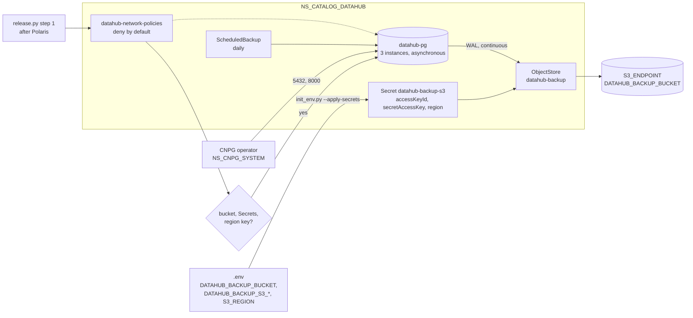

# ADR-066: Datahub's PostgreSQL is a chart of its own, with three asynchronous instances, backing up to its own bucket with its own key

- **Status:** Proposed
- **Date:** 2026-10-18
- **Related:** ADR-006, ADR-008, ADR-010, ADR-025, ADR-039, ADR-043, ADR-045, ADR-047, ADR-048, ADR-050, ADR-056, ADR-058, ADR-059, ADR-060

## Context

**P3 starts with Datahub's PostgreSQL** (`docs/plans/roadmap.md`; Kade, 2026-10-18). What is
already decided:
- **ADR-025 and ADR-010:** a CloudNativePG `Cluster` `datahub-pg` in `NS_CATALOG_DATAHUB`,
  used by Datahub only.
- **ADR-045 step 1:** after Polaris, Datahub's network policies, then its PostgreSQL `Cluster`,
  ready; Kafka, OpenSearch and Datahub come later in the same step.
- **ADR-048 §3 and §4:** a local chart of network policies per service namespace. Datahub's
  PostgreSQL takes 5432 and 8000 "as polaris-pg", for Datahub's pods, its Cluster's join pods
  and the operator.
- **ADR-043 §1:** every CNPG `Cluster` of this repository backs up through the Barman Cloud
  Plugin, "Datahub's when it enters". Each service's PostgreSQL chart carries its own
  `ObjectStore`.
- **`init_env.py`** already creates `datahub-db` (basic-auth, user `datahub`) from
  `DATAHUB_DB_PASSWORD` (ADR-006).

**What is not decided:**
- **The chart.** `charts/polaris-postgres` is Polaris's, released since `platform-2026.10.12`,
  and carries settings measured for polaris-pg only:
  - synchronous commits (ADR-056) and `failoverQuorum` (ADR-058);
  - `smartShutdownTimeout: 0`, a tuning value from failover's C0 under S1 (ADR-047 §8).
- **Where Datahub's backups go.** ADR-043 §2 and ADR-060 name Polaris's: the bucket
  `POLARIS_BACKUP_BUCKET`, the key `POLARIS_BACKUP_S3_*` in the Secret `polaris-backup-s3`,
  and its `region`. They name none for Datahub, and a Secret is read only in its own
  namespace.

Kade's choices (2026-10-18): a chart copied from Polaris's, not a shared one; three
asynchronous instances; Datahub's backups in a bucket of their own with a key of their own;
its network policies in the same PR; a smoke check of its own; three instances on the gate
too.

## Decision

ADR-043 and ADR-060 stand unchanged for polaris-pg. This ADR decides what they leave open for
Datahub's `Cluster`, in the same pattern.

### 1. A chart of its own

- **`charts/datahub-postgres`**, copied from `charts/polaris-postgres` and changed only as
  below, renders the `Cluster` `datahub-pg`, its `ObjectStore` `datahub-backup` and a daily
  `ScheduledBackup`. The CNPG operator and the plugin stay preconditions (ADR-045 step 0).
- **The copies are kept apart.** A later change to one chart is made to the other only when its
  own evidence says so.

### 2. Three instances, replicating asynchronously

- **Three instances that never share a node** (`podAntiAffinityType: required`), the same image
  as polaris-pg, and the gate runs three too.
- **No `synchronous` block and no `failoverQuorum`.** CNPG's default replication is
  asynchronous: a standby lost or slow never stops a commit, and a failover can lose the last
  commits a standby had not received. ADR-056 and ADR-058 were measured for Polaris's catalog
  and stay polaris-pg's.
- **`smartShutdownTimeout: 0`,** as polaris-pg's: a deleted primary then shuts down at once,
  instead of waiting up to 180 s for open sessions. Datahub's own measure, if any, changes it.
- **The database `datahub`, owned by `datahub`,** with the `datahub-db` Secret.
- **Storage size and retention** are tuning values in the chart, starting from polaris-pg's.

### 3. Its own bucket and its own key

- **`.env` gains three values:** `DATAHUB_BACKUP_BUCKET`, on the same `S3_ENDPOINT`, and
  `DATAHUB_BACKUP_S3_ACCESS_KEY_ID` and `DATAHUB_BACKUP_S3_SECRET_ACCESS_KEY`, typed in by hand
  like the other teams' credentials (ADR-031).
- **`init_env.py --apply-secrets` creates `datahub-backup-s3`** in `NS_CATALOG_DATAHUB`, with
  `accessKeyId`, `secretAccessKey`, and `region` from `S3_REGION` (as ADR-060 for Polaris).
  It stops when any of them is empty.
- **`datahub-backup`'s `s3Credentials`** take all three keys from that Secret, so the plugin
  signs for `S3_REGION`.
- **On the gate,** the S3 stand-in gets that bucket and a key of its own.

### 4. Its network policies, and the install

- **`charts/datahub-network-policies`** (ADR-048 §4) denies ingress to `NS_CATALOG_DATAHUB` by
  default, and allows, until Datahub's other charts add their rules:

  | Target | Port | Allowed from |
  |---|---|---|
  | datahub-pg's instances | 5432 | pods labelled `lakehouse/datahub-pg-client: "true"` in this namespace; the other instances of the namespace's Clusters; CNPG's join pods in this namespace (`cnpg.io/jobRole: join`) |
  | datahub-pg's instances | 5432, 8000 | the operator's namespace `NS_CNPG_SYSTEM` |

  Metrics (9187) join with Datahub's scrape contract (P5).
- **`install/release.py` step 1, Datahub's part** (ADR-045), after Polaris's:
  1. Datahub's network policies;
  2. it stops when `DATAHUB_BACKUP_BUCKET` is empty, when `datahub-db` or `datahub-backup-s3`
     is missing, or when `datahub-backup-s3` has no key `region`, reading key names only;
  3. `datahub-postgres`, waited for until the `Cluster` is ready.

### 5. What the smoke gate proves

A new `gate.py check-datahub-pg`, its own step in `smoke.yml`:
- `datahub-pg` has three ready instances on three nodes, and no synchronous replication;
- its WAL archiving works: the `Cluster`'s status reports WAL archived through the plugin;
- an on-demand `Backup` of it completes.

`check-network` adds one allowed and one refused connection for each new rule. No restore of
`datahub-pg` is taken: ADR-043 §4 proves the restore path with polaris-pg, and Datahub's data
migration has its own runbook (ADR-025).

## Diagram

## Alternatives considered

**The chart:**

| Option | Why not |
|---|---|
| **One shared chart for every service's PostgreSQL** | `polaris-postgres` is released; renaming it moves polaris-pg to a new helm release on upgrade. Each setting would become a per-service value, and Polaris's measured ones would no longer read as Polaris's. |
| **Install `polaris-postgres` twice with other values** | The chart's name, comments and defaults speak for Polaris, and its defaults would turn synchronous commits on for Datahub unless every install remembered to turn them off. |

**Replication:**

| Option | Why not |
|---|---|
| **Synchronous, as polaris-pg (ADR-056)** | Its cost and benefit were measured for Polaris's catalog writes. Most of Datahub's metadata is re-ingested from its sources; whether the rest, what users write by hand, justifies stopping writes on a lost standby is for a measurement of its own. |
| **One instance** | No standby to fail over to. polaris-pg runs three, as the target clusters do (#9). |

**The backups:**

| Option | Why not |
|---|---|
| **Polaris's bucket under Datahub's own server name, with Polaris's backup key copied into Datahub's namespace** | No new `.env` value, but a key in Datahub's namespace would then read and delete Polaris's catalog backups. |
| **Polaris's bucket with a key of Datahub's own** | Bucket policies by prefix are the object storage team's, and not every S3 service has them. A bucket of its own needs none. |
| **Supersede ADR-043 to cover both services** | ADR-043 is already amended by ADR-060, so a change to it means superseding it whole. Nothing of it changes here: this ADR only names Datahub's bucket and key, in its pattern. |

## Consequences

- **Every install and upgrade needs the three new `.env` values** and `--apply-secrets` run with
  the release's `init_env.py`. Step 1 stops otherwise, after Polaris is installed. The release
  notes say so.
- **The object storage team provides a second bucket and key** on the target. A question for
  them, added to #9.
- **A failover of datahub-pg can lose its last commits.** Ingested metadata comes back with the
  next ingestion; an edit a user made in those last moments does not. A measurement that shows
  this matters changes it with a new ADR.
- **Each gate install starts three more PostgreSQL instances,** about 30 s each (#135), on top
  of polaris-pg's.
- **Code follows once this ADR is Accepted, in a PR of its own,** opened as a draft because it
  changes `smoke.yml` and `CLAUDE.md` (ADR-059):
  - `.env.template`, `scripts/init_env.py`;
  - `charts/datahub-network-policies` and `charts/datahub-postgres`, with their tests;
  - `install/release.py`'s step 1;
  - `gates/gate.py` (the stand-in's bucket and key, `check-datahub-pg`, `check-network`'s
    cases) and `smoke.yml`'s new step;
  - `CLAUDE.md`'s layout, and `docs/plans/roadmap.md`'s P3.

  It touches `charts/` and `install/` and adds a chart, so it needs dry-run, smoke and
  smoke-fresh on its head (ADR-039, ADR-050).
