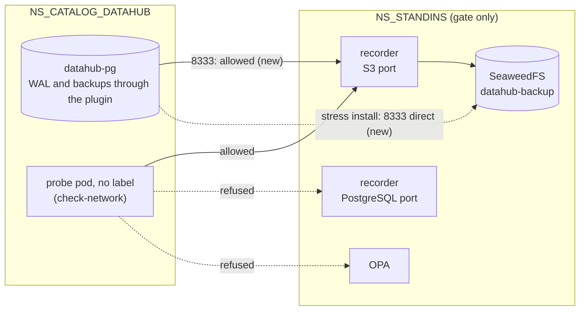

# ADR-067: Datahub's namespace reaches the gate's S3 stand-in on its S3 port only

- **Status:** Proposed
- **Date:** 2026-10-18
- **Related:** ADR-031, ADR-034, ADR-043, ADR-048, ADR-053, ADR-066

## Context

**ADR-066 §3 sends datahub-pg's backups to `S3_ENDPOINT`,** into `DATAHUB_BACKUP_BUCKET`, and
gives the gate's S3 stand-in that bucket and a key. On the gate, `S3_ENDPOINT` names the
recorder in `NS_STANDINS` (ADR-034). In a stress install, `gate.py secrets --direct`, it names
SeaweedFS itself (ADR-053 §4).

**ADR-048 §3's `NS_STANDINS` table lets nothing from Datahub's namespace in:**

| Target | Port | Allowed from |
|---|---|---|
| The recorders | their ports | Polaris's namespace; the gate's check pods |
| SeaweedFS, OPA | their ports | the recorders; the gate's check pods |

`gates/standins.py` applies it that way. A stress install also admits Polaris's namespace to
SeaweedFS and OPA.

**The code PR for ADR-066 failed smoke and smoke-fresh on this** (head `662f879`, runs
[39048156248](https://github.com/enjay27/lakehouse/actions/runs/39048156248) and
[39048158371](https://github.com/enjay27/lakehouse/actions/runs/39048158371)). The dry-run
passed.
- In both runs, `datahub-pg-1` and `-2` started within a minute. `datahub-pg-3` started about
  10 minutes later and was not ready when the install timed out, after about 15 minutes.
- `polaris-pg`, with the same image, backups and plugin, was healthy in a minute in the same
  runs.
- What differs is only the namespace: datahub-pg's plugin cannot reach the recorder, so its
  WAL archiving cannot reach S3. The failure step printed no events or logs from Datahub's
  namespace, so this is read from the policies, **not yet confirmed** from the cluster.

## Decision

**Amends ADR-048 §3's `NS_STANDINS` table and §6.** Nothing else of ADR-048 changes.

1. **The recorder admits `NS_CATALOG_DATAHUB` on its S3 port** (`standins.S3_PORT`, 8333)
   **only.** Its policy and PostgreSQL ports stay Polaris's namespace's.
2. **In a stress install, SeaweedFS admits `NS_CATALOG_DATAHUB` on its S3 port too,** since
   `S3_ENDPOINT` names it there. OPA stays closed to Datahub's namespace.
3. **The rows become:**

   | Target | Port | Allowed from |
   |---|---|---|
   | The recorders | their ports | Polaris's namespace; the gate's check pods |
   | The S3 recorder | its S3 port | also Datahub's namespace (ADR-066 §3) |
   | SeaweedFS, OPA | their ports | the recorders; the gate's check pods |
   | SeaweedFS, in a stress install | its S3 port | also Datahub's namespace |

4. **`check-network` proves it (§6):** from an unlabelled pod in `NS_CATALOG_DATAHUB`, the
   recorder's S3 port connects, and OPA and the recorder's PostgreSQL port are refused.
5. **The failure step of smoke prints Datahub's namespace too:** its events, and the logs of
   any datahub-pg instance that is not ready. The next run then shows the cause, not only the
   timeout.

## Diagram

## Alternatives considered

| Option | Why not |
|---|---|
| **Admit Datahub's namespace to every port of the recorder** | The policy and PostgreSQL ports carry Polaris's own traffic; Datahub has no use for them. |
| **Point datahub-pg's ObjectStore at SeaweedFS directly, past the recorder** | `S3_ENDPOINT` is one value for both services (ADR-066 §3), so Datahub's chart would need a second endpoint variable for the gate alone, and its S3 traffic would no longer be recorded. |
| **No backups for datahub-pg on the gate** | ADR-066 §5 makes the gate prove its WAL archiving and a backup; a gate that skips them proves neither. |

## Consequences

- **The stand-ins' policies take Datahub's namespace from `.env`** (`NS_CATALOG_DATAHUB`),
  selected by name as ADR-048 §2 does for this repository's namespaces.
- **The recorder records datahub-pg's S3 requests** beside Polaris's. `check-traffic`'s rules
  for every request then cover them too: no signed S3 request refused, no stream left
  unparsed, no upstream unreachable (`gates/expectations/standins.json`). No rule names them.
- **Code follows once this ADR is Accepted, in ADR-066's code PR (`claude/datahub-postgres`):**
  `gates/standins.py` and its tests, `gates/network.py`'s cases, and `smoke.yml`'s failure
  step. The PR stays a draft (ADR-059) and needs dry-run, smoke and smoke-fresh on its new head.
- **ADR-048 becomes `Amended by ADR-067`** in the commit that accepts this one.
