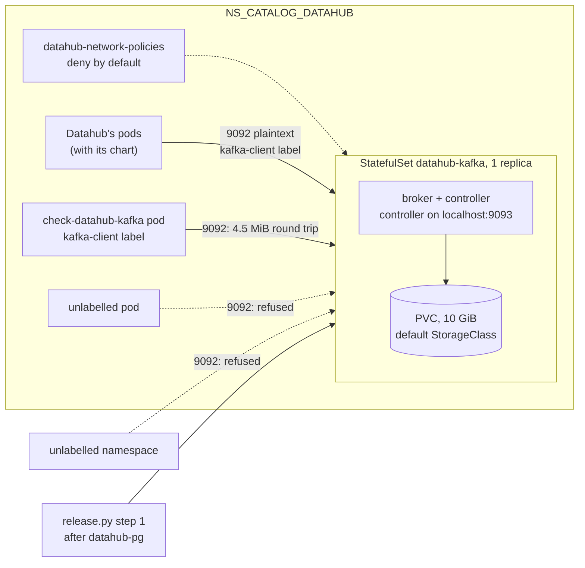

# ADR-068: Datahub's Kafka is one plaintext KRaft broker in a chart of its own, reached only by Datahub's labelled pods

- **Status:** Accepted
- **Date:** 2026-10-18
- **Related:** ADR-016, ADR-025, ADR-039, ADR-043, ADR-045, ADR-048, ADR-050, ADR-059, ADR-066

## Context

**After Datahub's PostgreSQL (ADR-066), P3 continues with its Kafka** (`docs/plans/roadmap.md`;
Kade, 2026-10-18). What is already decided:
- **ADR-025:** one broker in KRaft mode, no ZooKeeper, from the official `apache/kafka` image
  pinned by tag and digest, in a small chart of this repository, in `NS_CATALOG_DATAHUB`,
  used by Datahub only. Strimzi and Datahub's `datahub-prerequisites` chart were rejected
  there. The roadmap pins `apache/kafka` 4.3.1.
- **ADR-045 step 1:** Datahub's Kafka comes after its PostgreSQL `Cluster`, ready, and before
  Datahub.
- **ADR-048 §3:** "Datahub's Kafka and OpenSearch | their ports | Datahub's own pods only", in
  `charts/datahub-network-policies` (§4), each rule proven by `check-network` (§6).

**What Datahub v1.7.0 expects of Kafka** (upstream `datahub-helm`, `charts/datahub/values.yaml`,
read on 2026-10-18):
- `global.kafka.schemaregistry.type: INTERNAL`: GMS serves the schema registry itself, so no
  Confluent registry is needed. This answers ADR-025's open question.
- `global.kafka.precreateTopics: true`: Datahub's system-update job creates its topics
  (`MetadataChangeProposal_v1`, `MetadataChangeLog_Versioned_v1` and the others). The legacy
  `kafkaSetupJob` is off by default.
- `global.kafka.maxMessageBytes` and `producer.maxRequestSize` are `5242880` (5 MiB). A
  broker's default `message.max.bytes` is about 1 MiB.
- No SASL or TLS is set by default. Partitions and replication factor are left to the
  broker.

**What is not decided:** the chart's shape, the broker's settings, how clients authenticate,
the network rule's port and label, and what the smoke gate proves.

Kade's choices (2026-10-18): plaintext behind the network policy, with no SASL; the recovery
of Datahub's topics after the broker's volume is lost (ADR-025's consequence) is proven with
Datahub's chart, not now; the broker's size is set by tuning values, not by a measurement.

## Decision

ADR-025 stands. This ADR decides what it leaves open for the broker.

### 1. A chart of its own

- **`charts/datahub-kafka`** renders a `StatefulSet` `datahub-kafka` with one replica, a
  headless `Service` for its client port 9092, and one `PersistentVolumeClaim` from its
  `volumeClaimTemplates` on the cluster's default StorageClass (`storageClass: ""`, as
  `datahub-postgres`).
- **One process is both broker and controller** (`process.roles=broker,controller`,
  `node.id=1`). The controller listener binds to `localhost:9093` only, and
  `controller.quorum.bootstrap.servers` names it there, so no network rule covers it. The
  client listener 9092 advertises the pod's stable name in the headless Service.
- **The image is `apache/kafka`, the JVM build, by tag and digest** in the chart's values.
  Every broker setting is passed as the image's `KAFKA_*` environment variables, so the
  image's default `server.properties` is never used.
- **The KRaft cluster ID is a fixed value in `values.yaml`,** checked by the values schema as
  a 22-character base64url ID (ADR-016). It is not a secret and does not differ between
  environments; the broker formats its volume with it on first start.
- **The pod runs as the image's non-root user,** with `fsGroup` set so it can write the volume.
- **No liveness probe.** A readiness probe checks 9092 over TCP. A broker that exits restarts
  through the pod's restart policy. A liveness probe could turn a busy broker into a restart,
  as #179 records for Polaris, and a single broker has no standby to take over.

### 2. The broker's settings

| Setting | Value | Why |
|---|---|---|
| `message.max.bytes`, `replica.fetch.max.bytes` | 5242880 | Datahub sends up to 5 MiB |
| `offsets.topic.replication.factor`, `transaction.state.log.replication.factor`, `default.replication.factor` | 1 | one broker |
| `transaction.state.log.min.isr`, `min.insync.replicas` | 1 | one broker |
| `auto.create.topics.enable` | `false` | Datahub's system-update creates its topics; a missing one fails loudly instead of appearing with defaults |
| `log.retention.hours` | 168 | tuning value |

- **Tuning values, not measured** (Kade): heap 1 GiB (`KAFKA_HEAP_OPTS`), the volume 10 GiB,
  CPU and memory requests and limits in the chart's values with comments. A measurement that
  shows they matter changes them in the values.

### 3. Plaintext, behind the network policy

- **No SASL and no TLS** (Kade). The client listener is `PLAINTEXT`. No credential, no Secret
  and no new `.env` value is needed, so `init_env.py` does not change.
- **`charts/datahub-network-policies` gains one rule** (ADR-048 §3's row, with its port and
  label named):

  | Target | Port | Allowed from |
  |---|---|---|
  | datahub-kafka's pod | 9092 | pods labelled `lakehouse/datahub-kafka-client: "true"` in this namespace |

  Datahub's pods carry that label when its chart enters; until then the smoke check's pod
  does. The gate's check label still reaches every port (ADR-048 §5). Metrics join with
  Datahub's scrape contract (P5).

### 4. The install

**`install/release.py` step 1, Datahub's part** (ADR-045), after `datahub-postgres`:
`datahub-kafka`, waited for until its `StatefulSet` is ready. No new check precedes it,
since it reads no Secret and no `.env` value besides the namespace.

### 5. What the smoke gate proves

A new `gate.py check-datahub-kafka`, its own step in `smoke.yml`, from a pod in
`NS_CATALOG_DATAHUB` labelled `lakehouse/datahub-kafka-client: "true"`, without the gate's
check label, running the chart's own image:
- it creates a topic with one partition and replication factor 1, produces one message of
  4.5 MiB, and consumes it back unchanged, which proves the size settings;
- the broker's pod is deleted, comes back ready, and the topic and message are still there,
  which proves they live on the volume;
- the topic is deleted.

`check-network` adds the rule's cases (ADR-048 §6): 9092 allowed from a pod with the client
label in `NS_CATALOG_DATAHUB`, refused from an unlabelled pod there and from the unlabelled
namespace.

**The recovery after the volume is lost** (ADR-025) is proven when Datahub's chart enters
(Kade), since only Datahub's system-update recreates its topics.

## Diagram

## Alternatives considered

**Authentication:**

| Option | Why not |
|---|---|
| **SASL/SCRAM** | A credential from `init_env.py`, a Secret, a SCRAM user created in the broker before Datahub starts, and one more Secret for `release.py` to check, for a broker that only Datahub's labelled pods can reach. |
| **TLS** | A certificate to issue and renew inside one namespace; cert-manager runs on the gate only (ADR-043), and the target clusters' is not this repository's. |

**The chart:**

| Option | Why not |
|---|---|
| **Broker and controller in separate pods** | Two pods and two volumes for one broker; the controller quorum would still be one node. |
| **`apache/kafka-native`** (the GraalVM build) | Smaller and faster to start, but upstream calls it experimental and not for production. |
| **A cluster ID generated per clone by `init_env.py`** | A new `.env` value for something that is neither a secret nor per-environment. |
| **`auto.create.topics.enable=true`, the default** | A topic Datahub failed to create would appear with the broker's defaults, and the failure would show only as wrong behaviour later. |
| **A liveness probe** | See §1: a busy broker becomes a restart, with no standby. |

## Consequences

- **A single broker has no redundancy** (ADR-025). A node drain or a pod restart stops
  Datahub's writes to Kafka until the pod is back on its volume. No `PodDisruptionBudget` is
  set, since one replica with one would block every drain.
- **Kafka 4 refuses client protocols older than 2.1.** Datahub's Java consumers and its Python
  ingestion are newer; the ingestion run in P3's gate (`docs/plans/roadmap.md`) proves it.
- **A release that changes Kafka's version raises `metadata.version`** with
  `kafka-features.sh upgrade` after the new broker is ready. That release's change decides how
  `release.py` runs it.
- **Each gate install starts one more pod and volume.** The check deletes the broker's pod once,
  which adds its restart time to smoke.
- **Code follows once this ADR is Accepted, in a PR of its own,** opened as a draft because it
  changes `smoke.yml` and `CLAUDE.md` (ADR-059):
  - `charts/datahub-kafka`, with its tests and values schema;
  - `charts/datahub-network-policies`' Kafka rule, with its tests;
  - `install/release.py`'s step 1;
  - `gates/gate.py`'s `check-datahub-kafka`, `gates/network.py`'s cases, and `smoke.yml`'s new
    step;
  - `CLAUDE.md`'s layout, and `docs/plans/roadmap.md`'s P3.

  It touches `charts/`, `install/` and `gates/` and adds a chart, so it needs dry-run, smoke and
  smoke-fresh on its head (ADR-039, ADR-050).
