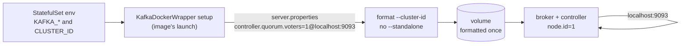

# ADR-069: Datahub's Kafka names its controller as a static voter, as the apache/kafka image requires

- **Status:** Proposed
- **Date:** 2026-10-18
- **Related:** ADR-025, ADR-068

## Context

**ADR-068 §1 has the broker find its controller through `controller.quorum.bootstrap.servers`**
at `localhost:9093`, the dynamic quorum that KRaft gained in Kafka 3.9.

**The `apache/kafka` image cannot start that way.** Read on 2026-10-18 at tag `4.3.1` (commit
`26b251a451ce941d3d7a55e6487bcb7f16b5ad48`), the release ADR-068 pins:
- `docker/jvm/launch` runs `kafka.docker.KafkaDockerWrapper setup` before the broker. That step
  writes `server.properties` from the `KAFKA_*` variables, then formats the volume.
- `core/src/main/scala/kafka/docker/KafkaDockerWrapper.scala`, `formatStorageCmd`: the format
  is `format --cluster-id=<CLUSTER_ID> -c server.properties`, with no `--standalone` and no
  `--initial-controllers`.
- Without those flags, Kafka's storage tool refuses to format a controller that has no
  `controller.quorum.voters`. The wrapper catches that refusal and stops with "the Docker image
  continues to use static voters, which are supported in 3.7 and later".

ADR-068 is Accepted (2026-10-18), so this record amends it rather than editing it.

## Decision

**Amends ADR-068 §1's second bullet.** Nothing else of ADR-068 changes.

- **The controller is named as a static voter:** `controller.quorum.voters=1@localhost:9093`,
  matching `node.id=1`. `controller.quorum.bootstrap.servers` is not set.
- **Otherwise as ADR-068 §1:** one process is both broker and controller
  (`process.roles=broker,controller`), and the controller listener binds to `localhost:9093`
  only, so no network rule covers it.
- **The image's own setup formats the volume** on first start with the chart's cluster ID, and
  leaves an already formatted volume as it is.

## Diagram

## Alternatives considered

| Option | Why not |
|---|---|
| **Keep `controller.quorum.bootstrap.servers` and format the volume ourselves**, in an init container with `kafka-storage.sh format --standalone` | Bypasses the image's setup: the chart would write `server.properties` itself and keep that in step with every image upgrade. A dynamic quorum lets controllers be added and removed while running; one broker never does that. |
| **Mount our own `server.properties`** | The wrapper still runs the same format without `--standalone`, so it refuses the same way. |

## Consequences

- **Moving to a dynamic quorum later** (more than one controller) means reformatting or a
  KRaft migration of the metadata. That would be a decision of its own, with the replica count.
- **The code PR for ADR-068** sets `KAFKA_CONTROLLER_QUORUM_VOTERS` in `charts/datahub-kafka`.
  Its chart test checks that `KAFKA_CONTROLLER_QUORUM_BOOTSTRAP_SERVERS` is absent, and smoke
  shows that the broker formats and starts.
- **ADR-068 becomes `Amended by ADR-069`** in the commit that accepts this one.
