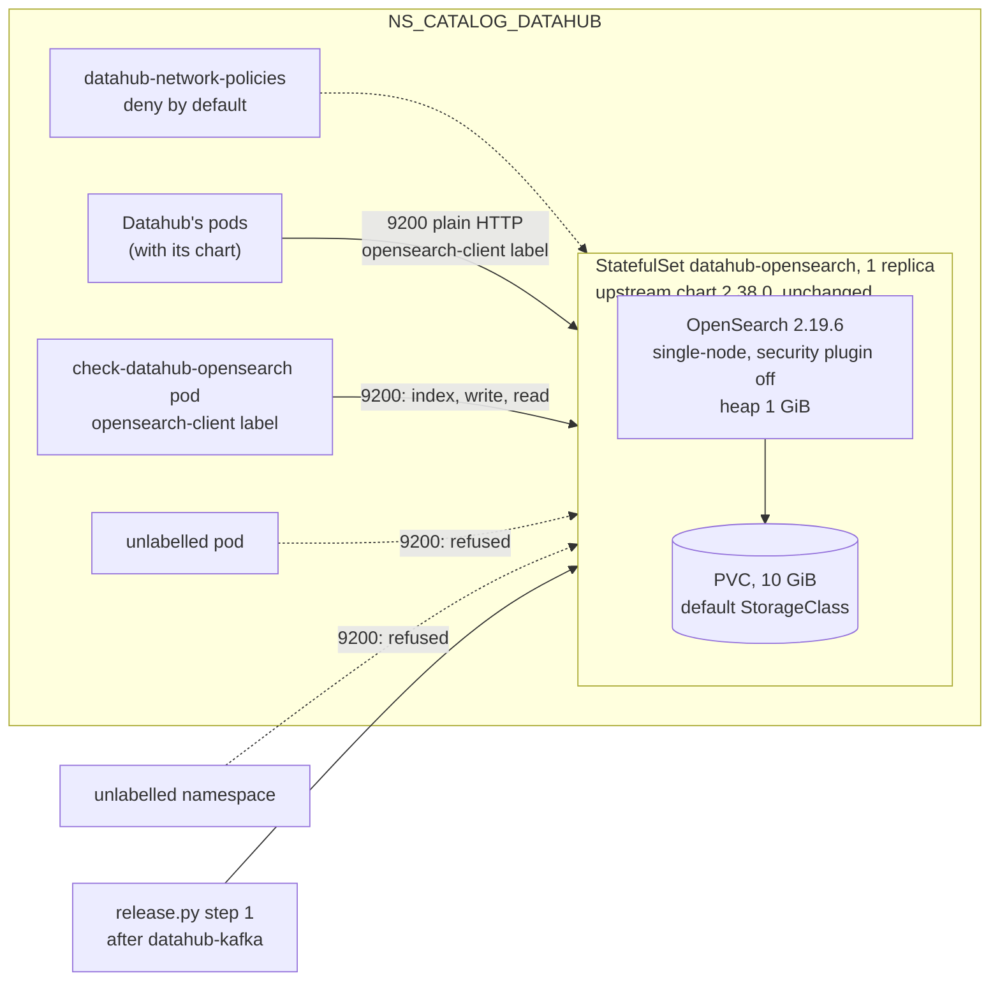

# ADR-070: Datahub's OpenSearch is one node from upstream's chart, unchanged, with its security plugin off, reached only by Datahub's labelled pods

- **Status:** Proposed
- **Date:** 2026-10-18
- **Related:** ADR-009, ADR-016, ADR-025, ADR-039, ADR-043, ADR-045, ADR-048, ADR-050, ADR-052, ADR-059, ADR-068

## Context

**After Datahub's Kafka (ADR-068, ADR-069), P3 continues with its OpenSearch**
(`docs/plans/roadmap.md`). What is already decided:
- **ADR-025:** "a single-node OpenSearch from the opensearch-project chart, at a version
  Datahub supports, pinned; used by Datahub only", in `NS_CATALOG_DATAHUB`. The roadmap pins
  OpenSearch 2.19.6, the latest 2.x.
- **ADR-045 step 1:** Datahub's OpenSearch comes after its Kafka, ready, and before Datahub.
- **ADR-048 §3:** "Datahub's Kafka and OpenSearch | their ports | Datahub's own pods only", in
  `charts/datahub-network-policies`, each rule proven by `check-network` (§6).

**What Datahub v1.7.0 expects of its search index** (read on 2026-10-18):
- **Its chart** (`acryldata/datahub-helm`, tag `datahub-1.1.7`, commit `19ca74e`,
  `charts/datahub/values.yaml`): `global.elasticsearch.host: opensearch-cluster-master`,
  `port: "9200"`, `useSSL: "false"`, and no `auth` or `indexPrefix` set. With
  `consolidatedUpgrade: true`, the system-update job builds the indices; the legacy
  `elasticsearchSetupJob` is off.
- **Datahub itself** (`datahub-project/datahub`, tag `v1.7.0`, commit `7f81ccb`): its own
  compose file (`docker/profiles/docker-compose.prerequisites.yml`) and its test container
  (`OpenSearchTestContainer.java`) run OpenSearch 2.19.3. The compose file runs it with
  `discovery.type=single-node` and `DISABLE_SECURITY_PLUGIN=true`, and its env file gives it
  `-Xms768m -Xmx1024m`. `application.yaml` creates each index with one replica
  (`ELASTICSEARCH_NUM_REPLICAS_PER_INDEX`, default 1).
- **Datahub's prerequisites chart** (`datahub-prerequisites-0.3.0`, rejected by ADR-025) runs
  the opensearch chart 2.19.0 with image 2.19.5, its security plugin disabled.

**What the image and the chart do at the pin:**
- **The opensearch-project chart 2.38.0** has appVersion 2.19.6 (tag `opensearch-2.38.0-1`,
  commit `d8e136e`; created 2026-07-08 in the chart repository's index). Read in
  `charts/opensearch`:
  - `singleNode: true` sets one replica and `discovery.type=single-node`.
  - Its `fsgroup-volume` init container runs `busybox:latest` as root, unless
    `persistence.enableInitChown` is false. The pod already runs as user and `fsGroup` 1000.
  - Its `sysctl` and privileged `sysctlInit` options are off by default.
  - It has a startup probe and a readiness probe, both TCP on 9200, and no liveness probe.
  - It renders a `PodDisruptionBudget` whenever `maxUnavailable` is set, and the default is 1.
  - It ships no `values.schema.json`, so a misspelt value is ignored without a warning.
- **The image's entrypoint** (`opensearch-build`, tag `2.19.6`, commit `fc46a1d`,
  `opensearch-docker-entrypoint-2.x.sh`):
  - The security plugin is on unless `DISABLE_SECURITY_PLUGIN=true`.
  - When the plugin is on, the image installs the plugin's demo certificates unless
    `DISABLE_INSTALL_DEMO_CONFIG=true`. That install quits when
    `OPENSEARCH_INITIAL_ADMIN_PASSWORD` is not set.
  - The image refuses to run as root.
  - It starts the performance analyzer's agent as a second process unless
    `DISABLE_PERFORMANCE_ANALYZER_AGENT_CLI=true`.
- **`vm.max_map_count`** (`OpenSearch`, tag `2.19.6`, commit `97d3c13`,
  `BootstrapChecks.java`): `enforceLimits` is false under `discovery.type=single-node`, so the
  262144 check does not stop a single node from starting.
  - GitHub's Ubuntu runners set `vm.max_map_count=262144` (`actions/runner-images`,
    `images/ubuntu/scripts/build/configure-environment.sh`, commit `c9dd4ec`). The setting is
    not namespaced, so the gate's kind nodes, and the pods on them, share it.
  - The Linux test server's value was not read.

**What is not decided:** the chart's shape, the security plugin, the node's settings, the
network rule's port and label, and what the smoke gate proves.

Kade's choices (2026-10-18):
- upstream's chart unchanged with our values, as Polaris's;
- the security plugin off behind the network policy, as Kafka's plaintext;
- no privileged sysctl container;
- sizes as tuning values;
- a smoke check of its own, with its network cases.

## Decision

ADR-025 stands. This ADR decides what it leaves open for the search index.

### 1. Upstream's chart, unchanged

- **`charts/datahub-opensearch` is a local copy of the opensearch-project chart 2.38.0**,
  taken unchanged from its release archive, with our `values-lakehouse.yaml` beside it, as
  ADR-009 keeps Polaris's. The release is `datahub-opensearch`. `fullnameOverride` and
  `masterService` name both its `StatefulSet` and its `Service` `datahub-opensearch`.
- **OpenSearch 2.19.6, `opensearchproject/opensearch`, by tag and digest** in the values. The
  chart and the image move together: an upgrade is a PR of its own, through the gates.
  Docker Hub last pushed the 2.19.6 tag on 2026-10-15, so the code PR pins the digest it reads
  then.
- **One node:** `singleNode: true`, so `discovery.type=single-node`, with the roles master,
  ingest and data.
- **No root container.**
  - `persistence.enableInitChown: false`: the pod's `fsGroup` 1000 lets OpenSearch write its
    volume, as Kafka's chart does.
  - `sysctl` and `sysctlInit` stay off (§3).
- **No `PodDisruptionBudget`** (`maxUnavailable: 0`, for which the chart renders none), as
  Kafka's: with one replica, a budget that allows no disruption would block every drain.
- **Upstream's probes stay:** startup and readiness on 9200 and no liveness probe, as
  ADR-068 §1 argues for one broker.
- **The volume** is one `PersistentVolumeClaim` on the cluster's default StorageClass
  (`persistence.storageClass` unset).
- **The chart test** (ADR-016) checks that every key in `values-lakehouse.yaml` exists in
  upstream's `values.yaml`, since upstream has no schema to refuse a misspelt one. It also
  checks the rendered output for every value this section and §2 to §4 set.

### 2. The security plugin off, behind the network policy

- **`DISABLE_SECURITY_PLUGIN=true`** (Kade), as Datahub's own compose file and its
  prerequisites chart set it, and `securityConfig.enabled: false`, so the chart mounts no
  security files. OpenSearch serves plain HTTP on 9200 with no login.
- **No credential, no certificate, no Secret and no new `.env` value**, so `init_env.py` does
  not change. Datahub's chart keeps `useSSL: "false"` and sets no `auth`.
- **`charts/datahub-network-policies` gains one rule** (ADR-048 §3's row, with its port and
  label named):

  | Target | Port | Allowed from |
  |---|---|---|
  | datahub-opensearch's pod | 9200 | pods labelled `lakehouse/datahub-opensearch-client: "true"` in this namespace |

  - **The transport port 9300 gets no rule.** A single node has no peer, so nothing needs it.
  - Datahub's pods carry the label when its chart enters; until then the smoke check's pod
    does. The gate's check label still reaches every port (ADR-048 §5).
  - Metrics join with Datahub's scrape contract (P5).

### 3. The node's settings

- **No container changes `vm.max_map_count`** (Kade). A single node starts below 262144
  (Context). Nodes should still offer at least 262144, so that OpenSearch can memory-map its
  index files as they grow. The gate's nodes do.
- **The performance analyzer's agent is off** (`DISABLE_PERFORMANCE_ANALYZER_AGENT_CLI=true`):
  it is a second process in the pod, and metrics come with P5.
- **Tuning values, not measured** (Kade), in `values-lakehouse.yaml` with comments:
  - the heap, 1 GiB (`opensearchJavaOpts: -Xms1g -Xmx1g`), near Datahub's own 1024 MiB;
  - CPU 250m and memory 1536 MiB requested, a 2 GiB memory limit;
  - a 10 GiB volume.

  A measurement that shows they matter changes them in the values.

### 4. The install

**`install/release.py` step 1, Datahub's part** (ADR-045), after `datahub-kafka`:
`datahub-opensearch`, waited for until its `StatefulSet` is ready. No new check precedes it,
since it reads no Secret and no `.env` value besides the namespace.

### 5. What the smoke gate proves

A new `gate.py check-datahub-opensearch`, its own step in `smoke.yml` after
`check-datahub-kafka`. It runs from a pod in `NS_CATALOG_DATAHUB` labelled
`lakehouse/datahub-opensearch-client: "true"`, without the gate's check label, running the
chart's own image:
- **Plain HTTP:** it creates an index with one shard and no replica over plain HTTP without
  credentials, which proves the security plugin is off. It waits for that index's health to be
  green.
- **A round trip:** it writes one document and reads it back by search.
- **The volume:** it deletes OpenSearch's pod. Once the pod is ready again, the index and the
  document are still there, which proves they live on the volume.
- **Clean-up:** it deletes the index.

`check-network` adds the rule's cases (ADR-048 §6):
- 9200 is allowed from a pod with the client label in `NS_CATALOG_DATAHUB`;
- 9200 is refused from an unlabelled pod there and from the unlabelled namespace;
- 9300 is refused from the labelled pod.

## Diagram

## Alternatives considered

**The chart:**

| Option | Why not |
|---|---|
| **A small chart of our own**, as Kafka's | Kafka had no upstream chart; OpenSearch has one, maintained and released with each version, which ADR-025 names. Our own would amend ADR-025 and keep a StatefulSet in step with upstream's settings at every upgrade, to gain a values schema that the key check in §1 replaces. |
| **Upstream's `fsgroup-volume` init container** | An unpinned `busybox:latest` running as root, for an ownership change the pod's `fsGroup` already makes. |
| **OpenSearch 3.x** | Datahub v1.7.0 tests and runs 2.19.3; 3.x is not what it supports. The log-batch gate's 3.6.0 stand-in (ADR-040) plays the observability team's OpenSearch, not Datahub's. |

**The security plugin:**

| Option | Why not |
|---|---|
| **On, with the demo configuration and `OPENSEARCH_INITIAL_ADMIN_PASSWORD`** | The demo certificates ship inside the plugin, the same in every install, so its TLS protects nothing. Its admin password would need a credential from `init_env.py` and a Secret. |
| **On, with certificates of our own and an internal user for Datahub** | Certificates to issue and renew inside one namespace, while cert-manager runs on the gate only (ADR-043). Also a hashed password in the security configuration, a credential and a Secret from `init_env.py`, and `useSSL` and `auth` in Datahub's chart, for a node that only Datahub's labelled pods can reach. |

**`vm.max_map_count`:**

| Option | Why not |
|---|---|
| **Upstream's privileged `sysctlInit` container** | A root, privileged container that changes a kernel setting for the whole node, on target clusters this repository does not own. |
| **`node.store.allow_mmap: false`** | Removes the need, but reads every index file without memory mapping, which is slower, for nodes that already meet 262144 on the gate. |

## Consequences

- **A single node has no redundancy** (ADR-025). A node drain or a pod restart stops Datahub's
  search and indexing until the pod is back on its volume. If the volume is lost, Datahub's
  indices are rebuilt from its database by its own restore-indices job; that recovery is
  proven when Datahub's chart enters, as Kafka's topics are (ADR-068 §5).
- **Datahub creates its indices with one replica by default,** which a single node never
  assigns, so they stay yellow. Datahub's chart sets `ELASTICSEARCH_NUM_REPLICAS_PER_INDEX` to
  0 when it enters, and points `global.elasticsearch.host` at `datahub-opensearch`.
- **A target cluster's `vm.max_map_count` is not known here.** The runbook for the first
  install there (ADR-052) reads it on the nodes first. The Linux test server's value is read
  before smoke's check is first proven there.
- **Each gate install pulls one more large image** (about 1 GB for amd64 on Docker Hub) and
  starts one more pod and volume. The check deletes OpenSearch's pod once, which adds its
  restart time to smoke.
- **Code follows once this ADR is Accepted, in a PR of its own,** opened as a draft because it
  changes `smoke.yml` and `CLAUDE.md` (ADR-059):
  - `charts/datahub-opensearch`, upstream's 2.38.0 unchanged, with `values-lakehouse.yaml` and
    `charts/test_datahub_opensearch.py`;
  - `charts/datahub-network-policies`' OpenSearch rule, with its tests;
  - `install/release.py`'s step 1;
  - `gates/gate.py`'s `check-datahub-opensearch`, `gates/network.py`'s cases, and `smoke.yml`'s
    new step;
  - `CLAUDE.md`'s layout, and `docs/plans/roadmap.md`'s P3.

  It touches `charts/`, `install/` and `gates/` and adds a chart, so it needs dry-run, smoke and
  smoke-fresh on its head (ADR-039, ADR-050).
