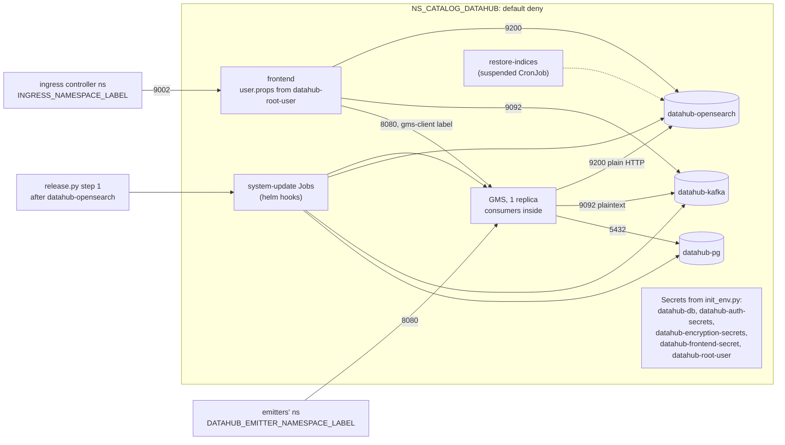

# ADR-071: Datahub runs from upstream's chart, unchanged: GMS with its consumers, the frontend and system-update on its three stores, with credentials from init-env

- **Status:** Accepted
- **Date:** 2026-10-18
- **Related:** ADR-004, ADR-006, ADR-009, ADR-016, ADR-025, ADR-039, ADR-045, ADR-048, ADR-050, ADR-051, ADR-052, ADR-059, ADR-066, ADR-068, ADR-069, ADR-070

## Context

**Datahub's three stores are on `main`** (P3, `docs/plans/roadmap.md`), each with a smoke check:
datahub-pg (ADR-066), datahub-kafka (ADR-068, ADR-069) and datahub-opensearch (ADR-070). Datahub
itself comes next. What is already decided:
- **ADR-025:** Datahub runs in `NS_CATALOG_DATAHUB` from Datahub's official `datahub` chart, kept
  as a local copy, as Polaris's (ADR-009). The prerequisites chart is not used. Login goes
  through SSO over OIDC; ingestion of Polaris uses a read-only principal; the metadata moves from
  the target clusters' PostgreSQL-HA by a runbook. Its consequences put the recovery of Datahub's
  topics after the broker's volume is lost in the smoke gate.
- **ADR-068 §5 and ADR-070's consequences** defer two recoveries to Datahub's chart: the topics
  recreated after Kafka's volume is lost, and the indices rebuilt from the database after
  OpenSearch's volume is lost.
- **ADR-045 step 1:** Datahub comes after its network policies and its three stores, each ready.
- **ADR-048 §3:** the frontend's HTTP port open to the ingress controller's namespace, GMS's API
  port to lineage emitters' namespaces and Datahub's own pods; §2 gives the emitters a namespace
  label "with Datahub's chart".
- **The stores' clients:** datahub-pg on 5432 for pods labelled `lakehouse/datahub-pg-client`,
  with the Secret `datahub-db` (user `datahub`) from `init_env.py`; datahub-kafka on 9092,
  plaintext, for `lakehouse/datahub-kafka-client`, with a 5 MiB `message.max.bytes`;
  datahub-opensearch on 9200, plain HTTP without login, for
  `lakehouse/datahub-opensearch-client`, and Datahub's chart is to set
  `ELASTICSEARCH_NUM_REPLICAS_PER_INDEX` to 0 and `global.elasticsearch.host` to
  `datahub-opensearch` (ADR-070).

**Datahub's chart** (`acryldata/datahub-helm`, tag `datahub-1.1.7`, commit `19ca74e`,
`charts/datahub`, read on 2026-10-18):
- **Version 1.1.7, appVersion `v1.7.0`, but `global.datahub.version: v1.7.0.1`:** its images
  default to the tag `v1.7.0.1`.
- **Components:** the subcharts `datahub-gms`, `datahub-frontend`, `acryl-datahub-actions`
  (enabled by default), `datahub-mae-consumer` and `datahub-mce-consumer` (only when
  `global.datahub_standalone_consumers_enabled`, false by default, so GMS runs the consumers
  itself), and `datahub-ingestion-cron` (off).
- **The system-update Jobs:** with `consolidatedUpgrade: true` (the default), a blocking
  `SystemUpdateBlocking` Job, a `pre-install,pre-upgrade` hook, creates the SQL tables, the
  indices and the Kafka topics (`precreateTopics: true`). A non-blocking `post-install,post-upgrade`
  Job does the rest. They run under a ServiceAccount of their own, bound to a `Role` in the
  release's namespace (Deployments, Jobs, ConfigMaps). The legacy setup Jobs are off. With
  `zdu.enable: true`, the v1.7 default, the scale-down step is off.
- **Restore-indices:** a suspended `CronJob` template, rendered only when `datahubUpgrade.enabled`
  (false by default), from which a Job is created by hand to replay the database into the indices.
- **Images:** `registry/repository:tag`, from `global.imageRegistry` (`docker.io`) and each
  component's `image.tag`, or the global version. There is no digest field. Polaris's values pin
  `tag: "1.6.0@sha256:…"`, which the same form accepts.
- **Pod labels:** the Deployments take `global.podLabels` and their own `extraPodLabels`; the hook
  Jobs and the restore-indices template take `global.podLabels` only.
- **Services:** GMS on 8080 and the frontend on 9002, both `type: LoadBalancer` by default.
- **Values schema:** `values.schema.json` exists, but does not refuse an unknown key.
- **Stores:** `global.sql.datasource` (host, URL, driver, username, password by `secretRef` and
  `secretKey`); `global.kafka.bootstrap.server`; `global.kafka.maxMessageBytes`,
  `producer.maxRequestSize` and `consumer.maxPartitionFetchBytes`, all `5242880`;
  `schemaregistry.type: INTERNAL`; `global.elasticsearch.host`, `port: "9200"`, `useSSL: "false"`,
  no `auth`. `datahubSystemUpdate.sql.setup.createDatabase` is true by default.
  `ELASTICSEARCH_NUM_REPLICAS_PER_INDEX` has no value of its own; each component has `extraEnvs`.
- **Credentials the chart makes itself:**
  - `datahub-auth-secrets` (`system_client_secret`, `token_service_signing_key`,
    `token_service_salt`) and `datahub-encryption-secrets` (`encryption_key_secret`), as hooks,
    from `randAlphaNum` unless `lookup` finds them in the cluster. Both can be turned off and named.
  - The frontend's `<release>-gms-secret`, from `randAscii 32` with no `lookup`, so a new value on
    every render, unless `existingGmsSecret` names one.
  - The frontend's users: with `defaultUserCredentials` empty, the image's own `user.props`.

**Datahub itself** (`datahub-project/datahub`, tag `v1.7.0`, commit `7f81ccb`):
- **`datahub-frontend/conf/user.props` is `datahub:datahub`:** the root user's password, unless
  the file is replaced.
- **`application.yaml`:** topics with `PARTITIONS` and `REPLICATION_FACTOR` 1 and
  `max.message.bytes` 5242880 (`MAX_MESSAGE_BYTES`); indices with one replica
  (`ELASTICSEARCH_NUM_REPLICAS_PER_INDEX`, default 1). GMS waits at start for system-update's
  message for its version on `DataHubUpgradeHistory_v1`
  (`BOOTSTRAP_SYSTEM_UPDATE_WAIT_FOR_SYSTEM_UPDATE`, default true), so a lost topic keeps it from
  starting until system-update runs again.
- **The SQL setup on PostgreSQL** (`datahub-upgrade`, `PostgresDatabaseOperations.java`) checks
  `pg_database` before a `CREATE DATABASE`, and creates its tables with `IF NOT EXISTS`.
- **`docs/how/restore-indices.md`:** `RestoreIndices` replays each aspect's latest version from
  `metadata_aspect_v2` as change-log events, which rebuild the search and graph indices.

**`v1.7.0.1`** (tag `v1.7.0.1`, commit `e99431e`) is 40 commits after `v1.7.0`: security fixes,
dependency updates for CVEs, authorization fixes and a few performance backports. Docker Hub has
`acryldata/datahub-gms`, `datahub-frontend-react`, `datahub-upgrade`, `datahub-actions`,
`datahub-mae-consumer` and `datahub-mce-consumer` at `v1.7.0.1`, pushed on 2026-09-03.

**What is not decided:** the version, the chart's shape and components, the images, how it reaches
its stores, its network rules, its credentials, its place in the install, and what smoke proves.

Kade's choices (2026-10-18):
- `v1.7.0.1`, the chart's default;
- upstream's chart unchanged with our values;
- GMS with its consumers, the frontend and system-update; actions not until ingestion;
- every Datahub pod labelled as a client of the three stores;
- the frontend open to the ingress namespace, GMS to Datahub's pods and an emitters' namespace
  label;
- every credential from `init_env.py`, none generated by the chart;
- the install after datahub-opensearch, waiting on helm;
- a smoke check of an entity round trip in the first code PR; the recoveries decided here, in a
  second.

## Decision

ADR-025 stands. This ADR decides what it leaves open for Datahub itself.

### 1. Upstream's chart, unchanged, at `v1.7.0.1`

- **`charts/datahub` is a local copy of `datahub-helm`'s `datahub` chart 1.1.7**, with its
  subcharts, taken unchanged from tag `datahub-1.1.7`, and our `values-lakehouse.yaml` beside it,
  as ADR-009 keeps Polaris's and ADR-070 OpenSearch's. The release is `datahub`.
- **Datahub `v1.7.0.1`** (Kade), the chart's own default. The chart and the images move together:
  an upgrade is a PR of its own, through the gates.
- **The chart test** (ADR-016) checks that every key in `values-lakehouse.yaml` exists in
  upstream's values, since its schema does not refuse an unknown one. It checks the rendered
  output for every value this section and §2 to §5 set.

### 2. Its components

| Component | Runs | Why |
|---|---|---|
| GMS, `datahub-gms` | 1 replica, its MCE, MAE and platform-event consumers inside it | The chart's default. Standalone consumers are needed only for several GMS with managed ingestion. |
| The frontend, `datahub-frontend` | 1 replica | Datahub's UI and its login |
| System-update | the blocking Job (pre-install, pre-upgrade) and the non-blocking Job (post-install, post-upgrade), upstream's ZDU defaults | Creates and migrates the tables, the indices and the topics |
| Restore-indices | its `CronJob` template, suspended (`datahubUpgrade.enabled: true`) | The tool §6 uses to rebuild the indices |
| `datahub-mae-consumer`, `datahub-mce-consumer` | no | Inside GMS |
| `acryl-datahub-actions` | no, until ingestion enters | Its executor installs ingestion packages from PyPI at run time; the ingestion PR decides how ingestion runs |
| `datahub-ingestion-cron`, `datahubSystemCronHourly` | no | Upstream's defaults; ingestion decides the first, and upstream marks the second not ready |

- **Managed ingestion is off** (`global.datahub.managed_ingestion.enabled: false`) while no
  executor runs.
- **System-update keeps upstream's ServiceAccount and its `Role`** in `NS_CATALOG_DATAHUB` only.
- **Upstream's probes, security contexts (non-root, user 1000) and resources stay**, as tuning
  values: GMS 1 GiB requested and a 2 GiB limit, the frontend 512 MiB and 1400 MiB, system-update
  2 GiB. A measurement that shows they matter changes them in the values.
- **GMS's and the frontend's Services are `ClusterIP`.**

### 3. Images, by digest

- **Each image runs by tag and digest,** set as `image.tag: "v1.7.0.1@sha256:…"` per component, as
  Polaris's values do: `acryldata/datahub-gms`, `acryldata/datahub-frontend-react` and
  `acryldata/datahub-upgrade` (system-update and restore-indices). `global.imageRegistry` stays
  `docker.io`.
- **Docker Hub's index digests, read on 2026-10-18:**

  | Image | Digest |
  |---|---|
  | `datahub-gms:v1.7.0.1` | `sha256:74e15e982b94d0e147de41d05133ef3df48f74a1004a9c997805e0aa7e010173` |
  | `datahub-frontend-react:v1.7.0.1` | `sha256:99513cc1c45e4cc053ceb0f9aeb04a3263a8a747907bb0e85cac2eb03461310d` |
  | `datahub-upgrade:v1.7.0.1` | `sha256:c3db54d8fb94bc761be611c014c5ede3fd02daac1f15c8c177d69eceee79a24c` |

  The code PR reads them again and pins what it reads then. The chart test checks that every
  rendered container image carries a digest.

### 4. Its stores

- **datahub-pg:** `global.sql.datasource` names `datahub-pg-rw:5432`, the URL
  `jdbc:postgresql://datahub-pg-rw:5432/datahub`, the driver `org.postgresql.Driver`, the user
  `datahub`, and the password from the Secret `datahub-db`, key `password`.
  `datahubSystemUpdate.sql.setup.createDatabase` and `createUser` are false: datahub-pg's chart
  creates the database and its owner (ADR-066 §2).
- **datahub-kafka:** `global.kafka.bootstrap.server: datahub-kafka:9092`, plaintext, the internal
  schema registry. `maxMessageBytes`, `producer.maxRequestSize` and
  `consumer.maxPartitionFetchBytes` stay `5242880`, the broker's `message.max.bytes`
  (ADR-068 §2). The topics get one partition and replication factor 1, Datahub's defaults for one
  broker. The broker does not create topics itself, so system-update must create each one.
- **datahub-opensearch:** `global.elasticsearch.host: datahub-opensearch`, `port: "9200"`,
  `useSSL: "false"`, no `auth`, no index prefix. `ELASTICSEARCH_NUM_REPLICAS_PER_INDEX=0` goes in
  `extraEnvs` of GMS and of system-update, which creates the indices (ADR-070).
- **Every Datahub pod carries the clients' labels** (Kade), in `global.podLabels`:
  `lakehouse/datahub-pg-client`, `lakehouse/datahub-kafka-client`,
  `lakehouse/datahub-opensearch-client` and `lakehouse/datahub-gms-client` (§5), all `"true"`.
  The hook Jobs take no other labels, and they use all three stores. The frontend reaches Kafka
  (its tracking topic) and OpenSearch (analytics) itself.

### 5. Its network rules

`charts/datahub-network-policies` gains two rules (ADR-048 §3's Datahub rows, with their ports
and callers named):

| Target | Port | Allowed from |
|---|---|---|
| The frontend's pods | 9002 | the ingress controller's namespace (`INGRESS_NAMESPACE_LABEL`) |
| GMS's pods | 8080 | pods labelled `lakehouse/datahub-gms-client: "true"` in this namespace; the lineage emitters' namespaces (`DATAHUB_EMITTER_NAMESPACE_LABEL`) |

- **`DATAHUB_EMITTER_NAMESPACE_LABEL`,** a new `.env` value, is the emitters' caller class
  (ADR-048 §2): one `key=value` namespace label. Empty means no namespace of that class may
  connect, and the install says so.
- **No Ingress or route for the frontend yet:** it enters with the SSO login.
- **Metrics ports (4318, 4319) get no rule;** they join with Datahub's scrape contract (P5).
- The gate's check label still reaches every port (ADR-048 §5).

### 6. Its credentials

- **Every credential comes from `init_env.py`** (Kade, ADR-006); the chart generates none.
  `.env` gains six values, generated per clone and left empty in `.env.template`:

  | `.env` | Secret, key | Read by |
  |---|---|---|
  | `DATAHUB_SYSTEM_CLIENT_SECRET` | `datahub-auth-secrets`, `system_client_secret` | GMS, the frontend, system-update |
  | `DATAHUB_TOKEN_SIGNING_KEY` | `datahub-auth-secrets`, `token_service_signing_key` | GMS, system-update |
  | `DATAHUB_TOKEN_SALT` | `datahub-auth-secrets`, `token_service_salt` | GMS, system-update |
  | `DATAHUB_ENCRYPTION_KEY` | `datahub-encryption-secrets`, `encryption_key_secret` | GMS |
  | `DATAHUB_FRONTEND_SECRET` | `datahub-frontend-secret`, `secret` | the frontend (`existingGmsSecret`) |
  | `DATAHUB_ROOT_PASSWORD` | `datahub-root-user`, `user.props`, as `datahub:<password>` | the frontend |

- **The values turn the chart's own off:** `metadata_service_authentication.provisionSecrets` and
  `encryptionKey.provisionSecret` disabled, with upstream's Secret names and keys;
  `existingGmsSecret` names `datahub-frontend-secret`. `datahub-root-user` is mounted over the
  image's `/datahub-frontend/conf/user.props` through the frontend's `extraVolumes` and
  `extraVolumeMounts`, so the image's `datahub:datahub` never applies.
- **`init_env.py --apply-secrets`** creates the four Secrets in `NS_CATALOG_DATAHUB`, beside
  `datahub-db`.

### 7. The install

**`install/release.py` step 1, Datahub's part** (ADR-045), after `datahub-opensearch`:
1. it stops when `datahub-auth-secrets`, `datahub-encryption-secrets`, `datahub-frontend-secret`
   or `datahub-root-user` is missing or lacks its keys, reading key names only;
2. it says so when `DATAHUB_EMITTER_NAMESPACE_LABEL` is empty, and goes on;
3. `helm upgrade --install datahub` with `values-lakehouse.yaml` and `--wait`. Helm runs the
   pre-install hooks first: the ServiceAccount and its `Role`, then the blocking system-update Job,
   which must complete. It then waits for GMS and the frontend to be ready, and for the
   non-blocking Job to complete. A failed or timed-out step stops the install.

### 8. What the smoke gate proves

**In the first code PR:** a new `gate.py check-datahub`, its own step in `smoke.yml` after
`check-datahub-opensearch`. It runs from a pod in `NS_CATALOG_DATAHUB` labelled
`lakehouse/datahub-gms-client: "true"`, without the gate's check label:
- **Installed:** both system-update Jobs completed, and GMS's `/health` answers.
- **A round trip through every store:** as the system client, it writes a dataset with one aspect
  through GMS, reads it back by its URN (datahub-pg), and finds it by search within a time limit
  set in the code (the change log through Kafka, indexed in OpenSearch).
- **The root user:** the frontend signs in `datahub` with the password from `datahub-root-user`,
  and refuses `datahub:datahub`.
- **Clean-up:** it hard-deletes the dataset.

`check-network` adds the rules' cases (ADR-048 §6):
- 8080 allowed from a pod with the GMS client label and from a namespace with the emitters' label;
  refused from an unlabelled pod in `NS_CATALOG_DATAHUB` and from the unlabelled namespace;
- 9002 allowed from the ingress namespace; refused from the unlabelled and the emitters'
  namespaces.

**In a second code PR:** `gate.py check-datahub-recovery`, after `check-datahub`, gate only
(ADR-004), since it deletes volumes. It writes one dataset, then:
- **OpenSearch's volume lost** (ADR-070): it deletes datahub-opensearch's PVC and pod. Once the node
  is ready and empty, it runs Datahub's install step again, whose system-update creates the
  indices, then a Job from the restore-indices template. The dataset is then found by search again.
- **Kafka's volume lost** (ADR-025, ADR-068 §5): it deletes datahub-kafka's PVC and pod, and the
  broker formats a new volume (ADR-069). It runs Datahub's install step again, whose system-update
  recreates the topics and the upgrade-history message, then deletes GMS's pod. GMS starts and is
  ready, the first dataset still reads back by URN, and a second dataset is found by search.
- **Clean-up:** it hard-deletes both datasets.

### 9. Left to later PRs

Each with an ADR of its own where it decides something new:
- **Ingestion of Polaris's catalog** with its own read-only Polaris principal (ADR-025), and how
  ingestion runs: actions, a CronJob, or the gate; the ingestion run of P3's gate.
- **SSO login** over OIDC against a stand-in on the gate (`DATAHUB_OIDC_ISSUER_URL`), with the
  frontend's route.
- **The metadata migration runbook** from the target clusters' PostgreSQL-HA, proven on a Linux
  test cluster (ADR-025, ADR-052).
- **Datahub's metrics** in the scrape contract (P5).
- **Seeded Datahub objects** for `check-migration` (ADR-051), once a release carries Datahub.

## Diagram

## Alternatives considered

**The chart and version:**

| Option | Why not |
|---|---|
| **A chart of our own** | ADR-025 names the official chart; ours would supersede it and track hundreds of environment variables across GMS, the frontend and the Jobs at every upgrade. |
| **Exactly `v1.7.0`** | 40 commits of security and authorization fixes behind, and not the images chart 1.1.7 defaults to. |
| **Standalone MAE and MCE consumers** | Two more Deployments and images (about 1.4 GB for amd64) to process the same topics; they matter only for several GMS replicas with managed ingestion. |
| **Actions now** | An executor with no ingestion to run, which installs packages from PyPI at run time; the ingestion PR decides whether it runs at all. |
| **Datahub's PostgreSQL transport for its events** (`DATAHUB_MESSAGING_TRANSPORT`) | ADR-025 and ADR-068 chose Kafka; a change would be a decision of its own. |

**Credentials:**

| Option | Why not |
|---|---|
| **The chart's own Secrets** | Credentials not from `init_env.py` (ADR-006). `lookup` returns nothing under `helm template` or a client dry-run. The frontend's secret changes on every upgrade, signing every user out, and the root user keeps `datahub:datahub`. |
| **`defaultUserCredentials.manualValues`** | The root password would sit in the values file, and the chart renders it into a Secret of its own. |

**Labels:**

| Option | Why not |
|---|---|
| **Per component, through `extraPodLabels`** | The hook Jobs take only `global.podLabels`, and they need all three stores; only the frontend would lose the PostgreSQL label. |

**The smoke gate:**

| Option | Why not |
|---|---|
| **GMS healthy only** | Proves none of the paths to the stores. |
| **The recoveries in the first code PR** | A larger first PR and a longer smoke while the install itself is still unproven. |
| **Defer the recoveries again** | ADR-025 makes Kafka's part of the smoke gate, and ADR-068 and ADR-070 deferred them to this chart. |

## Consequences

- **One GMS has no redundancy.** A restart or a drain stops Datahub's API and UI until it is ready
  again, which takes minutes (upstream's readiness probe starts at 120 s).
- **Each gate install pulls three more large images** (about 2.7 GB for amd64 on Docker Hub) and
  starts GMS, the frontend and the Jobs beside Polaris and the three stores, on a 16 GB runner
  within smoke's 40 minutes. The first runs give the numbers; if the runner cannot hold them,
  that is a change of its own.
- **Every install and upgrade needs the six new `.env` values,** plus
  `DATAHUB_EMITTER_NAMESPACE_LABEL` where emitters exist, and `--apply-secrets` run with the
  release's `init_env.py`. Step 1 stops otherwise. The release notes say so.
- **`DATAHUB_ENCRYPTION_KEY` never changes once set:** GMS encrypts the secrets users store with
  it in datahub-pg. `init_env.py` keeps a value already in `.env`; a rotation is a runbook.
- **The first release with Datahub installs it fresh** on the gate's upgrade path, since the last
  release has none; `check-migration` covers Datahub once a release carries it (ADR-051).
- **Code follows once this ADR is Accepted,** in two PRs, each opened as a draft because it changes
  `smoke.yml` (ADR-059). Each touches `charts/`, `install/` or `gates/`, so it needs dry-run and
  smoke on its head; the first adds a chart and changes `install/` and `init_env.py`, so it also
  needs smoke-fresh (ADR-039, ADR-050):
  1. `charts/datahub` (upstream's 1.1.7 unchanged, `values-lakehouse.yaml`,
     `charts/test_datahub.py`); `charts/datahub-network-policies`' GMS and frontend rules;
     `.env.template` and `scripts/init_env.py`; `install/release.py`'s step 1; `gates/gate.py`'s
     `check-datahub`, `gates/network.py`'s cases and `smoke.yml`'s step; `CLAUDE.md`'s layout and
     `docs/plans/roadmap.md`'s P3;
  2. `gates/gate.py`'s `check-datahub-recovery` and its step in `smoke.yml`.
