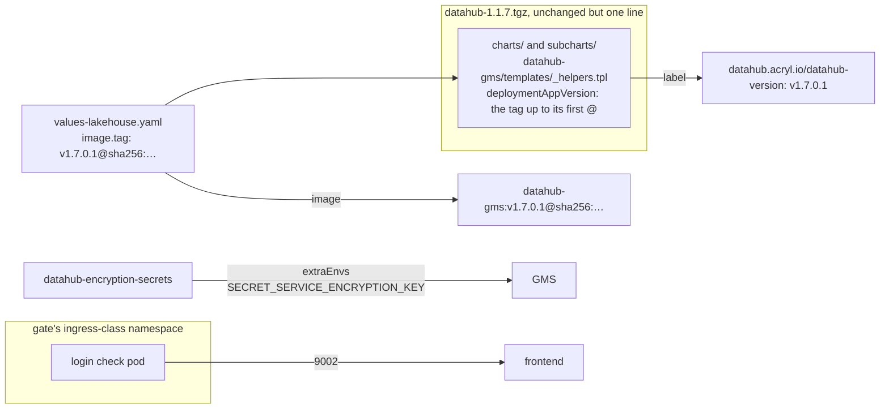

# ADR-072: Datahub's chart gets one patched line so GMS runs by digest, and three of ADR-071's details follow the chart as it is

- **Status:** Proposed
- **Date:** 2026-10-18
- **Related:** ADR-006, ADR-009, ADR-016, ADR-048, ADR-071

## Context

**ADR-071's first code PR read upstream's chart again** on 2026-10-18 before writing any code:
- `acryldata/datahub-helm`, tag `datahub-1.1.7`, commit `19ca74e`, which is also its `master`;
- the tag's release archive `datahub-1.1.7.tgz`, whose sha256
  `9df268aad539c6b26bc266be21be6b9e86829ca68a1ac9410890de7a704debac` equals the digest
  in the chart repository's index.

The archive is the chart helm renders as it is: its `charts/` holds the six subcharts unpacked,
with `Chart.lock`. The git tree has them only under `subcharts/`, as `file://` dependencies that
need `helm dependency build`. The archive also keeps `subcharts/`, so each subchart is there twice.
ADR-071 §1's copy is that archive, as ADR-070's is OpenSearch's.

Four points of ADR-071 do not hold against that chart. ADR-071 is Accepted, so this record amends
it. ADR-000 §6 lets an amended ADR only be superseded whole, so the four go in one record.

**1. GMS cannot run by digest with the chart unchanged** (ADR-071 §1, §3):
- **The label:** `charts/datahub-gms/templates/_helpers.tpl`, line 39, defines
  `datahub-gms.deploymentAppVersion` as `.Values.image.tag | default .Values.global.datahub.version`.
  `datahub-gms.applicationVersionLabels` writes it as the label `datahub.acryl.io/datahub-version`
  on GMS's Service, its Deployment and its pod template.
- **Why it fails:** with ADR-071 §3's `image.tag: "v1.7.0.1@sha256:…"`, that label's value is 80
  characters with `@` and `:`. A label value has at most 63 characters, from letters, digits, `-`,
  `_` and `.`. The API server refuses all three objects.
- **No value avoids it:** the image is always written as `registry/repository:tag`
  (`datahub.image` in `templates/_helpers.tpl`), so the digest can only go in `image.tag`.
- **Only GMS:** the frontend and `datahub-upgrade` have no such label. Their images run by tag and
  digest unchanged.

**2. GMS does not receive the encryption key** (ADR-071 §6):
- `charts/datahub-gms/templates/deployment.yaml` sets `SECRET_SERVICE_ENCRYPTION_KEY` only while
  `global.datahub.managed_ingestion.enabled` is true, and ADR-071 §2 turns that off.
- Without the variable, GMS falls back to the literal `ENCRYPTION_KEY`
  (`metadata-service/configuration/src/main/resources/application.yaml`, `secretService`, Datahub
  tag `v1.7.0`, commit `7f81ccb`).
- So the table's "read by GMS" for `DATAHUB_ENCRYPTION_KEY` would not hold, and anything GMS
  encrypted before managed ingestion entered would use a key that is public.

**3. Some values exist only in upstream's templates** (ADR-071 §1's key check). Upstream's
`values.yaml` lacks these keys, or has them only in comments, yet its templates read them:
- `global.podLabels` (§4);
- `datahubSystemUpdate.extraEnvs` (§4);
- `datahubSystemUpdate.image.tag` and `datahubUpgrade.image.tag` (§3);
- `datahub-frontend.existingGmsSecret` (§6).

A check that a key "exists in upstream's values" would refuse them.

**4. The login check cannot reach the frontend from where §8 runs it:**
- **The rule:** ADR-071 §5 opens the frontend's 9002 to the ingress controller's namespace only.
- **The check:** ADR-071 §8 runs check-datahub from a pod in `NS_CATALOG_DATAHUB` without the
  gate's check label, which that rule refuses.

## Decision

**Amends ADR-071 §1 (the copy "unchanged", its key check), §3, §6 and §8.** Nothing else of
ADR-071 changes.

### 1. One patched line in GMS's subchart

- **The patch:** `datahub-gms.deploymentAppVersion` drops everything from the first `@` of the tag:
  `{{- .Values.image.tag | default .Values.global.datahub.version | splitList "@" | first -}}`.
- **Its effect:** the label reads `v1.7.0.1`, and GMS's image is
  `docker.io/acryldata/datahub-gms:v1.7.0.1@sha256:…`, as ADR-071 §3 pins it.
- **Where:** the line changes in both copies, `charts/datahub-gms/templates/_helpers.tpl`, which
  helm renders, and `subcharts/datahub-gms/templates/_helpers.tpl`, which `Chart.yaml`'s `file://`
  dependency names. The two copies stay identical.
- **Every other file of the archive stays unchanged.** The patch is its own commit, after the copy.
- **The chart test proves the patch is the only change.** It fetches the release archive by its
  URL and sha256, pinned in `gates/pins.json` as the kubeconform schemas are. It then compares:
  every other file of `charts/datahub` equals the archive's, byte for byte, with none added or
  missing; each helper differs from the archive's in line 39 alone, which is the patched line.
- **It also checks the rendered result:** the label is the version alone, and GMS's image keeps
  its digest.
- **An upgrade of the chart reapplies the line,** or drops it once upstream accepts a tag with a
  digest.

### 2. GMS receives the encryption key from our values

- **The variable:** GMS's `extraEnvs` set `SECRET_SERVICE_ENCRYPTION_KEY` from the Secret
  `datahub-encryption-secrets`, key `encryption_key_secret`.
- **Why:** ADR-071 §6's table holds while managed ingestion is off, and GMS never encrypts with its
  built-in key.
- **The chart test checks it:** the variable comes from that Secret and key, once only.

### 3. The key check also knows what upstream's templates read

- **Upstream's values:** every key in its `values.yaml`, with each subchart's `values.yaml` under
  the subchart's name;
- **Upstream's templates:** every `.Values.<path>` its templates read, a subchart's under the
  subchart's name, and `global` from any of them;
- **Pass-through objects:** keys inside a Kubernetes object the chart passes through as it is, such
  as `resources`, are checked by kubeconform's strict schemas, as ADR-070's test does.

A key in neither of the first two, or one misspelt, still fails the test.

### 4. The login is checked from the ingress namespace

- **Where it runs:** check-datahub's root-user part runs from a pod in the gate's ingress-class
  namespace, labelled with the gate's `INGRESS_NAMESPACE_LABEL`, without the check label. The
  gate creates that namespace if it does not exist yet.
- **The password:** the gate reads it from `datahub-root-user` and sends it to that pod on stdin.
  It is never printed or put on a command line.
- **The rest of check-datahub runs as ADR-071 §8 says:** from a pod in `NS_CATALOG_DATAHUB`
  labelled `lakehouse/datahub-gms-client`.

## Diagram

## Alternatives considered

**GMS's image (Kade chose the patch, 2026-10-18):**

| Option | Why not |
|---|---|
| **GMS by tag only, with the pulled digest checked after install** | It detects a moved tag only after GMS has started with the database's credentials. |
| **Our own label of the same name through `extraPodLabels`** | Writes the key twice in the pod template, and cannot reach the Service's or the Deployment's labels. |
| **A post-renderer** | Helm 4 runs post-renderers only as plugins: a plugin to keep in step with helm, for one label. |
| **Wait for upstream** | Its `master` is the tag. Datahub would wait on another project's release. |

**The login check:**

| Option | Why not |
|---|---|
| **The check label on the pod** | Proves nothing about the rule the frontend has. |
| **A port-forward from the runner** | Bypasses the network policy altogether. |

## Consequences

- **Every upgrade of the chart reapplies the patched line:** two files, one line each. The upgrade
  also moves the archive's pin in `gates/pins.json`. The chart test fails until all three are done,
  or until upstream's helper accepts a digest.
- **The ingestion PR, enabling managed ingestion,** drops the `extraEnvs` entry, since upstream then
  sets the same variable from the same Secret.
- **The code PR for ADR-071** (the first of its two) follows this ADR once Accepted:
  - the copy and the patch are separate commits;
  - the key check is as §3 says;
  - check-datahub's login is as §4 says.
- **ADR-071 becomes `Amended by ADR-072`** in the commit that accepts this one.
