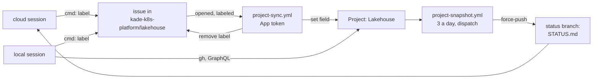

# ADR-073: State moves to a Project of the kade-k8s-platform organization, fed by this repository's own bridge; labels become requests

- **Status:** Accepted
- **Date:** 2026-10-18
- **Related:** ADR-002, ADR-003, ADR-030, ADR-059, ADR-074

## Context

ADR-003 keeps state in labelled issues of `enjay27/lakehouse`, a repository on a personal
account. Three labels are state: `cmd:status-now`, `cmd:verify-not-verified` and
`cmd:verify-needs-linux`. ADR-003 also says that moving to an organization later keeps these
issues and is a new ADR that amends it. On 2026-10-18 the repository has 12 open issues, 5 of
them carrying one of these labels: 3 `cmd:verify-needs-linux`, 1 `cmd:verify-not-verified`
and 1 `cmd:status-now`.

Kade's other repositories keep state in an organization Project fed by `cmd:` labels. A bridge
App sets the Project's fields from each label and then removes it, and a scheduled workflow
writes the Project to `STATUS.md` on a `status` branch. Labels there are requests, not state.
Kade wants this repository on a board too: priority and dates, one view, and `STATUS.md` for
the sessions that cannot read the board.

Three facts shape how:

- **Cloud sessions cannot reach the Project API.** Their proxy refuses GraphQL and the
  `projectsV2` REST endpoints. Endpoints under one repository work: labels, and starting a
  workflow. So a cloud session writes with labels and reads `STATUS.md`.
- **An App cannot reach a Project on a personal account.** GitHub's user-owned Project
  endpoints refuse GitHub App installation tokens. A Project fed by an App must belong to an
  organization.
- **This repository's bridge must stand alone.** star-resonance/.github#5 let this repository
  use star-resonance's App and Project, through a `project-owner` input, while staying on the
  personal account. It was reverted in #6. Kade's decision (2026-10-18): an organization of
  this repository's own, `kade-k8s-platform`, with its own Project and its own App, and nothing
  mixed with star-resonance's App, Project or workflows.

What exists when this ADR is written:

- **The organization** `kade-k8s-platform`, on GitHub's free plan, with no repositories and
  no Apps.
- **Its Project 1, "Lakehouse"**, which holds no items yet. It was made with Kade's `gh` login
  on 2026-10-18 and has exactly the fields named in §2.
- **The bridge to adapt:** star-resonance/.github `scripts/project_bridge.py` at `3396a33`
  (MIT, Kade's), with its tests (119 pass). It has three commands: `sync`, `snapshot` and
  `backfill`, the last of which adds a repository's open issues and applies their labels.
- **A backfill dry run of this repository**, read only and run against a Project given
  "Needs Linux test cluster": 12 open issues, 5 fields set and 5 labels removed. None of the
  labels was added by someone without write access, and none was unknown. Against a Project
  without that option, the same dry run stopped with nothing written and named the 3 issues.

## Decision

1. **The repository moves to `kade-k8s-platform/lakehouse`** by GitHub's transfer, after this
   ADR is accepted. Issues, PRs, releases, tags, labels and Actions history move with it.
   GitHub redirects the old URLs, so links in ADRs, measurements and the roadmap are not
   rewritten. It stays public (ADR-002). The image registry is ADR-074's.
2. **The Project "Lakehouse"** (`kade-k8s-platform` Project 1) holds every issue of this
   repository, with these fields:

   | Field | Options |
   |---|---|
   | Status | Backlog, Next, Now, In review, Done |
   | Verification | Verified, NOT VERIFIED, Needs Linux test cluster |
   | Priority | P1, P2, P3 |
   | Start, Target | dates |

   Verification is independent of Status. A closed issue keeps "Needs Linux test cluster" or
   "NOT VERIFIED" until it is set to Verified.
3. **Labels become requests.** A command label sets one field and is then removed:

   | Label | Sets |
   |---|---|
   | `cmd:status-backlog`, `-next`, `-now`, `-in-review`, `-done` | Status |
   | `cmd:verify-verified`, `cmd:verify-not-verified`, `cmd:verify-needs-linux` | Verification: Verified, NOT VERIFIED, Needs Linux test cluster |
   | `cmd:priority-p1`, `-p2`, `-p3` | Priority |

   The bridge applies a command only from someone with write access. From anyone else, it
   removes the label without applying it. A `cmd:` label it does not know stays on the issue
   and is reported. A decision that is Kade's is still an issue assigned to him, with no label;
   `STATUS.md` lists those under "Waiting on Kade".
4. **This repository's own bridge App**, owned by `kade-k8s-platform` and installed there on
   this repository only. Its permissions: organization Projects read and write, issues read,
   pull requests read, metadata read. Kade makes it and holds its key:
   - its client ID is the repository variable `BRIDGE_APP_CLIENT_ID`;
   - the Project's number is the variable `PROJECT_NUMBER`;
   - its private key is the repository secret `BRIDGE_APP_PRIVATE_KEY`, and exists nowhere
     else: never in a commit (ADR-002), never in a session.
5. **The bridge lives in this repository and calls nothing outside it.**
   `scripts/project_bridge.py` and its tests are adapted from the file named in the Context,
   which is cited, never called. Its only Verification environment is
   "Needs Linux test cluster". Two workflows, neither reusable:
   - **`project-sync.yml`** runs `sync` when an issue is opened, reopened or labelled. It needs
     `issues: write` and is skipped while `PROJECT_NUMBER` is empty.
   - **`project-snapshot.yml`** runs `snapshot` three times a day and by `workflow_dispatch`.
     It force-pushes one generated commit with `STATUS.md` to the `status` branch, and needs
     `contents: write`.

   Neither checks out, calls or shares a secret with a star-resonance repository. Logs never
   print issue titles (ADR-002). `STATUS.md` carries titles, which are already public.
6. **Sessions:**
   - **A local session** reads the Project with Kade's `gh` login, or `STATUS.md`.
   - **A cloud session** reads `STATUS.md` with
     `git fetch origin status && git show origin/status:STATUS.md`, and starts
     `project-snapshot.yml` when it needs fresh state.
   - **Both** write with command labels, and close issues with `Closes #N` in their PRs.
7. **The open issues join once.** After the implementation PR merges, Kade's `gh` login runs
   `project_bridge.py backfill` for this repository: first with `--dry-run`, then for real.
8. **Unchanged from ADR-003:** work, open questions and unverified items are issues of this
   repository. The PR is the session record, decisions go to ADRs, measurements go to
   `docs/measurements/`, and nothing private is written in an issue.

## Diagram

## Alternatives considered

- **Labels as state (ADR-003):** no board, priority or dates. The account's skills already
  read `STATUS.md` in Kade's other repositories, but here they read labels.
- **star-resonance's App and Project**, with this repository on the personal account
  (star-resonance/.github#5): this repository's state would depend on another organization's
  App key and workflows. Reverted in #6, at Kade's direction.
- **A Project on the personal account, fed by a personal access token:** App tokens cannot
  reach it. A classic token with the `project` scope in an Actions secret would be a
  long-lived credential for Kade's whole account, much broader than an App installed on one
  repository.
- **A shared bridge in a `kade-k8s-platform/.github` repository:** it pays only once a second
  repository joins the organization. A later ADR can move the bridge there.

## Consequences

- **Code follows once this ADR is Accepted,** in one draft PR that Kade merges, because it
  changes `.github/workflows/` and `CLAUDE.md` (ADR-030, ADR-059). It holds:
  - the bridge and its tests (the `scripts/` gate) and the two workflows;
  - `.github/labels.json` with the 11 command labels, and `scripts/test_labels.py` following
    it;
  - `CLAUDE.md`'s State section;
  - the lines that tell a reader to label an issue `cmd:verify-needs-linux` (`CLAUDE.md`, the
    roadmap, `docs/runbooks/stress-capacity.md`), which say "Needs Linux test cluster";
  - the index's *What is next* line.
- **Kade's steps:**
  - before the move, he makes the App and installs it;
  - after the move, he sets the two variables and the secret;
  - he installs the Claude GitHub App on `kade-k8s-platform` for cloud sessions, which reach
    this repository through it;
  - local clones may keep their old `origin` URL, since GitHub redirects it.
- **Verified only on GitHub:** a test issue with a command label, followed by a
  `project-snapshot` run, proves the App, the two workflows and the variables together.
- **Upkeep:** one App and its key to rotate, and three snapshot runs a day.
- **ADR-003 becomes "Amended by ADR-073"** when this ADR is accepted: its labels table, its
  "read over the REST API" and its first Consequence give way to §3 and §6.
