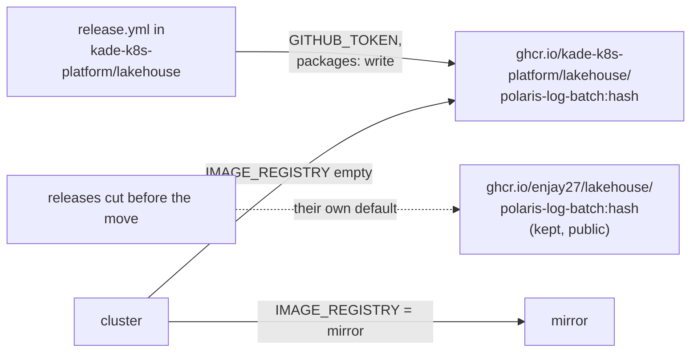

# ADR-074: The log batch's image moves with the repository, to `ghcr.io/kade-k8s-platform/lakehouse`

- **Status:** Accepted
- **Date:** 2026-10-18
- **Related:** ADR-033, ADR-042, ADR-051, ADR-073

## Context

ADR-042 pushes the log batch's image from `release.yml` as
`ghcr.io/enjay27/lakehouse/polaris-log-batch:<content hash>`. That name is the repository's
owner and name: it is the default for `IMAGE_REGISTRY` in `install/release.py`
(`DEFAULT_IMAGE_REGISTRY`) and the chart's default repository in
`charts/polaris-log-batch/values.yaml`, and two tests pin it (`install/test_release.py`,
`gates/test_gate.py`). The push signs in with the workflow's own `GITHUB_TOKEN` and
`packages: write`. Releases `platform-2026.10.10`, `.12` and `.14` were cut this way.

ADR-073 moves the repository to the `kade-k8s-platform` organization. A container package
stays in the namespace it was pushed to; it does not move with a repository. After the move,
the workflow's token belongs to a repository of `kade-k8s-platform`, and pushing it to
`ghcr.io/enjay27/...`, a personal account's namespace, has not been tried. To keep pushing
there with certainty would take a credential of Kade's personal account in an Actions secret.

## Decision

- **Amends ADR-042 §1 and §2, the image's name only:** new images are pushed as
  `ghcr.io/kade-k8s-platform/lakehouse/polaris-log-batch:<content hash>`. An empty
  `IMAGE_REGISTRY` means `ghcr.io/kade-k8s-platform/lakehouse`, and the chart's default
  repository is `ghcr.io/kade-k8s-platform/lakehouse/polaris-log-batch`.
- **The workflow still signs in with its own `GITHUB_TOKEN`** and `packages: write`. No
  personal credential is added.
- **The first push makes the package in the organization.** If GHCR makes it private, the
  anonymous read-back of ADR-042 §1 stops the release before the tag. Kade makes the package
  public once, in its settings, and the release runs again, as ADR-042 already says.
- **Images already pushed stay where they are.** `ghcr.io/enjay27/lakehouse/polaris-log-batch`
  is neither deleted nor made private. A checkout of a release cut before the move still pulls
  from there by its own default, and a cluster installed from one keeps running.
- **Unchanged from ADR-042:** tags are never overwritten, a mirror is named in
  `IMAGE_REGISTRY`, and the gate builds and loads the image itself (§3). Gates that upgrade
  from the last release (ADR-051) build its image from its checkout too, so they pull nothing.
- **When:** in the first PR after the move, before the next release.

## Diagram

## Alternatives considered

- **Keep `ghcr.io/enjay27/lakehouse`:** the repository's images would live under an account
  it no longer belongs to, and the push would depend on that namespace accepting another
  owner's workflow token, or on a personal token in a secret.
- **Copy the old tags into the new namespace:** not needed, since old releases pull by their
  own default. It would also be a second copy of each image to keep in step.

## Consequences

- **The code:**
  - `install/release.py` (`DEFAULT_IMAGE_REGISTRY`) and its test;
  - the chart's `values.yaml`;
  - `gates/test_gate.py`;
  - the `IMAGE_REGISTRY` comment in `.env.template`.

  The PR passes dry-run and smoke on its head (ADR-039), since it changes `charts/` and
  `install/`.
- **A `.env` that names `ghcr.io/enjay27/lakehouse` explicitly** keeps pulling the old
  images. To run a release cut after the move, it names the new path, or leaves the value empty.
- **ADR-042 becomes "Amended by ADR-074"** when this ADR is accepted.
