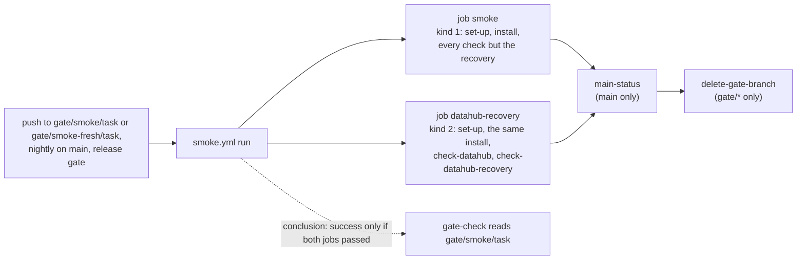

# ADR-075: check-datahub-recovery runs in a smoke job of its own, on its own kind cluster, on every smoke run

- **Status:** Proposed
- **Date:** 2026-10-18
- **Related:** ADR-000, ADR-017, ADR-028, ADR-030, ADR-033, ADR-039, ADR-049, ADR-050, ADR-055, ADR-059, ADR-071

## Context

**PR #213 added `gates/gate.py check-datahub-recovery`** (ADR-071 §8) to `smoke.yml`'s one job,
right after `check-datahub`. Smoke's first run with it, 39126143044 on 2026-10-18, took
35.5 min of the job's 40-minute timeout:

| Phase | Steps | Minutes |
|---|---|---|
| Set-up | tools, kind and CNPG, the gate's Secrets, the console's and the batch's images, the stand-ins | 1.9 |
| Install | the last release, its seed, this commit over it | 11.8 |
| Checks before the recovery | `check-migration` to `check-datahub` | 2.0 |
| `check-datahub-recovery` | OpenSearch's volume lost, then Kafka's, each followed by Datahub's install step | 17.2 |
| Checks after it | `check-standins` to the console's steps | 2.6 |

- **The install is mostly Datahub's serial waits:** datahub-pg about 1.5 min, then Kafka and
  OpenSearch, the blocking system-update about 3 min, GMS's start about 2.7 min, the
  non-blocking system-update about 1.6 min. Pulling the images takes 10 to 16 s. The recovery
  is the one step that can move without changing what an install does.
- **Where smoke runs:**
  - on `gate/smoke/<task>` for every PR that changes platform files, which gate-check requires
    (ADR-039);
  - on `gate/smoke-fresh/<task>` when a PR changes what a first install creates (ADR-050 §3);
  - nightly on `main`, reporting through `main-status.yml` (ADR-055);
  - twice from the release gate, upgrade and fresh (ADR-033).
- **What gate-check reads:** the latest successful run of `smoke.yml` on `gate/smoke/<task>`.
  A workflow run succeeds only when every job in it succeeded or was skipped, so a second job
  in `smoke.yml` is part of what gate-check requires, with no change to `scripts/gate_check.py`.
- **What else is fixed:**
  - a kind cluster is created in its job and gone with it (ADR-017), so two jobs have two
    clusters on two runners;
  - ADR-071 §8 runs `check-datahub-recovery` after `check-datahub`, on the gate only;
  - ADR-050 §2: smoke-fresh runs every step of smoke's, and only the install differs;
  - ADR-039, ADR-050 and ADR-071 are each already amended, so changing any of them means
    superseding it whole (ADR-000 rule 6).

**Kade's two candidates (2026-10-18):** (a) the recovery in a job or workflow of its own, on its
own kind cluster, still run for every platform PR; (b) the recovery only when Datahub's files
change, plus nightly on `main` and in the release gate. Kade chose (a), as a second job in
`smoke.yml`, on every smoke run, with `check-datahub` first.

## Decision

### 1. `smoke.yml` runs two jobs side by side

| Job | Steps | Timeout |
|---|---|---|
| `smoke` | every step it has today except `check-datahub-recovery` | 40 min |
| `datahub-recovery` | smoke's set-up steps, the console's image among them; the same install step; `check-datahub`; `check-datahub-recovery`; a state-on-failure step for Datahub's namespace | 40 min |

- **The same install:** the upgrade from the last release, or `--fresh` from the same input or
  ref (ADR-050 §2). The console's image is built and loaded as in `smoke`, never blocking
  (ADR-028), so the install is the same as `smoke`'s and does not wait on a missing image.
- **`check-datahub` first:** it proves Datahub runs on this cluster before the recovery deletes
  its volumes, so ADR-071 §8's order holds in the job that runs the recovery.
- **No other check runs in `datahub-recovery`.** Polaris's checks, `check-network`,
  `check-traffic` and the rest stay in `smoke`, on a cluster whose volumes were not deleted.

### 2. On every smoke run

Both jobs run on every trigger of `smoke.yml`: `gate/smoke/**`, `gate/smoke-fresh/**`, the
nightly run on `main` and both release-gate calls. smoke-fresh still runs every job and step of
smoke's, and only the install differs (ADR-050 §2).

### 3. The jobs after them

- **`main-status`** (ADR-055 §2) needs both jobs and is given `success` only when both
  succeeded, so a red recovery on `main` opens or comments on `main is red: Smoke` as any other
  failure does.
- **`delete-gate-branch`** (ADR-049) still needs every other job, so it runs last.

### 4. What does not change

- **gate-check:** `scripts/gate_check.py`, its gate branches and `.claude/rules/gates.md`. A
  passing run on `gate/smoke/<task>` now covers both jobs.
- **ADR-039, ADR-050, ADR-055 and ADR-071** are not amended: gate-check reads the same runs,
  smoke-fresh runs smoke's steps, `main-status` reports smoke's runs on `main`, and
  `check-datahub-recovery` runs after `check-datahub`, on the gate only, in `smoke.yml`.

## Diagram

## Alternatives considered

| Option | Why not |
|---|---|
| **(b) Only when Datahub's files change**, plus nightly and the release gate | The runs that keep the recovery (Datahub PRs, nightly, both release-gate calls) keep 35.5 of 40 minutes, so the timeout stays where the check runs. The recovery also depends on files outside Datahub's: `install/release.py` (one file for both, so Datahub's steps cannot be picked by path), `gates/gate.py` (which holds the check), `gates/network.py`, the kind and CNPG pins, `scripts/init_env.py`, `smoke.yml`. A path list either names nearly all of them or misses some, and a miss is found by the nightly run after the merge, with every Datahub PR red until it is fixed. Smoke would no longer prove §8 on every run, so ADR-071 would be superseded whole. |
| **(a) as a workflow of its own** on `gate/datahub-recovery/<task>` | gate-check needs a new gate in `scripts/gate_check.py` (a path Kade merges by hand, ADR-030), ADR-039 and ADR-050's levels superseded whole, and a copy of smoke's set-up steps that drifts from them, the reason ADR-050 gave against `smoke-fresh.yml`. |
| **Raise the timeout** and keep one job | No run gets shorter: 35.5 min stays the wait on every platform PR, and the next Datahub check moves the limit again. |
| **The recovery job on upgrade runs only** | Saves about 31 runner-minutes per smoke-fresh run, but smoke-fresh would no longer run smoke's steps, so ADR-050 would be superseded whole. |
| **The recovery without `check-datahub` first** | Saves about 12 s, but changes ADR-071 §8's order, and a recovery that fails on a Datahub that never worked reads as a recovery fault. |
| **The recovery job installs Datahub alone** | A job shorter by Polaris's part of the install, not yet measured, but `install/release.py` gains a mode outside ADR-045's order. A change of its own, if the job's time matters later. |

## Consequences

- **Each smoke run ends sooner:** about 31.5 min (the recovery job: 1.9 + 11.8 + 0.2 + 17.2)
  instead of 35.5, with the `smoke` job at about 18.3. The recovery job has about 8.5 min of
  headroom, `smoke` about 21.7.
- **Each run costs about 14 more runner-minutes,** a second set-up and install: about 50 in all
  instead of 35.5. GitHub-hosted standard runners are not billed for a public repository; each
  run now holds two runners at once, and each job restores the image cache and pulls on its own.
- **The recovery no longer runs before Polaris's checks** on the same cluster, so a lost volume
  or a slow rebuild cannot fail a check that is not Datahub's.
- **A failed run names its job;** the PR's *Verified* links the run, which covers both.
- **A further long Datahub check** joins `datahub-recovery` or a third job, decided with it.
- **Code follows once this ADR is Accepted, in one PR:**
  - `smoke.yml`: the `datahub-recovery` job, `check-datahub-recovery`'s step moved into it, the
    `needs` and the result given to `main-status`, and its header comment;
  - `scripts/test_gate_workflows.py`, its tests written first: the recovery job's steps and
    their order, `check-datahub-recovery` in that job only, both jobs on every trigger,
    `main-status` and `delete-gate-branch` needing both.
- **That PR changes `.github/workflows/`,** so it is a draft Kade merges by hand (ADR-030,
  ADR-059). It changes `smoke.yml`, so it needs dry-run and smoke on its head (ADR-039); it also
  pushes smoke-fresh, to show both jobs on a fresh install, with that reason under *Verified*.
