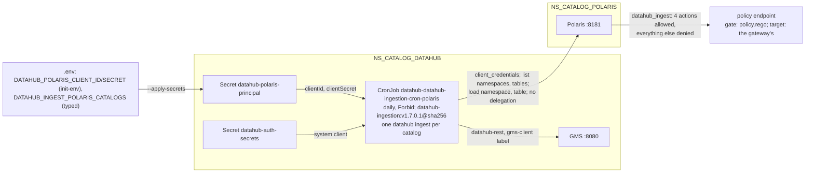

# ADR-076: Datahub ingests each Polaris catalog daily from upstream's ingestion CronJob, as its own principal the policy lets only read

- **Status:** Proposed
- **Date:** 2026-10-18
- **Related:** ADR-004, ADR-006, ADR-009, ADR-016, ADR-025, ADR-026, ADR-031, ADR-034, ADR-039, ADR-045, ADR-048, ADR-050, ADR-051, ADR-053, ADR-059, ADR-071, ADR-072, ADR-074, ADR-075

## Context

**What is already decided:**
- **ADR-025:** Datahub ingests Polaris's catalog with its own Polaris principal, which has
  read-only grants. Issue #10 confirmed that Polaris is the only source Datahub ingests from
  (roadmap P4).
- **ADR-026:**
  - Polaris issues its own tokens: a caller authenticates with `client_credentials`.
  - Polaris asks an OPA policy endpoint about every request. On the gate that endpoint is a
    stand-in running `gates/opa/policy.rego`; on the target clusters it is the catalog
    gateway's, whose policy this repository does not write.
  - The services of this repository get their own principals, with the narrowest grants that
    work, never root.
- **ADR-048 §3:** Datahub's namespace reaches Polaris's API on 8181. Egress is not restricted.
- **ADR-071:**
  - §2 leaves `datahub-ingestion-cron` and `acryl-datahub-actions` off and managed ingestion
    disabled, "until ingestion enters".
  - §4 labels every Datahub pod as a client of the three stores and of GMS, through
    `global.podLabels`.
  - §9 leaves this ADR to decide how ingestion runs and what P3's "one ingestion run" in smoke
    proves.
- **ADR-072's consequences:** the extra `SECRET_SERVICE_ENCRYPTION_KEY` entry in GMS's values
  goes away only if managed ingestion is turned on.
- **ADR-075:** `check-datahub-recovery` moves to a smoke job of its own, which frees time in
  smoke's main job.

**Datahub's Iceberg source** (`datahub-project/datahub`, tag `v1.7.0.1`, commit `e99431e`,
`metadata-ingestion/src/datahub/ingestion/source/iceberg/`, read on 2026-10-18):
- **The catalog block is handed to PyIceberg as it is.**
  - `iceberg_common.py` passes the recipe's `catalog` entry to `pyiceberg.catalog.load_catalog`.
  - For a REST catalog, PyIceberg does OAuth `client_credentials` with the properties our smoke
    test already uses against Polaris (`gates/iceberg/smoke.py`): `credential`,
    `oauth2-server-uri`, `scope`, `warehouse` and `header.*`.
  - `setup.py` pins `pyiceberg>=0.11.0,<0.12.0`. PyIceberg 0.11.0's `_config_headers`
    (`pyiceberg/catalog/rest/__init__.py`) applies the `header.*` properties first and only then
    defaults `X-Iceberg-Access-Delegation` to `vended-credentials`, so an empty
    `header.X-Iceberg-Access-Delegation` keeps delegation off, as it does in 0.12.0.
- **One catalog per recipe:** `validate_catalog_size` refuses anything but exactly one entry.
  The `platform_instance` names the catalog (the source's own description), which keeps apart
  the URNs of tables with the same name in two catalogs.
- **What it asks Polaris** (`iceberg.py`):
  - `list_namespaces()` with no parent, so top-level namespaces only: nested namespaces are not
    walked;
  - `load_namespace_properties`;
  - `list_tables`;
  - `load_table`.
  - **It ingests no views.** Profiling is off by default, so it reads no data files on S3.
- **Deletion detection** is stateful ingestion: with a `pipeline_name`, a run removes from
  Datahub the datasets that its previous run saw and this one did not.
- **The recipe expands `${VAR}`** from the environment (`configuration/config_loader.py`,
  `resolve_env_variables`).
- **The sink:** with no token in the recipe, the REST emitter (`emitter/rest_emitter.py`)
  authenticates as the system client from `DATAHUB_SYSTEM_CLIENT_ID` and
  `DATAHUB_SYSTEM_CLIENT_SECRET`. Upstream's own executor works the same way.

**The images** (`docker/datahub-ingestion/Dockerfile`, `docker/datahub-actions/Dockerfile`,
same tag; Docker Hub, read on 2026-10-18):
- **`acryldata/datahub-ingestion:v1.7.0.1`** is the `full` variant, which installs
  `metadata-ingestion[all]`. `all` leaves out only airflow, great-expectations, mssql-odbc,
  datahub-lite, feast and debug-recording, so iceberg is in.
  - Its index digest is `sha256:8845102fd495f2589e1ffc00dbd85cee3cbb700abc20d62fac1929ce95535620`,
    pushed on 2026-09-03.
  - It is about 1.1 GiB compressed for amd64, has an arm64 image as well, and runs as the
    non-root user `datahub` (UID 1000), with the `datahub` CLI as its entrypoint.
- **`-slim` and `-locked` do not include iceberg.** Slim's extras are a fixed list without it;
  locked has fewer still and blocks PyPI.
- **The actions image** bundles prebuilt venvs for `s3`, `demo-data`, `file`, `datahub-gc` and
  `datahub-documents` only. Managed ingestion of Iceberg would therefore install the plugin
  from PyPI at run time, as ADR-071 §2 found.

**The chart's `datahub-ingestion-cron`** (`acryldata/datahub-helm`, tag `datahub-1.1.7`, commit
`19ca74e`, `subcharts/datahub-ingestion-cron`):
- **One CronJob per entry of `crons`.** Each entry has its `schedule`, `concurrencyPolicy`,
  history limits, `backoffLimit`, `restartPolicy`, `suspend` and `resources`.
- **The recipe:** `recipe.fileContent` renders a ConfigMap, mounted at `/etc/recipe`.
- **Its command** is run as `/bin/sh -c`, `datahub ingest -c /etc/recipe/<fileName>` by
  default.
- **Its environment:** `env` (plain values) and `envFromSecrets` (`secretKeyRef`).
- **The pod** takes `global.podLabels`, and runs as UID 1000 with `runAsNonRoot` and no
  privilege escalation.
- **The image** is `registry/repository:tag`. No label is built from the tag, so a tag with a
  digest works unchanged, unlike GMS's (ADR-072 §1).

**Polaris 1.6.0** (`apache/polaris`, tag `apache-polaris-1.6.0`, commit `dd30600`):
- **With the OPA authorizer, Polaris's own grants are never consulted.**
  - `OpaPolarisAuthorizer.authorize` sends one request per intent to the policy endpoint and
    allows or denies on its answer alone.
  - Catalog roles, principal roles and their grants therefore decide nothing. "Read-only" is
    whatever the policy endpoint allows.
- **The four actions the source causes** are `LIST_NAMESPACES`, `LOAD_NAMESPACE_METADATA`,
  `LIST_TABLES` and `LOAD_TABLE` (`PolarisAuthorizableOperation`).
  - `GET /v1/config` and the token endpoint never ask the policy endpoint
    (`docs/contracts/polaris-opa-input.md`).
  - With delegation on, a load asks for `LOAD_TABLE_WITH_WRITE_DELEGATION`, then
    `..._READ_DELEGATION`.
- **No roles are needed for a token:** a principal with no principal roles gets one with
  `scope: PRINCIPAL_ROLE:ALL`. `gate_smoke` and `gate_maintainer` already work that way.
- **A principal's credentials can be set by the caller.** `POST /principals/{name}/reset`
  (`spec/polaris-management-service.yml`, `ResetPrincipalRequest`) takes an optional `clientId`
  and `clientSecret`.
  - It is enabled by `ENABLE_CREDENTIAL_RESET`, true by default (`FeatureConfiguration.java`),
    and authorized as `RESET_CREDENTIALS`.
  - `PolarisAdminService.resetCredentialsHelper` refuses only a client ID that another
    principal already uses. The JDBC path stores the values without checking their format.
  - Polaris's own credentials are 16 and 32 hexadecimal characters
    (`PolarisPrincipalSecrets`).

**What is not decided:**
- where ingestion runs and on which image;
- which catalogs are ingested, and when;
- how the principal and its credential come to exist on every cluster;
- what the principal may do;
- how the sink authenticates to GMS;
- what smoke's ingestion run proves.

**Kade's choices (2026-10-18):**
- upstream's `datahub-ingestion-cron` with the full image by digest;
- one CronJob running one ingestion per catalog listed in `.env`, daily, with stateful
  ingestion;
- the principal's credential from `init_env.py`, set on the principal by the install as root;
  no Polaris grants; the gate's policy and a contract for the gateway's team;
- the sink as GMS's system client;
- a smoke check that seeds a catalog, runs one ingestion, finds what it ingested and sees the
  principal refused a write.

## Decision

ADR-025 and ADR-071 stand. This ADR decides what ADR-071 §9 leaves open for ingestion.

### 1. Upstream's ingestion CronJob, by digest

- **`datahub-ingestion-cron` is enabled in `charts/datahub/values-lakehouse.yaml`**, with one
  entry, `polaris`.
  - Upstream's helper names its CronJob `datahub-datahub-ingestion-cron-polaris`, in
    `NS_CATALOG_DATAHUB`.
  - The chart stays upstream's archive with ADR-072's one patched line.
- **Its image** is `acryldata/datahub-ingestion` with `image.tag: "v1.7.0.1@sha256:…"`: the full
  variant, the only one that includes iceberg.
  - The digest read on 2026-10-18 is in the Context. The code PR reads it again and pins what
    it reads then.
  - The chart test's check that every rendered image carries a digest covers it. The image moves
    with Datahub's version in the same PR, as ADR-071 §1 says.
- **When it runs:**

  | Value | Setting |
  |---|---|
  | `schedule` | `"0 3 * * *"`, daily, in the controller's time zone (UTC on the gate) |
  | `concurrencyPolicy` | `Forbid` |
  | `restartPolicy` | `Never` |
  | `backoffLimit` | `1` |
  | History limits | 3 successful Jobs, 3 failed Jobs |

  These are tuning values in the values file. Requests and a memory limit come from the gate's
  first runs.
- **Managed ingestion and `acryl-datahub-actions` stay off** (ADR-071 §2). So ADR-072 §2's
  `SECRET_SERVICE_ENCRYPTION_KEY` entry stays.

### 2. One run per catalog, from one recipe

- **The catalogs are a new `.env` value, `DATAHUB_INGEST_POLARIS_CATALOGS`:** Polaris catalog
  names, comma-separated, typed by hand.
  - `install/release.py` checks each name against `^[A-Za-z0-9_-]+$` and stops on any other.
  - An empty value: the install says so and sets the CronJob's `suspend: true`.
- **The CronJob's command** runs `datahub ingest -c /etc/recipe/polaris.yml` once per catalog,
  one after another, with `POLARIS_CATALOG` set to that catalog.
  - Every catalog runs even when an earlier one fails.
  - The Job fails if any run failed, and the log names the catalog of each run.
- **The recipe** sits in the values file as `recipe.fileContent`. It holds no credential; every
  value that varies is a `${VAR}`:

  | Recipe field | Value |
  |---|---|
  | `source.type` | `iceberg` |
  | `catalog.polaris.type`, `uri` | `rest`, `${POLARIS_URI}` |
  | `oauth2-server-uri` | `${POLARIS_URI}/v1/oauth/tokens` |
  | `credential` | `${POLARIS_CLIENT_ID}:${POLARIS_CLIENT_SECRET}` |
  | `scope`, `warehouse` | `PRINCIPAL_ROLE:ALL`, `${POLARIS_CATALOG}` |
  | `header.Polaris-Realm` | the realm, `POLARIS` (ADR-026) |
  | `header.X-Iceberg-Access-Delegation` | empty: no vended credentials |
  | `platform_instance`, `env` | `${POLARIS_CATALOG}`, `PROD` |
  | `profiling.enabled` | `false` |
  | `stateful_ingestion` | enabled, `remove_stale_metadata: true` |
  | `pipeline_name` | `polaris-${POLARIS_CATALOG}`, so each catalog keeps its own state |
  | `sink` | `datahub-rest` to GMS's Service on 8080 in the namespace, no token |

- **The environment of the CronJob:**

  | Variable | From |
  |---|---|
  | `POLARIS_CLIENT_ID`, `POLARIS_CLIENT_SECRET` | `envFromSecrets`: `datahub-polaris-principal`, keys `clientId` and `clientSecret` (§3) |
  | `DATAHUB_SYSTEM_CLIENT_ID` | `env`: `__datahub_system` |
  | `DATAHUB_SYSTEM_CLIENT_SECRET` | `envFromSecrets`: `datahub-auth-secrets`, key `system_client_secret` (ADR-071 §6) |
  | `POLARIS_URI` | set by the install: `http://polaris.<NS_CATALOG_POLARIS>.svc.cluster.local:8181/api/catalog`, the namespace from `.env`, so no name is written in a chart (ADR-048 §2) |
  | `DATAHUB_INGEST_POLARIS_CATALOGS` | set by the install from `.env` |

- **What is not ingested:** views, and namespaces below the top level. Datahub v1.7.0.1's source
  does not read them. A later Datahub version that does changes §4's rule and the contract, in
  the PR that moves the version.

### 3. The principal `datahub_ingest` and its credential

- **The name is `datahub_ingest`,** one principal per Polaris realm. It gets no principal role,
  no catalog role and no grant: the policy decides what it may do (§4).
- **Its credential comes from `init_env.py`** (ADR-006):
  - `DATAHUB_POLARIS_CLIENT_ID` (16 characters, init-env's identity form) and
    `DATAHUB_POLARIS_CLIENT_SECRET` (32), generated per clone and left empty in `.env.template`.
  - A value already in `.env` is kept.
  - `--apply-secrets` creates the Secret `datahub-polaris-principal` (`clientId`, `clientSecret`)
    in `NS_CATALOG_DATAHUB`. Only the CronJob and the step below read it.
- **`install/release.py` step 1 gains a last part, after Datahub** (ADR-045; ADR-071 §7):
  1. It stops when `datahub-polaris-principal` is missing or lacks its keys, reading key names
     only.
  2. It runs a short-lived pod in `NS_CATALOG_DATAHUB` from the ingestion image, which has
     Python. The pod mounts that Secret, and receives root's client ID and secret on stdin from
     `.env`, never on a command line or in a Secret of Datahub's namespace. ADR-048 §3 already
     lets that namespace reach 8181.
  3. As root, the pod gets a token, then creates `datahub_ingest`. If it already exists (409),
     that is fine.
  4. It resets the principal's credentials to the Secret's `clientId` and `clientSecret`, then
     gets a token as `datahub_ingest` to prove they work. It prints no credential.
  5. Any other answer stops the install. With `--dry-run` the part does not run, and says so,
     as the bootstrap does.
- **Every install resets the principal to the same values,** so a run is idempotent. A rotation
  is new values in `.env`, `--apply-secrets`, then the install.
- **Root is used as the bootstrap already uses it** (ADR-026): the install holds root's
  credential from `.env`, and nothing stores it in Datahub's namespace.

### 4. What `datahub_ingest` may do: read, through the policy

- **On the gate,** `gates/opa/policy.rego` gains one rule:
  - `input.actor.principal == "datahub_ingest"` may do `LIST_NAMESPACES`,
    `LOAD_NAMESPACE_METADATA`, `LIST_TABLES` and `LOAD_TABLE`, in any catalog, with a non-empty
    target;
  - nothing else: no write, no `*_WITH_*_DELEGATION`, no views, no `LIST_CATALOGS`, no
    management call.
  - The policy's tests cover allowed and refused cases, as the other principals' do.
- **On the target clusters the gateway's policy decides.** A new contract,
  `docs/contracts/datahub-polaris-ingestion.md`, written beside `polaris-opa-input.md`, states:
  - the principal's name;
  - the four actions and the targets Polaris 1.6.0 sends with them;
  - that everything else is refused;
  - root's `CREATE_PRINCIPAL` and `RESET_CREDENTIALS` at install;
  - and, for Datahub's operators, that views and nested namespaces are not ingested.
- **The contract is re-read** against the new source on every Polaris or Datahub upgrade
  (ADR-009, ADR-071 §1).

### 5. Its network: no new rule

- **To Polaris:** ADR-048 §3 already admits Datahub's namespace to Polaris's 8181.
- **To GMS:** the CronJob's pods take `global.podLabels`, so they carry
  `lakehouse/datahub-gms-client` and reach GMS's 8080 (ADR-071 §5). With them come the three
  stores' client labels, as on every Datahub pod (ADR-071 §4).
- **To S3:** no connection. Profiling is off and the source reads no data files.

### 6. What the smoke gate proves

**A new step, `gate.py check-datahub-ingestion`,** in smoke's main job right after
`check-datahub`. The gate's `.env` sets `DATAHUB_INGEST_POLARIS_CATALOGS=gate_ingest_catalog`.
1. **Seed:** root creates the catalog `gate_ingest_catalog` on SeaweedFS, as the smoke tests
   create theirs, with a namespace `ingest` and two tables. One table has a nested struct
   column. A catalog already there is kept, and tables already there are kept.
2. **One ingestion run:** the step creates a Job from the CronJob in `NS_CATALOG_DATAHUB`
   (`kubectl create job --from=cronjob/…`). It passes when the Job completes within a time limit
   set in the code. On failure it prints the pod's log. The install never starts a run itself.
3. **What Datahub holds,** read from a pod labelled `lakehouse/datahub-gms-client`, as the
   system client, with `gates/datahub/check.py`:
   - the container of the namespace;
   - both datasets, by the URNs the source makes with the platform instance
     `gate_ingest_catalog`;
   - each dataset's schema fields, the nested ones included.
4. **What `datahub_ingest` may not do:** from a pod in `NS_CATALOG_DATAHUB` that mounts
   `datahub-polaris-principal`, without the gate's check label:
   - a namespace create in `gate_ingest_catalog` is refused with 403;
   - a table load with `X-Iceberg-Access-Delegation: vended-credentials` is refused with 403;
   - the same load without delegation succeeds.
5. **On the wire** (ADR-034): a new `gates/expectations/datahub-ingestion.json`, added to
   smoke's `check-traffic` step. The policy endpoint allowed `datahub_ingest` only the four
   actions, and denied its `CREATE_NAMESPACE` and its delegated loads.
6. **Clean-up:** it hard-deletes the two datasets and the container from Datahub. The catalog
   stays.

The step runs only on the kind gate (ADR-004). It creates a catalog and starts a Job by hand,
neither of which belongs in `install/`.

### 7. Left to later

- Views and nested namespaces, once a Datahub version ingests them (§2).
- Seeded Datahub objects for `check-migration` (ADR-051), with ADR-071 §9's.
- How long a run takes on many tables, in P6's measurements.
- The gateway's policy on the target clusters, which is its team's, from §4's contract.

## Diagram



```mermaid
sequenceDiagram
    participant R as release.py step 1
    participant P as pod in NS_CATALOG_DATAHUB
    participant PO as Polaris
    participant S as smoke: check-datahub-ingestion
    participant C as ingestion Job
    participant G as GMS
    R->>P: root's credential on stdin; datahub-polaris-principal mounted
    P->>PO: token as root
    P->>PO: create principal datahub_ingest (201 or 409)
    P->>PO: reset its credentials to the Secret's values
    P->>PO: token as datahub_ingest
    S->>PO: as root: gate_ingest_catalog, namespace ingest, two tables
    S->>C: create Job from the CronJob
    C->>PO: list, load (datahub_ingest)
    C->>G: namespace container, datasets, schemas (system client)
    S->>G: read container, datasets, fields
    S->>PO: as datahub_ingest: create namespace, delegated load: 403
```

## Alternatives considered

**Where ingestion runs:**

| Option | Why not |
|---|---|
| **Managed ingestion through `acryl-datahub-actions`** | The actions image bundles no iceberg venv, so each run installs the plugin from PyPI at run time, unpinned. Recipes and their secrets would live in GMS, edited in the UI, outside this repository and its gates. |
| **A CronJob chart of our own** | It would repeat upstream's subchart for no difference. |
| **Our own slim image** from a hash-locked `acryl-datahub[iceberg,datahub-rest]` | About a third of the size, but a lockfile, a build and a registry push of our own to keep in step with every Datahub version (ADR-074). |
| **`-slim` or `-locked`** | Neither includes iceberg. |
| **Runs from the gate only** | It would prove nothing that runs on a target cluster. |

**Catalogs and schedule:**

| Option | Why not |
|---|---|
| **One CronJob per catalog** | The chart's `crons` is a static map and the catalogs come from `.env`, so `release.py` would write each entry, recipe and schedule included, in code instead of the values file (Kade chose one CronJob, 2026-10-18). |
| **Listing the catalogs at run time** | Needs `LIST_CATALOGS` for the principal and a script of our own around the CLI, and would ingest every catalog a gateway creates. |
| **Hourly** | Each run loads every table's metadata, about 1 MB each in the stress setup (ADR-053), across every catalog. Daily keeps that load small, and a schedule is a tuning value. |
| **No stateful ingestion** | Tables dropped in Polaris would stay in Datahub for good. |

**The principal:**

| Option | Why not |
|---|---|
| **Created by the gateway on the target clusters, its credential typed into `.env`** | The install would wait on another team, and the gate would still need its own way to create it. ADR-026 gives this repository's services their own principals, made here. |
| **Polaris's generated credential written into a Secret by the install** | A credential not from `init_env.py`, and the only way credentials reach charts would no longer be `--apply-secrets` (ADR-006). |
| **Catalog and principal roles with read grants** | Polaris's OPA authorizer never reads them. They would suggest a boundary that is not there, and need a grant per new catalog. |

**The sink:**

| Option | Why not |
|---|---|
| **A personal access token of a Datahub service user** | A user and a token to create through GraphQL, and an expiry to renew. Whoever holds the token can still write any entity in Datahub, as the system client can. |

**The smoke gate:**

| Option | Why not |
|---|---|
| **Only the Job's success** | Would not show that anything was ingested, or that the principal is read-only. |
| **A second run after a table is dropped** | Proves deletion detection, but doubles the run. Upstream's stateful ingestion is its own tested feature. |

## Consequences

- **Smoke's main job pulls another large image,** about 1.1 GiB compressed for amd64, and runs
  one ingestion. ADR-075 moved `check-datahub-recovery` out of that job. The first runs give the
  time.
- **On a target cluster, ingestion works only once the gateway's policy allows
  `datahub_ingest`.** Until then each run's loads get 403 and the CronJob shows failed Jobs. The
  install cannot tell, because its own calls are root's. The release notes hand over §4's
  contract and say so.
- **Every install and upgrade needs the new `.env` values** and `--apply-secrets` run with the
  release's `init_env.py`: two generated values, and the catalog list where catalogs exist.
  Step 1 stops when the Secret is missing.
- **The install uses root once more,** for one principal, as it does for the bootstrap.
  `datahub_ingest`'s credential lives in Datahub's namespace only.
- **The CronJob holds the system client's secret,** which can write anything in Datahub, as GMS
  and the frontend already hold it.
- **Catalogs run one after another in one pod.** A slow catalog delays the next. With `Forbid`, a
  run longer than a day skips the next day's.
- **Code follows once this ADR is Accepted,** in one PR opened as a draft because it changes
  `smoke.yml` (ADR-059). It touches `charts/`, `install/`, `gates/` and `scripts/init_env.py`,
  so it needs dry-run, smoke and smoke-fresh on its head (ADR-039, ADR-050). Its files:
  - `charts/datahub/values-lakehouse.yaml` (the CronJob, its image by digest, the recipe) and
    `charts/test_datahub.py`;
  - `.env.template` and `scripts/init_env.py` (the two credentials, `datahub-polaris-principal`,
    `DATAHUB_INGEST_POLARIS_CATALOGS`), with their tests;
  - `install/release.py`'s step 1 (the principal, the CronJob's install values), with its tests;
  - `gates/opa/policy.rego` and its tests;
  - `gates/gate.py`'s `check-datahub-ingestion`, `gates/datahub/check.py`'s reads,
    `gates/expectations/datahub-ingestion.json`, and their tests;
  - `smoke.yml`'s step and its `check-traffic` list;
  - `docs/contracts/datahub-polaris-ingestion.md`;
  - `CLAUDE.md`'s layout and `docs/plans/roadmap.md`'s P3.
