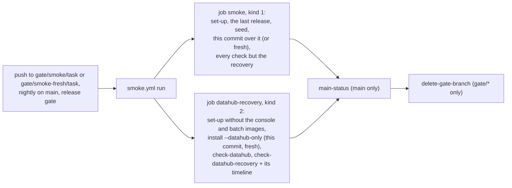

# ADR-077: The datahub-recovery job installs Datahub alone, from this commit, and check-datahub-recovery prints its timeline

- **Status:** Accepted
- **Date:** 2026-10-18
- **Related:** ADR-000, ADR-028, ADR-030, ADR-036, ADR-039, ADR-045, ADR-050, ADR-051, ADR-059, ADR-066, ADR-067, ADR-071, ADR-075, ADR-076

## Context

**Since ADR-075, the `datahub-recovery` job sets smoke's wall time.** In PR #220's runs on
2026-10-18 (39133872292 upgrade, 39133872386 fresh), it took 31.6 and 30.6 min of its
40-minute timeout, and the `smoke` job took 20.7 and 18.8. Its steps, in seconds:

| Step | upgrade | fresh |
|---|---|---|
| Set-up: kind and CNPG 78 / 88, the console's image 15 / 27, the batch's image 10 / 18, the stand-ins 12 / 13 | 120 | 154 |
| Install | 793 | 743 |
| `check-datahub` | 11 | 12 |
| `check-datahub-recovery` | 968 | 921 |

**The install, from its own timeline** (seconds):

| Part | upgrade | fresh |
|---|---|---|
| Polaris: the last release 159, its seed 19, this commit's Polaris 61 (fresh: this commit's Polaris), then the log batch and the console | 239 | 207 |
| datahub-pg, with Datahub's network policies: Ready, then three healthy reads | 81 | 87 |
| datahub-kafka, then datahub-opensearch, each ready | 18 + 35 | 21 + 37 |
| Datahub's `helm --wait`: system-update, then GMS and the frontend ready, then the non-blocking Job | 152 + 168 + 96 | 135 + 168 + 85 |

**`check-datahub-recovery` cannot yet be split into its phases.** It prints its notes only
when it ends, so a passing run's log has no time for any phase, and no run of it has failed
with a dump of the cluster's events. From steps measured in the same runs, its two volume
losses cost about 30 to 40 s each, each of its two install steps about 220 to 250 s (both
system-update Jobs run again on every Helm revision), GMS's restart about 165 s and its nine
check pods about 45 s; the rest, about 130 to 230 s, is the restore-indices Job and waits.

**What the job needs from the install:** Datahub, running. Its two checks, `check-datahub` and
`check-datahub-recovery`, read nothing of Polaris's, the console's or the log batch's. The last
release, `platform-2026.10.14`, has no Datahub, so today the upgrade installs Datahub fresh in
both jobs anyway.

**Options compared with Kade (2026-10-18):**
- (a) the job installs only Datahub, fresh: about 4.2 to 4.4 min less;
- (b) one double loss, OpenSearch's and Kafka's volumes together, with one install step: about
  4 to 4.5 min less. ADR-071 §8 sets two losses one after the other, and ADR-071 is already
  amended by ADR-072, so changing it means superseding it whole (ADR-000 rule 6);
- (c) Datahub's three stores started and waited on together: about 55 s less in each job;
  not waiting on the non-blocking Job: about 90 s per Helm run;
- (d) fewer PostgreSQL instances on the gate (#135): about 45 s for datahub-pg here; Kade's
  decision, open in #135.

Kade chose (a), and a timeline of `check-datahub-recovery`'s phases, so that (b) can be decided
later on measured numbers. ADR-075 had listed (a) as "a change of its own, if the job's time
matters later".

## Decision

### 1. The `datahub-recovery` job installs Datahub alone, from this commit

- **A new gate command, `gate.py install --datahub-only`,** runs `install/release.py`'s own
  functions, in ADR-045's order: step 0 (the CNPG operator and the Barman Cloud Plugin
  checked), then Datahub's part of step 1: its network policies, datahub-pg, datahub-kafka,
  datahub-opensearch, Datahub. The first step with a problem stops the rest, as in a release.
- **`install/release.py` gains no mode.** A release installs as ADR-045 says, on every cluster;
  only the gate composes a part of it, as `check-datahub-recovery` already does when it runs
  Datahub's install step again.
- **Fresh on every trigger:** the job installs this commit's Datahub on `gate/smoke/**` and
  `gate/smoke-fresh/**`, nightly on `main` and in both release-gate calls. It installs no last
  release, seeds nothing and runs no Polaris, no `gate-policies`, no log batch and no console.
- **It prints the same timeline and image pulls** the install step prints today.

### 2. The job's set-up loses the Polaris-only steps

| Job | Steps | Timeout |
|---|---|---|
| `datahub-recovery` | tools; kind and CNPG; the gate's Secrets; the stand-ins; `gate.py install --datahub-only`; `check-datahub`; `check-datahub-recovery`; a state-on-failure step for Datahub's namespace | 40 min |

- **No console image** (ADR-028) and **no log batch image** (ADR-036): nothing in this job runs
  them.
- **The stand-ins stay:** datahub-pg backs up to the S3 stand-in (ADR-066, ADR-067).
- **The `smoke` job does not change:** the upgrade from the last release, the seed and
  `check-migration`, `check-datahub` and every other check stay in it.

### 3. `check-datahub-recovery` prints its timeline

When it ends, passed or failed, it prints the seconds after it started, and since the line
before, at which each phase started and ended:
- the check pods ready; the first dataset written and found;
- OpenSearch's claim and pod deleted; the new pod ready; the index gone;
- Datahub's install step, with its Helm revision and both system-update Jobs' start and
  completion; the index back; the restore-indices Job created and finished; the dataset found;
- Kafka's claim and pod deleted; the new pod ready; the topics gone; the install step, as above;
  the topics back;
- GMS's pod deleted and the new one ready; the first dataset read; the second written and found;
- the clean-up.

Times come from the check's own clock and from Helm and the cluster, as the install's timeline
reads them. A timeline that cannot be read is said, and never fails the check.

### 4. What this amends

- **ADR-075 §1,** the bullet "The same install" and the `datahub-recovery` row of its table:
  replaced by §1 and §2 here. Its other sections stand. smoke-fresh still runs every job and
  step of smoke's, and only the `smoke` job's install differs (ADR-075 §2).
- **ADR-045 §2,** the bullet "The gates use the same script": the `datahub-recovery` job runs
  step 0 and Datahub's part of step 1 of that script, in its order, and nothing else of it.
- **ADR-051 §1:** the smoke gates install the last release and upgrade to the commit, except
  the `datahub-recovery` job, which installs this commit's Datahub alone.
- **Not amended:** ADR-050 (the smoke level still installs the last release, upgrades and runs
  the smoke tests, in the `smoke` job; smoke-fresh still runs every job and step) and ADR-071
  (§8's recovery and its order are unchanged).

## Diagram

## Alternatives considered

| Option | Why not |
|---|---|
| **(b) One double loss, with one install step** | About 4 to 4.5 min less, but each single store's loss, the likelier incident, would no longer be proven alone, and ADR-071 would be superseded whole (ADR-000 rule 6), mixing Datahub's design into a decision about gate time. Left for its own ADR once §3's timeline has measured the phases. |
| **(c) The stores started together, or the non-blocking Job not waited on** | About 55 s for the stores, in both jobs, and a change to every release's order (ADR-045 §2). The non-blocking Job as an ordinary Job, upstream's documented way, would no longer be a hook: its pod template carries `DATAHUB_REVISION`, which changes on every Helm revision, and a Job's template cannot change, so the next upgrade would fail unless the Job is deleted first; the wait would also move into `check-datahub`. |
| **(d) One PostgreSQL instance per Cluster** (#135) | About 45 s for datahub-pg here. `rebuild-replica` and the anti-affinity check rely on three; Kade's decision, open in #135. |
| **A Datahub-only mode in `install/release.py`** | Puts a gate-only path into the script target clusters run (ADR-075's reason against it). The gate can compose the script's own functions instead. |
| **Keep the upgrade, drop only the seed and the two images** | About 1 min less: the last release and this commit's Polaris stay. |
| **Raise the timeout** | No run gets shorter. |

## Consequences

- **The recovery job takes about 26.4 to 27.2 min** instead of 30.6 to 31.6, still the longer of
  the two (`smoke`: 18.8 to 20.7), with about 13 min of headroom. Each run uses about 4.2 to
  4.4 runner-minutes less, and pulls none of Polaris's images in that job.
- **Recovery is proven on a fresh Datahub only.** Nothing is lost today: the last release has
  no Datahub. Once a release ships Datahub, its upgrade and `check-datahub` stay proven in
  `smoke`, but recovery after an upgrade is not; a later ADR may add it if it matters.
- **Datahub is proven to install with no Polaris in the cluster.** A check that needs both, such
  as ADR-076's ingestion while it is Proposed, runs in `smoke`.
- **The next cut is measured, not inferred:** §3's timeline gives each phase's time on every
  run, for (b) and for the timeout.
- **Code follows once this ADR is Accepted, after PR #220 (ADR-075's code) has merged, in one
  PR, tests first:**
  - `gates/gate.py`: `install --datahub-only` and the recovery timeline, with tests in
    `gates/`: the steps called and their order, the first problem stopping the rest, no
    Polaris step, and the timeline's lines from a recorded set of times;
  - `smoke.yml`: the recovery job's set-up without the console's and the batch's image steps,
    its install step calling `install --datahub-only`, and its header comment;
  - `scripts/test_gate_workflows.py`: the recovery job's steps and their order.
- **That PR changes `.github/workflows/`,** so it is a draft Kade merges by hand (ADR-030,
  ADR-059). It needs dry-run and smoke on its head (ADR-039), and pushes smoke-fresh to show
  the recovery job on both triggers, with that reason under *Verified*.
