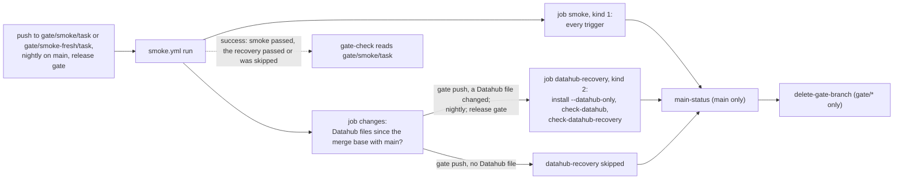

# ADR-078: check-datahub-recovery runs on a gate push only when it changes Datahub's files, and always nightly and in the release gate

- **Status:** Proposed
- **Date:** 2026-10-18
- **Related:** ADR-000, ADR-030, ADR-033, ADR-039, ADR-049, ADR-050, ADR-055, ADR-059, ADR-071, ADR-075, ADR-077

## Context

**Since ADR-075, every smoke run waits for the `datahub-recovery` job.** In PR #227's runs on
2026-10-18, on the commit `main` now holds (`f88c018`), the two jobs took:

| Run | `smoke` job | `datahub-recovery` job |
|---|---|---|
| 39151127918, upgrade | 22.0 min | 28.2 min: set-up 1.6, install 9.9, `check-datahub` 0.2, `check-datahub-recovery` 16.4 |
| 39151127917, fresh | 20.4 min | 30.0 min |

- **The recovery sets the wall time:** about 28 to 30 min for a run on `gate/smoke/<task>` or
  `gate/smoke-fresh/<task>`, against 10 to 11 min on 2026-10-17, before Datahub (ADR-071) and
  the recovery (ADR-075) joined smoke. Without the recovery job, a run takes as long as the
  `smoke` job, about 20.4 to 22.0 min.
- **ADR-077 §3's timeline now measures the recovery:** OpenSearch's pod back on a new volume
  about 25 s, then its install step about 372 s and restore-indices about 92 s; Kafka's about
  15 s, then its install step about 295 s; GMS's pod deleted and ready again about 141 s. None of it reads Polaris, the console or the log batch.
- **Most platform PRs change no Datahub file.** Datahub's own files are
  `charts/datahub/`, the stores' and policies' charts `charts/datahub-postgres/`,
  `charts/datahub-kafka/`, `charts/datahub-opensearch/` and `charts/datahub-network-policies/`,
  and `gates/datahub/`. The shared files the recovery also executes change on nearly every
  platform PR: `gates/gate.py` and `install/release.py` each in 18 commits in the week to
  2026-10-18.
- **What a workflow run's conclusion is:** success when every job succeeded or was skipped
  (ADR-075 Context). gate-check (ADR-039, amended by ADR-040) reads only that conclusion.

**ADR-075 rejected this option** ("(b) Only when Datahub's files change"), for three reasons,
read again here:
- *The timeout stays where the check runs:* true, but since ADR-077 the job takes 28.2 to 30.0
  of its 40 minutes; the timeout is not what this ADR is for.
- *A path list either names nearly all shared files or misses some, and a miss is found by the
  nightly run after the merge:* still true. This ADR takes that cost (Consequences).
- *Smoke would no longer prove §8 on every run, so ADR-071 would be superseded whole:* ADR-071
  §8 sets what the check does, that it runs after `check-datahub`, and that it runs on the gate
  only (ADR-004); it names no trigger. This ADR reads §8 as unchanged. If Kade reads §8 as
  "on every smoke run", ADR-071 is superseded whole, in an ADR of its own, before this one is
  accepted.

**Options compared with Kade (2026-10-18):**
- (A) a workflow of its own on `gate/datahub-recovery/<task>`, required by gate-check when
  Datahub's files change: `scripts/gate_check.py` gains a gate, ADR-039 and ADR-050 (both
  amended) are superseded whole, ADR-033 and ADR-055 amended, the rc ruleset and
  `install/release_tag.py`'s `REQUIRED_CHECKS` gain a check;
- (B) the `datahub-recovery` job stays in `smoke.yml` and is skipped on a gate push that
  changes no Datahub file; gate-check, the release gate and the rc ruleset do not change.

Kade chose (B), with the narrow path list: Datahub's own files and `smoke.yml`, not the shared
files.

## Decision

### 1. When the `datahub-recovery` job runs

| Trigger | `datahub-recovery` |
|---|---|
| A push to `gate/smoke/**` or `gate/smoke-fresh/**` | Only when the head changes a Datahub file (§2) since its merge base with `main` |
| The nightly schedule on `main` (ADR-050, ADR-055) | Always |
| Either release-gate call, upgrade and fresh (ADR-033) | Always |

- **The same rule on both gate levels:** for one head, smoke and smoke-fresh run the same jobs,
  so smoke-fresh still runs every step of smoke's and only the install differs (ADR-050 §2).
- **The merge base, as gate-check reads a PR:** `git diff --name-only origin/main...HEAD`, so
  commits on `main` after the PR branched never count, and a push of `main`'s own head runs
  no recovery.
- **The `smoke` job runs on every trigger,** as today; it does not wait for the decision.

### 2. Datahub's files

- **`charts/datahub/`** and every chart whose folder starts with **`charts/datahub-`**: today
  datahub-postgres, datahub-kafka, datahub-opensearch and datahub-network-policies, and any
  later one named so.
- **`gates/datahub/`.**
- **`.github/workflows/smoke.yml`,** which holds the job and its rule.

Every other file is not Datahub's, `gates/gate.py`, `install/release.py`, `gates/standins.py`,
`gates/kind.yaml`, `gates/pins.json`, `gates/network.py` and `scripts/init_env.py` included.

### 3. How `smoke.yml` decides

- **A first job, `changes`,** on `ubuntu-24.04`, 5 minutes, `contents: read`: it checks out the
  head with its history and prints `recovery=true` or `recovery=false`, with the Datahub files
  that decided it, or none, to its job summary.
- **The list lives in `scripts/gate_check.py`,** beside the other path lists, with a function
  that matches it and a command that the `changes` job runs. gate-check's decision does not
  change: it never reads the list.
- **`datahub-recovery` needs `changes`** and runs when its output is `true`. A failed `changes`
  job fails the run; it never counts as "no recovery needed".
- **`main-status` and `delete-gate-branch`** keep their `needs` and conditions. On `main` the
  recovery always runs, so `main-status`'s result is unchanged.

### 4. What ADR-075 decided and still holds

This ADR supersedes ADR-075 whole (ADR-000 rule 6: it is already amended by ADR-077). Of it,
these stand, with ADR-077's amendments:
- **Two jobs side by side in `smoke.yml`,** `smoke` and `datahub-recovery`, each on its own kind
  cluster, each with a 40-minute timeout. `smoke` runs every step it has, without
  `check-datahub-recovery`.
- **In `datahub-recovery`:** the set-up and install ADR-077 §1 and §2 set, then `check-datahub`,
  then `check-datahub-recovery`, then a state-on-failure step for Datahub's namespace. No other
  check runs in it.
- **`main-status`** needs both jobs and is given `success` only when both succeeded, `failure`
  when either failed, `cancelled` otherwise (ADR-055 §2).
- **`delete-gate-branch`** needs every other job and runs last (ADR-049).
- **gate-check:** `scripts/gate_check.py`'s decision, its gate branches and
  `.claude/rules/gates.md`'s flow do not change. A passing run on `gate/smoke/<task>` covers the
  head, with the recovery job passed or skipped.

### 5. What this amends

- **ADR-077 §1,** the bullet "Fresh on every trigger": the job installs this commit's Datahub,
  fresh, on every trigger §1 here runs it on. ADR-077's other sections stand.
- **Not amended:** ADR-039 and ADR-040 (gate-check reads the same runs), ADR-050 (smoke-fresh
  runs smoke's jobs and steps for the same head), ADR-055 (the nightly run on `main` runs both
  jobs and reports both), ADR-033 (the release gate calls `smoke.yml` as before, and both calls
  run the recovery), ADR-071 (§8, as read in the Context).

## Diagram

## Alternatives considered

| Option | Why not |
|---|---|
| **(A) A workflow of its own on `gate/datahub-recovery/<task>`** | The same wall time for the same rule, but a fourth gate in `scripts/gate_check.py`, ADR-039 and ADR-050 superseded whole, ADR-033 and ADR-055 amended, a check added to the rc ruleset and `REQUIRED_CHECKS`, one more gate branch per PR, and a copy of smoke's set-up steps that drifts from them (ADR-050's reason against `smoke-fresh.yml`). |
| **The broad path list:** the shared files the recovery executes too | `gates/gate.py` and `install/release.py` change on nearly every platform PR, so nearly every run would keep the recovery and save nothing. |
| **The recovery nightly and in the release gate only** | A Datahub PR would merge without its recovery proven; a break is found the next night, after the merge. |
| **Keep it on every run (ADR-075 as amended)** | 28 to 30 min on every platform PR for a check most of them cannot affect. |
| **Only cut the recovery's time** (GMS's redundant restart, probes, pre-pulled images, one double loss) | Each saves 0.5 to 5 min; none takes a non-Datahub run below the recovery job. Still open, each in an ADR of its own; they also shorten the runs that keep the recovery. |

## Consequences

- **A gate push that changes no Datahub file ends with the `smoke` job:** about 20.4 to 22.0 min
  instead of 28.2 to 30.0, and about 28 to 30 fewer runner-minutes. Runs that keep the
  recovery do not change.
- **A break in a shared file that only the recovery shows** (for example in `gates/gate.py`'s
  `check_datahub_recovery` or `install/release.py`'s Datahub steps) passes its PR's smoke and is
  found by the next nightly run on `main`, which opens or comments on `main is red: Smoke`
  (ADR-055). Until it is fixed, every Datahub PR's smoke fails on it too.
- **A session that knows its change reaches the recovery,** but touches no Datahub file, has no
  way to force the job on a gate push under this ADR; the nightly run is its proof. A later ADR
  may add one.
- **Below 20 minutes** needs the `smoke` job itself shorter: its install is 14.0 min upgrade
  (Datahub's part about 8.5) and 12.8 fresh. Those cuts are decided separately, on runs
  measured after this one.
- **Code follows once this ADR is Accepted, in one PR, tests first:**
  - `scripts/gate_check.py`: Datahub's paths, the function that matches them and the command
    the `changes` job runs, with tests in `scripts/test_gate_check.py` (each listed folder, a
    later `charts/datahub-*` chart, `smoke.yml`, `gates/gate.py` and `install/release.py` not
    matching, a rename);
  - `smoke.yml`: the `changes` job, the recovery job's `needs` and `if`, the header comment;
  - `scripts/test_gate_workflows.py`: the `changes` job, the recovery's condition, `smoke`
    without it;
  - `.claude/rules/gates.md` and `CLAUDE.md`: when the recovery runs.
- **That PR changes `.github/workflows/`, `scripts/gate_check.py`, `.claude/rules/` and
  `CLAUDE.md`,** so it is a draft Kade merges by hand (ADR-030, ADR-059). It changes `smoke.yml`,
  so its own smoke and smoke-fresh runs keep the recovery and show the job's rule on a Datahub
  change; after the merge, `main`'s head pushed to `gate/smoke/<task>` shows the job skipped
  and measures the `smoke`-only wall time, recorded on the PR.
