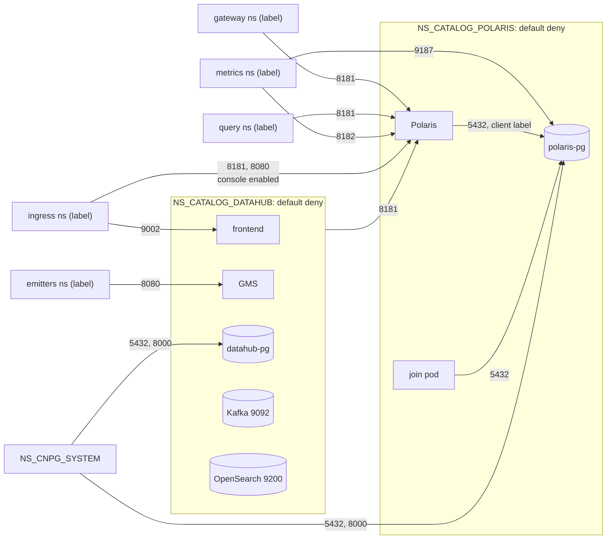
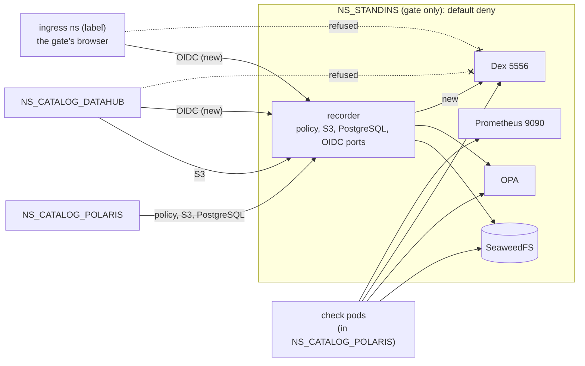

# ADR-079: Ingress is denied by default and allowed per caller, every rule restated with its port, and Datahub's OIDC stand-in admitted

- **Status:** Proposed
- **Date:** 2026-10-20
- **Related:** ADR-000, ADR-002, ADR-004, ADR-016, ADR-017, ADR-031, ADR-033, ADR-034, ADR-039, ADR-043, ADR-044, ADR-045, ADR-046, ADR-048, ADR-050, ADR-053, ADR-059, ADR-066, ADR-067, ADR-068, ADR-070, ADR-071, ADR-078

## Context

**ADR-078 needs two new rows in ADR-048 §3's `NS_STANDINS` table.** Its OIDC stand-in, Dex,
sits behind a new recorder port, and two callers must reach that port:
- **Datahub's frontend,** from `NS_CATALOG_DATAHUB`: discovery, keys, and the token exchange.
- **The gate's browser,** from the ingress controller's namespace. `check-datahub`'s login step
  already runs there (`gates/datahub/check.py`, ADR-071 §8), and `check-datahub-sso` will too.
  It reaches the authorize endpoint and the login form.

**ADR-048 is already amended by ADR-067,** so under ADR-000 rule 6 a second change supersedes it
whole. This ADR restates every rule in force, with the change.

**Where the rules in force are today:**
- **ADR-048** restates ADR-044, and ADR-046 §4's metrics rows.
- **ADR-067** amends §3's `NS_STANDINS` table and §6: Datahub's namespace reaches the recorder's
  S3 port, and SeaweedFS's S3 port in a stress install.
- **ADR-053 §4:** a stress install connects Polaris to SeaweedFS and OPA directly, past the
  recorders. `gates/standins.py` admits Polaris's namespace to both there.
- **ADR-066, ADR-068, ADR-070 and ADR-071 §5** fill in the ports of §3's `NS_CATALOG_DATAHUB`
  rows. ADR-048 left those as "its port", to be filled in when each chart entered. ADR-071 §5
  adds the emitters' caller class, `DATAHUB_EMITTER_NAMESPACE_LABEL`.

**One statement does not match the code.** ADR-068 and ADR-070 say "the gate's check label still
reaches every port (ADR-048 §5)". `gate.py`'s gate-only policies are in `NS_CATALOG_POLARIS`
only (`gates/network.py`, `gate_policies`). Datahub's checks run from pods with Datahub's client
labels instead (ADR-071 §8). §5 below states what the code does.

## Decision

**Supersedes ADR-048 whole.** ADR-067's rows and cases are restated in §3 and §6. ADR-067 stays
in force for its §5 (smoke's failure step prints Datahub's namespace). Only §3's two OIDC rows
and §6's matching cases are new.

### 1. Deny by default, allow per caller (restated from ADR-048)

- **Every namespace of this repository has a default-deny ingress `NetworkPolicy`**, and allow
  policies per caller class. On the gate and test clusters that includes `NS_STANDINS`
  (ADR-031).
- **Callers in other teams' namespaces are selected by a namespace label given in `.env`**
  (ADR-002), never by a namespace name in a chart.
- **Egress is not restricted;** that is a later ADR.

### 2. Caller classes from `.env` (restated from ADR-048 and ADR-071 §5)

- **One variable per caller class, holding one `key=value` namespace label:**

  | Variable | Caller class |
  |---|---|
  | `POLARIS_GATEWAY_NAMESPACE_LABEL` | the catalog gateway's namespace |
  | `POLARIS_QUERY_NAMESPACE_LABEL` | user namespaces (StarRocks) |
  | `METRICS_NAMESPACE_LABEL` | the metrics scraper's namespace |
  | `INGRESS_NAMESPACE_LABEL` | the ingress controller's namespace |
  | `DATAHUB_EMITTER_NAMESPACE_LABEL` | Datahub's lineage emitters' namespaces |

- **Empty means no namespace of that class is allowed;** the install says so and goes on.
- **This repository's own namespaces and the operator's** are selected by
  `kubernetes.io/metadata.name`, a label Kubernetes sets on every namespace, with the name from
  `.env` (`NS_CATALOG_DATAHUB`, `NS_CNPG_SYSTEM`, `NS_CATALOG_POLARIS`, `NS_STANDINS`). No name is
  written in a chart.

### 3. The rules

`NS_CATALOG_POLARIS` (restated from ADR-048):

| Target | Port | Allowed from |
|---|---|---|
| Polaris API | 8181 | gateway, query and Datahub namespaces; the ingress controller's namespace while the console is enabled |
| Polaris management | 8182 | the metrics scraper's namespace |
| The console | its container port (8080) | the ingress controller's namespace, while the console is enabled |
| polaris-pg's instances | 5432 | pods labelled `lakehouse/polaris-pg-client: "true"` in this namespace (Polaris, the bootstrap pod); the other instances of the namespace's Clusters; CNPG's join pods in this namespace (`cnpg.io/jobRole: join`) |
| polaris-pg's instances | 5432, 8000 | the operator's namespace `NS_CNPG_SYSTEM` |
| polaris-pg's instances | 9187 | the metrics scraper's namespace (ADR-046 §4) |

- **Join pods by `cnpg.io/jobRole: join`, not `cnpg.io/cluster`:** only the pods that clone an
  instance. CNPG's other jobs restore from S3 or initialise locally and need no ingress.
- **Instances** are pods with `cnpg.io/podRole: instance`. The rules cover every Cluster in the
  namespace, the gate's `polaris-pg-restore` (ADR-043) included.
- **The 8182 and 9187 rules** are left out while `METRICS_NAMESPACE_LABEL` is empty.
- **The log batch** and the bootstrap pod receive no connection, so nothing is allowed to them.

`NS_CATALOG_DATAHUB`, with the ports its charts filled in:

| Target | Port | Allowed from |
|---|---|---|
| datahub-pg's instances | 5432 | pods labelled `lakehouse/datahub-pg-client: "true"` in this namespace; the other instances of the namespace's Clusters; CNPG's join pods in this namespace (ADR-066) |
| datahub-pg's instances | 5432, 8000 | the operator's namespace `NS_CNPG_SYSTEM` (ADR-066) |
| datahub-kafka's pod | 9092 | pods labelled `lakehouse/datahub-kafka-client: "true"` in this namespace (ADR-068) |
| datahub-opensearch's pod | 9200 | pods labelled `lakehouse/datahub-opensearch-client: "true"` in this namespace (ADR-070) |
| Datahub GMS | 8080 | pods labelled `lakehouse/datahub-gms-client: "true"` in this namespace; the emitters' namespaces (ADR-071 §5) |
| Datahub frontend | 9002 | the ingress controller's namespace (ADR-071 §5) |

- **No rule:** OpenSearch's transport port 9300 (one node has no peer), and the metrics ports
  (datahub-pg's 9187, GMS's 4318 and 4319). The metrics ports join with Datahub's scrape
  contract (P5).

`NS_STANDINS`, gate and test clusters only. The gate's check pods are pods labelled
`lakehouse-gate/check: "true"` in `NS_CATALOG_POLARIS`.

| Target | Port | Allowed from |
|---|---|---|
| The recorder | its policy, S3 and PostgreSQL ports | Polaris's namespace |
| The recorder | its S3 port | also Datahub's namespace (ADR-067) |
| **The recorder** | **its OIDC port** | **Datahub's namespace; the ingress controller's namespace (new, ADR-078)** |
| SeaweedFS, OPA | their ports | the recorder; the gate's check pods |
| SeaweedFS, OPA, in a stress install | their ports | also Polaris's namespace (ADR-053 §4) |
| SeaweedFS, in a stress install | its S3 port | also Datahub's namespace (ADR-067) |
| **Dex** | **5556** | **the recorder; the gate's check pods (new, ADR-078)** |
| The Prometheus stand-in | 9090 | the gate's check pods (ADR-046 §4) |

- **The OIDC port admits the ingress controller's namespace by its label,** not the gate's
  check label. The gate's browser runs there, as a user's browser reaches a target's provider
  from outside. On a target cluster, nothing of this table exists (ADR-031).
- **Dex takes no connection from Datahub's or the ingress namespace directly,** so every OIDC
  exchange is recorded.

### 4. Where the policies live (restated from ADR-048)

- **A local chart per service namespace:** `charts/polaris-network-policies` and
  `charts/datahub-network-policies`. Each is installed first in its part of step 1 (ADR-045),
  and rendered, schema-checked and validated with kubeconform in the static gate (ADR-016). Helm
  removes from the cluster a policy removed from the chart.
- **The upstream charts stay unchanged.** Pods are selected by the labels they already carry,
  plus the client labels set through each `values-lakehouse.yaml`.
- **`NS_STANDINS`'s policies** are applied by the gate's own scripts with the stand-ins, never
  part of a release (ADR-031).

### 5. Gate-only callers (restated from ADR-048)

On the gate only, `gate.py` adds two allow policies to `NS_CATALOG_POLARIS`, never part of a
release:
- the gate's check pods reach every port there;
- the PostgreSQL recorder in `NS_STANDINS` reaches polaris-pg's 5432 (ADR-034).

`NS_CATALOG_DATAHUB` gets no gate-only policy. Datahub's checks run from pods carrying Datahub's
client labels, or from the ingress namespace, so they pass through §3's rules (ADR-071 §8).

### 6. `check-network` proves each rule

The smoke step `check-network` creates one namespace per caller label from the gate's `.env`,
and one with none. From a short-lived pod in each, it tries a TCP connection. The probe pods
never carry the gate's check label, so §5 does not admit them.
- **Each allowed row:** a connection from a namespace or pod of that class succeeds.
- **Each row:** a connection from the unlabelled namespace fails within a timeout. So does one
  from a labelled namespace to a port its class is not allowed (gateway to 8182, emitters to
  9002).
- **polaris-pg and datahub-pg on 5432:** refused from the unlabelled namespace and from an
  unlabelled pod in their namespace. Allowed from a pod there labelled
  `cnpg.io/jobRole: join`, and refused from a pod with that label in the unlabelled namespace.
- **polaris-pg on 9187:** allowed from the metrics namespace; refused from the unlabelled and
  the gateway namespaces.
- **Datahub's stores:** 9092 and 9200 allowed only from a pod with that store's client label;
  9300 refused from the labelled pod (ADR-068, ADR-070).
- **`NS_STANDINS`:**
  - SeaweedFS and OPA are refused from an unlabelled pod in `NS_CATALOG_POLARIS`.
  - From an unlabelled pod in `NS_CATALOG_DATAHUB`, the recorder's S3 port connects, and OPA
    and its PostgreSQL port are refused (ADR-067).
  - **New:** the recorder's OIDC port connects from an unlabelled pod in `NS_CATALOG_DATAHUB`
    and from the ingress namespace. Dex is refused from both, and the OIDC port from the
    unlabelled namespace.

Workloads working, and `check-traffic` (ADR-034), prove the other allowed sources. If a refused
connection succeeds, kindnet is not enforcing: the code stops there, and a new ADR changes
ADR-017's cluster to a CNI that does.

### 7. Smoke rebuilds a replica under the policies (restated from ADR-048)

- **`gate.py rebuild-replica`,** right after the install and before `check-polaris-pg`,
  deletes the PVC of one replica of polaris-pg (not `.status.currentPrimary`) without waiting,
  then its pod, with plain `kubectl` in `NS_CATALOG_POLARIS`.
- **It passes when** a join pod of polaris-pg ran, and the Cluster is Ready again with three
  instances within a time limit set in the code. On failure it prints the join pod's log.
- **`check-polaris-pg` then runs on the rebuilt Cluster.**
- **Gate only:** it deletes a volume, so it runs only on the kind gate (ADR-004). ADR-050's
  `smoke-fresh` runs it too.

## Diagram

## Alternatives considered

| Option | Why not |
|---|---|
| **Amend ADR-048 a second time** | ADR-000 rule 6: an ADR already amended is superseded whole. |
| **Supersede ADR-067 too** | Its §5, smoke's failure step, is not a network rule. Its rows are restated here, as ADR-048 restated ADR-046's and left ADR-046 in force. |
| **Restate only ADR-048's text, with "its port" left open** | The Datahub rows would still need four other ADRs to read. Each port is now known. |
| **Admit the gate's check pods, not the ingress namespace, to the OIDC port** | The browser would need the check label, and then §5 would admit it to every port of Polaris's namespace. The ingress namespace is where the gate's login check already runs. |
| **Let the frontend and the browser reach Dex directly** | No record of the token exchange (ADR-078 §3). |

## Consequences

- **The two OIDC rows and their cases** are built in ADR-078's code PRs, in `gates/standins.py`
  and `gates/network.py` with their tests. No other rule changes, so no chart or install code
  changes for this ADR.
- **When Kade accepts this ADR,** in the same commit: ADR-048 becomes `Superseded by ADR-079`;
  ADR-067 keeps its status (Accepted) and its §5. The living documents that cite ADR-048 cite
  this ADR instead (ADR-000 rule 9): `CLAUDE.md`, `docs/plans/roadmap.md`,
  `docs/runbooks/restore-polaris-pg.md` and `docs/runbooks/stress-capacity.md`.
- **Comments and tests that cite ADR-048** in `charts/`, `gates/`, `install/`, `scripts/`,
  `.env.template` and `smoke.yml` move to this ADR in ADR-078's first code PR. Those are not
  living documents, and the code does not change for them.
- **ADR-078 is accepted after this one,** since its §4 rests on §3's new rows.
