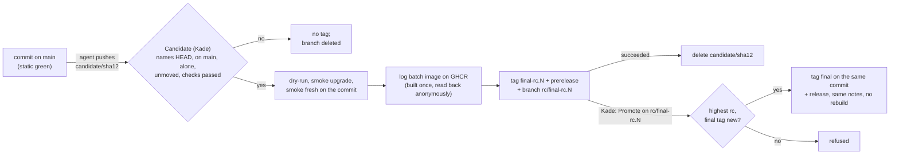

# ADR-080: Releases are candidates at a `main` commit, promoted without a rebuild

- **Status:** Proposed
- **Date:** 2026-10-23
- **Related:** ADR-000, ADR-002, ADR-006, ADR-022, ADR-033, ADR-036, ADR-037, ADR-039, ADR-042, ADR-049, ADR-050, ADR-051, ADR-055, ADR-059, ADR-074

## Context

**What is decided and in force:** ADR-033 releases through `rc`. Kade merges a PR from `main`
into `rc`; `release-gate.yml` runs `the head is main`, `static`, the dry-run and two smokes
(upgrade, fresh) on it; Kade starts `release.yml` on `rc`, which tags the merge commit with
`platform-YYYY.MM.DD` (`.N` for a later one the same UTC day) after reading those checks on the
PR's head. ADR-042 (amended by ADR-074) builds and pushes the log batch's image in that
workflow, before the tag. The `platform-*` tag ruleset keeps tags from moving or being deleted.

**What Kade decided for every repository** (`kade-agent/agent-config`,
`docs/release-flow-plan.md`, accepted 2026-10-20, step 7, and "merged. proceed lakehouse",
2026-10-23): a release is made in two runs of Kade's, on a commit that is already on `main`.
Candidate gates the commit and makes a candidate; Promote releases that same candidate. Neither
builds again. An agent starts a release by pushing `candidate/<12-character sha>` at a `main`
commit; the `rc` branch, its PR and its ruleset go.

**What is specific to this repository:** it has no version file. The release tag is computed
from the UTC date (`install/release_tag.py next_tag`), so there is nothing to stamp and a
candidate is the `main` commit itself. Its gates (dry-run, smoke upgrade, smoke fresh) are
workflows that can be called (ADR-050) and delete their own `gate/*` branch only when the ref
is a gate branch (ADR-049). Its log batch's image is built once per content hash and never
overwritten (ADR-042).

**ADR-042 is superseded whole** because ADR-074 already amended it, and ADR-000 §6 lets an
amended ADR change only by being superseded whole. §3 below restates what stays.

## Decision

### 1. The flow

1. **Push.** An agent pushes `candidate/<first 12 characters of the commit's sha>` at a commit
   on `main` and adds no commit. The branch is pushed once and never again.
2. **Candidate** (`candidate.yml`, Kade starts it by hand on that branch; §2 to §5). It checks
   the commit, runs the gates, builds the image, tags the commit `<final>-rc.N`, makes a
   GitHub prerelease with the notes, and makes the branch `rc/<rc tag>` at the same commit.
3. **Promote** (`promote.yml`, Kade starts it by hand on `rc/<rc tag>`; §6). It tags the same
   commit with the final tag and makes the release with the prerelease's notes. Nothing is
   built or tested again.

### 2. Names

- **The final tag** is `platform-YYYY.MM.DD`, `.N` appended (from 2) for a later one the same
  UTC day, as ADR-033 has it. `install/release_tag.py next_tag` computes it from the tags.
- **The candidate tag** is `<final>-rc.N`, N counting from 1 per version: `platform-2026.10.23-rc.1`.
  It is on the `main` commit, not a stamp commit: this repository has no version file.
- **A candidate tag is not a release.** `previous` and `next_tag` ignore it, so a date that has
  only candidate tags is still free, and the gates upgrade from the latest release, never from
  a candidate (ADR-051).
- **The branch** `rc/<rc tag>` exists to run Promote from, since the GitHub app lists branches
  and not tags. A branch `rc` cannot exist beside `rc/...` (git holds a ref as a file or a
  directory, not both), so Kade deletes `rc` first.

### 3. Candidate's checks (replace ADR-033's release gate)

All run on the candidate branch, in this order:

1. **The candidate is sound**, in `check the candidate`: the ref is `candidate/*`; the branch
   names HEAD; HEAD is on `origin/main`; no other `candidate/*` branch is left over; the
   branch has not moved; every check run on HEAD finished and none failed, and `static`
   succeeded (`install/release_tag.py check-candidate`, `checks-passed`). Left out of that
   read: this run's own jobs, Candidate's, the guard's and auto-candidate's jobs from any
   run, and the gates Candidate calls from an earlier run (`CANDIDATE_JOBS`).
2. **The gates**, called as ADR-033's release gate called them: `dry-run`, `smoke upgrade` and
   `smoke fresh`, from `dry-run.yml` and `smoke.yml`, on the candidate commit itself and not a
   merge result. A called workflow's jobs get at most what the calling job grants, so each
   calling job grants `contents: write` (their delete job) and `issues: write` (`smoke.yml`'s
   main-status job); both jobs skip a ref that is not a gate branch or `main` (ADR-049,
   ADR-055).
3. **The image** (§4).
4. **The tag** only when 1 to 3 succeeded, and after the branch is read again: it is still at
   the commit the run started on.

`static` is read as a check run of the commit, not run again; it ran on `main` for that commit
(ADR-050, ADR-055).

### 4. The image is built in Candidate, once (replaces ADR-042 §1)

- **Where:** a Candidate job, after the gates, with `contents: read` and `packages: write`
  only. The tag job needs it, so a candidate is tagged only once its image can be pulled.
- **What, unchanged:** built from `images/polaris-log-batch` of the candidate commit for
  `linux/amd64` and pushed as `ghcr.io/kade-k8s-platform/lakehouse/polaris-log-batch:<content
  hash>` (ADR-074), the tag `batch_image` computes and the chart pins. **A tag is never
  overwritten:** if it is in GHCR, nothing is built or pushed and its digest is used. The
  digest is then read back **without credentials**; if that is refused, for example because
  the package is private, no candidate is tagged, and Kade makes the package public once and
  runs Candidate again.
- **The prerelease's notes name the image with its digest.** Promote reuses those notes; it has
  no packages access and never builds.

### 5. Candidate's end

- **The rc tag and prerelease** are made on the candidate commit by a job that runs none of
  the repository's code and is the only one besides the image and cleanup jobs that can write;
  `rc/<rc tag>` is made at the same commit, and the same version's lower `rc/` branches are
  deleted.
- **The last job deletes `candidate/<sha>` only when the tag job succeeded.** A failed or
  refused Candidate keeps its branch, so Kade can run it again; a newer candidate or Kade
  deletes it.
- **`candidate-guard.yml`** keeps the branch as it was made: on creation it checks the name
  and that the commit is on `main`; on any later push it deletes the branch and fails; any
  push to `rc/*` is someone else's (Candidate makes them with `GITHUB_TOKEN`, which starts no
  workflow) and is deleted too.

### 6. Promote (replaces ADR-033's release workflow)

It refuses unless the branch `rc/<rc tag>` is at its tag's commit, that tag is the highest
candidate of its version, the final tag does not exist and is above the latest release, and the
prerelease exists (`install/release_tag.py rc-branch`, `check-promote`). It then tags the final
tag on the same commit, makes the GitHub release, marked latest, with the prerelease's notes,
and deletes the `rc/` branches of that version and every older one. A failed run keeps them.
Candidate and Promote share `concurrency: release`.

### 7. What does not change, and what goes

- **Unchanged:** the `platform-*` tag ruleset (it covers `-rc.N` tags); the gates' behaviour
  and their upgrade from the latest release (ADR-051); auto-merge acts only on `claude/*`
  heads into `main` (ADR-022) and leaves `.github/workflows/`, `docs/adr/` and `CLAUDE.md` to
  Kade (ADR-059); `gates/gate.py released_tags` still finds a tag that is an ancestor of HEAD.
  Releases `platform-2026.10.10` to the latest stand as they are, on `rc` merge commits.
- **Goes:** `release.yml`, `release-gate.yml`, the `rc` branch and its ruleset (Kade's
  settings), `REQUIRED_CHECKS` and `verify()` in `release_tag.py`, and the exception for PRs
  into `rc` in `gate-check.yml` (nothing can match it any more).
- **Sessions** push a candidate branch only when Kade asks, and never run Candidate or Promote.
- **Not here:** an automatic candidate (`auto-candidate.yml`); a later ADR adds it. Its job
  names are already left out of the check read (§3).
- **Supersedes ADR-033 and ADR-042.** ADR-074's image name is kept in §4.

## Diagram

## Alternatives considered

- **Keep the `rc` PR and add a Promote:** a release would still need a merge into a branch whose
  only content is `main`'s, and `rc` could not stay beside `rc/...`.
- **A stamp commit as the other repositories do:** this repository has no version file to
  write, so the commit would change nothing and the tag would name a commit that never
  passed `main`'s checks.
- **Rebuild the image in Promote:** a second build under the same hash would be the same bytes
  by design, but it would put `packages: write` in the workflow that tags the release.
- **Run `static`'s tests inside Candidate:** they already ran on the same commit on `main`
  (ADR-055); reading the check run costs nothing and cannot diverge.
- **Leave ADR-042 amended and say so in this ADR:** ADR-000 §6 forbids a second amendment.

## Consequences

- **Any commit of `main` that passed can be released** after a later commit fails, which ADR-033
  chose `rc` to get, without a branch that only mirrors `main`.
- **A candidate is tried before it is released**, and what is released is that candidate's
  commit, image and notes.
- **Kade's steps, in order:** delete the branch `rc` and its ruleset; keep the `platform-*` tag
  ruleset; an agent pushes `candidate/<sha>`; Kade runs Candidate there, then Promote on
  `rc/<rc tag>`.
- **`candidate.yml`, `promote.yml` and `candidate-guard.yml` run only after their merge:** the
  first candidate proves them.
- **`kade-agent/code-quality-assurance`'s profile of this repository** still names the old
  flow; it changes there.
