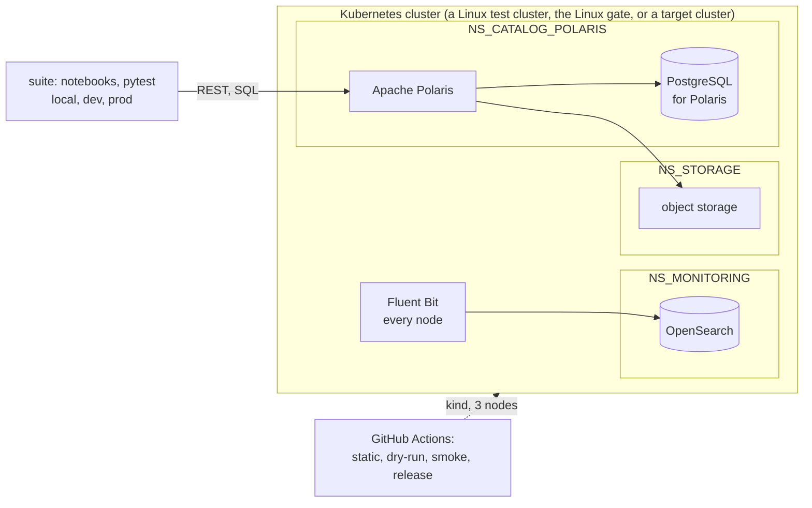

# lakehouse: Architecture Decision Records

The decisions this repository is built from (ADR-001). Nothing outside `docs/adr/` is trusted
until an ADR covering it is Accepted. See [ADR-000](000-adr-process-and-template.md) for how
these records are written and changed.

## Status legend

| Status | Meaning |
|---|---|
| **Accepted** | Decided. Build on it. |
| **Accepted (details proposed)** | The core decision is made; some details inside are still suggestions. |
| **Proposed** | Suggested, not yet confirmed. Confirm, change, or reject before building on it. |
| **Deferred** | Decided to decide later; recorded so nobody builds around an assumption. |
| **Rejected** | Dropped. Kept for history so that it is not proposed again. |
| **Superseded by ADR-NNN** | Replaced. Kept for history. |
| **Amended by ADR-NNN** | Still in force, except the part that ADR-NNN replaces. Read both. |

## System at a glance

## Index

| # | Title | Status |
|---|---|---|
| **Process and repository** | | |
| [000](000-adr-process-and-template.md) | ADR process and template | Accepted |
| [001](001-the-repository-starts-from-its-decision-records.md) | The repository starts from its decision records; code enters only under an Accepted ADR | Accepted |
| [002](002-the-repository-is-public-and-configuration-lives-in-env.md) | The repository is public; environment-specific configuration lives in `.env` | Accepted |
| [003](003-state-lives-in-labelled-issues-and-the-pr-is-the-session-record.md) | State lives in labelled issues of this repository; the PR is the session record | Accepted |
| **Environments and credentials** | | |
| [004](004-the-platform-targets-linux-only.md) | The platform targets Linux only; releases are proven on the Linux gate; target clusters are never reached | Accepted |
| [005](005-the-suite-runs-in-three-environments-with-guards.md) | The suite runs in three environments, each with its own guards | Accepted |
| [006](006-credentials-are-never-committed.md) | Credentials are never committed; an init-env script generates them per clone and creates the Secrets | Accepted |
| **Platform** | | |
| [007](007-namespaces-by-service-type-named-in-env.md) | Namespaces are split by service type, and their names come from `.env` | Amended by ADR-023 |
| [008](008-each-service-has-its-own-postgresql.md) | Each service has its own PostgreSQL, in the service's namespace | Accepted |
| [009](009-the-iceberg-catalog-is-apache-polaris.md) | The Iceberg catalog is Apache Polaris, from a local chart at a pinned version | Accepted |
| [010](010-postgresql-runs-on-the-cloudnativepg-operator.md) | PostgreSQL runs on the CloudNativePG operator, one `Cluster` per service | Amended by ADR-029 |
| [011](011-object-storage-is-minio.md) | Object storage is MinIO, from a local chart at a pinned release | Superseded by ADR-023 |
| [012](012-install-order-operators-first-then-storage-services-monitoring.md) | Install order: operators, storage, then each service's PostgreSQL and the service, then monitoring | Superseded by ADR-029 |
| [013](013-logs-ship-to-opensearch-in-the-monitoring-namespace.md) | Logs ship with Fluent Bit to OpenSearch, which runs in the monitoring namespace | Superseded by ADR-024 |
| [014](014-polaris-writes-one-log-file-per-pod-for-an-hourly-batch.md) | Polaris writes one log file per pod, read by an hourly batch released separately | Accepted |
| **Measurement and verification** | | |
| [015](015-measurements-run-on-the-plain-upstream-schema.md) | Measurements run on the plain upstream Polaris schema; no custom indexes | Accepted |
| [016](016-settings-are-verified-on-the-running-object.md) | A setting is verified on the running object against the chart default, never in the values file | Accepted |
| **Gates and releases** | | |
| [017](017-the-linux-gate-cluster-is-kind-with-three-nodes.md) | The Linux gate cluster is kind with three nodes on a GitHub-hosted runner | Amended by ADR-023 |
| [018](018-dry-run-and-smoke-gates-run-from-gate-branches.md) | Dry-run and smoke gates run from throwaway `gate/*` branches on the PR's exact commit | Amended by ADR-032 |
| [019](019-a-platform-pr-merges-only-when-a-dry-run-covers-its-head.md) | A platform PR merges only when a passing dry-run gate covers its head | Amended by ADR-033 |
| [020](020-a-release-tag-is-created-only-by-the-release-workflow.md) | A release tag is created only by the release workflow, after the full Linux gate | Superseded by ADR-033 |
| [021](021-gates-upgrade-from-the-last-release-rebuilt-from-its-tag.md) | Gates upgrade from the last release, rebuilt from its tag; no machine snapshots | Amended by ADR-033 |
| [022](022-claude-prs-merge-through-the-auto-merge-workflow.md) | Claude's PRs merge through an auto-merge workflow once every check on the head is green | Amended by ADR-030 |
| **Scope and integration** | | |
| [023](023-other-teams-services-are-interfaces-with-stand-ins-on-the-gate.md) | Other teams' services are interfaces in `.env`, with stand-ins only on the gate | Superseded by ADR-031 |
| [024](024-the-log-batch-hands-processed-files-to-the-observability-teams-fluent-bit.md) | The log batch hands processed files to the observability team's Fluent Bit | Accepted |
| [025](025-datahub-with-postgresql-on-cnpg-a-small-kafka-and-a-small-opensearch.md) | Datahub runs with PostgreSQL on CloudNativePG, a single-broker Kafka and a small OpenSearch | Accepted |
| [026](026-polaris-issues-its-own-tokens-and-asks-an-opa-policy-endpoint.md) | Polaris issues its own tokens and asks an OPA policy endpoint; principals are created by the catalog gateway | Accepted |
| [027](027-ingress-is-denied-by-default-and-allowed-per-caller.md) | Ingress to this repository's namespaces is denied by default and allowed per caller | Amended by ADR-034 |
| [028](028-the-polaris-console-is-a-maintainer-tool-outside-the-release-path.md) | The Polaris console is a maintainer tool, built from a pinned commit and kept off the release path | Accepted |
| [029](029-the-cnpg-operator-belongs-to-the-operator-team-installed-here-only-on-the-gate.md) | The CloudNativePG operator belongs to the operator team; this repository installs it only on the gate and test clusters | Accepted |
| [030](030-auto-merge-leaves-prs-that-change-the-merge-rules-or-the-checks-to-kade.md) | Auto-merge leaves PRs that change the merge rules or the checks to Kade | Accepted |
| [031](031-other-teams-services-are-interfaces-stand-ins-only-on-the-gate-seaweedfs-for-s3.md) | Other teams' services are interfaces in `.env`; stand-ins only on the gate, SeaweedFS for S3 | Amended by ADR-034 |
| [032](032-a-cleanup-workflow-deletes-merged-claude-branches-and-their-gate-branches.md) | A cleanup workflow deletes merged `claude/*` branches and their `gate/*` branches | Accepted |
| [033](033-release-candidates-are-gated-on-a-pr-from-main-into-rc-the-release-workflow-tags-rc.md) | Release candidates are gated on a PR from `main` into `rc`; the release workflow tags `rc` | Accepted |
| [034](034-recording-proxies-on-the-gate-prove-each-connection-and-its-exchanges.md) | Recording proxies on the gate prove each of Polaris's connections and its exchanges | Amended by ADR-035 |
| [035](035-the-postgresql-recorder-ends-the-clients-tls-and-talks-plain-to-postgresql.md) | The PostgreSQL recorder ends the client's TLS and talks plain TCP to PostgreSQL | Accepted |
| [036](036-polaris-and-the-log-batch-share-one-readwritemany-claim-and-the-batch-publishes-each-utc-hour-once.md) | Polaris and the log batch share one ReadWriteMany claim; the batch publishes each UTC hour once | Proposed |

## Not ADRs

- **Measurements and their numbers:** `docs/measurements/`, with their evidence (ADR-003).
- **What is next:** labelled issues (ADR-003).
- **How to run something:** runbooks, once they enter.
- **Tuning values** (window sizes, caps, replica counts): values files and their comments.
