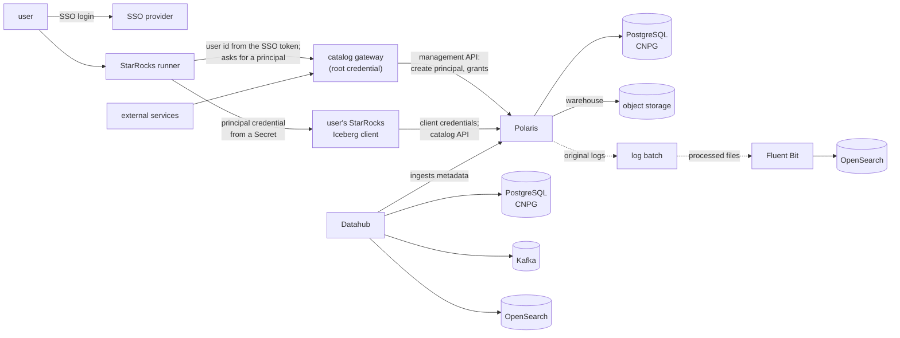

# Roadmap: publishing the lakehouse platform

- **Date:** 2026-10-10
- **Status:** plan. This is not a decision. Each item enters through its own ADR and PR
  (ADR-001); this file is updated when a phase starts or finishes.

## Scope

This repository builds, gates and releases the services in the first column. The services in
the second column belong to other teams. Here they are only interfaces, configured in `.env`
(ADR-002), with stand-ins on the gate cluster that are never released.

| Built and released here | Interfaces to other teams' services |
|---|---|
| **Apache Polaris** (ADR-009), with its own PostgreSQL on CloudNativePG (ADR-008, ADR-010) | **Object storage**, S3-compatible: the Iceberg warehouse and backups |
| **Polaris console** (`apache/polaris-tools` `console/`) | **Observability**: Fluent Bit, OpenSearch, Prometheus, Grafana |
| **The Polaris log batch** (ADR-014): processed log files ready for Fluent Bit | **ETL**: Spark, Flink, the shared Kafka |
| **Datahub**, with PostgreSQL on CNPG, a single-broker Kafka and a small OpenSearch, used by Datahub only (ADR-025) | **Query clients**: Trino, Iceberg clients, per-user StarRocks |
| | **SSO**: Keycloak |
| | **The catalog gateway**: Polaris's authorizer and wrapper API, built elsewhere |

Out of scope: each user's Spark cluster, because it calls neither Polaris nor Datahub.

## How callers reach Polaris and Datahub

- **Polaris issues its own tokens.** Each StarRocks Iceberg client authenticates to Polaris
  with its own principal's client ID and secret. Polaris RBAC on catalogs, namespaces and
  tables decides what it may do.
- **Principals are created by the catalog gateway**, which holds the root credential, when the
  StarRocks runner asks for one. The runner finds a user's credential by the user ID in their
  SSO token.
- **Exchanging an SSO token for a Polaris token is experimental** (P4). It is never on the
  release path until its ADR is Accepted.

## Phases

Each phase lists its ADRs, PRs, gate, and what only a Linux test cluster can verify
(`cmd:verify-needs-linux` issues).

### P0: realign the decisions to this scope (ADRs only)

**Done:** ADR-023 to ADR-028, accepted by Kade on 2026-10-10. Kade's choices: Datahub's PostgreSQL
moves to CNPG now, its Kafka is the official image with one broker, Polaris stays at 1.6.0,
Polaris uses the OPA authorizer, and the console's image source does not matter for
operation. What follows is the list they cover.

- **Amend or supersede the ADRs written for a wider scope:**
  - ADR-007: namespaces only for what is built here; endpoints of other teams' services go in
    `.env`.
  - Object storage becomes an external S3 endpoint, with MinIO only as the gate's stand-in
    (ADR-023).
  - The install order without storage and monitoring (ADR-023; restated in full by ADR-029).
  - Fluent Bit and OpenSearch belong to the observability team; this repository delivers the
    log files ADR-014 describes, in a documented format (ADR-024).
  - ADR-014: its open question (sharing the log volume across nodes) is answered before the
    batch is built.
  - ADR-017: the gate installs stand-ins (MinIO, Fluent Bit) that are never released.
  - ADR-006: `init_env.py` drops the `minio-root` and `opensearch-admin` Secrets and gains
    Datahub's.
- **New ADRs:**
  - Datahub and its PostgreSQL, Kafka and OpenSearch;
  - the contract with other teams' services (S3, metrics, log files, SSO);
  - Polaris authentication and principal provisioning, as above;
  - network policies: which callers may reach which port;
  - the Polaris console: chart, and image source.
- **Gate:** static (ADR checker). Kade accepts each ADR.

### P1: the gates and the foundation

- The kind gate with dry-run and smoke workflows (ADR-017, ADR-018), gate-check (ADR-019),
  and the release workflow (ADR-020, ADR-021). The first release has nothing to upgrade from.
- The CloudNativePG operator on the gate and test clusters only, at the pinned version; on
  the target clusters it is the operator team's, and a release only checks it is present
  (ADR-029, accepted by Kade on 2026-10-10).
- gate-check first, before any platform file (done, PR #16); then ADR-030 (accepted), so
  auto-merge leaves PRs that change workflows or gate scripts, and drafts, to Kade
  ([#15](https://github.com/enjay27/lakehouse/issues/15)).
- **Gate:** static, then dry-run and smoke on kind. **Linux:** `init_env.py --apply-secrets`
  ([#6](https://github.com/enjay27/lakehouse/issues/6)).

### P2: Polaris 1.6.0 and its console

- The PostgreSQL `Cluster`, then the local Polaris chart (ADR-009). Settings are verified on
  the running object (ADR-016).
- Bootstrap: the realm and root principal from Secrets (ADR-006), then a catalog on the S3
  endpoint (MinIO stand-in on the gate).
- Smoke tests through the Iceberg REST API, as an ordinary principal: create a namespace and
  a table, write, read, and check that a principal without a grant is refused.
- The console from `apache/polaris-tools`. If no image is published, it is built from a
  pinned commit in the job (ADR-017).
- The log batch (ADR-014) and its output format for Fluent Bit (ADR-024). A
  stand-in Fluent Bit on the gate proves the hand-off.
- **Gate:** dry-run and smoke. **Linux:** the release installed on a test cluster.

### P3: Datahub

- Its PostgreSQL on CNPG, a single-broker Kafka and a single-node OpenSearch, all in
  `NS_CATALOG_DATAHUB`, then Datahub itself (ADR-025).
- Datahub ingests Polaris's catalog with its own read-only principal.
- Its own login through SSO, against a stand-in on the gate.
- A runbook, proven on a Linux test cluster, moves Datahub's metadata from the target
  clusters' existing PostgreSQL-HA to the new `Cluster`.
- **Gate:** dry-run and smoke, including one ingestion run.

### P4: callers and their contracts

- One contract test per caller class against the gate's Polaris and Datahub. They use the
  caller's protocol and a principal like the one it uses in production. Classes:
  - the catalog gateway: the management API;
  - StarRocks' Iceberg client: the catalog API, one principal per user;
  - Trino, through its Iceberg REST catalog connector;
  - Spark and Flink ETL jobs writing Iceberg tables;
  - a Kafka Connect Iceberg sink on the ETL Kafka;
  - table maintenance jobs (compaction, snapshot expiry, orphan-file cleanup);
  - Prometheus, scraping Polaris's management port and Datahub's metrics;
  - Datahub's callers: Spark and Flink lineage, an orchestrator that emits lineage or runs
    ingestion, data-quality and BI tools reading its API, and SSO for its login.
- Datahub ingests from Polaris only (Kade, [#10](https://github.com/enjay27/lakehouse/issues/10)).
  Notebooks do not call Polaris.
- Network policies from P0's ADR.
- The experimental token exchange (an SSO token for a Polaris token for the same principal):
  a spike behind its own ADR, never on the release path.

### P5: hooks for the observability team

- Metrics endpoints for Polaris (management port 8182) and Datahub, and the scrape
  configuration the other team's Prometheus needs.
- Log files and their format as P0 documents them. No dashboards of our own.

### P6: measurements

- The suite (ADR-005) measures Polaris catalog latency and throughput on the plain upstream
  schema (ADR-015). Results go to `docs/measurements/`, with the versions measured (ADR-003).

### P7: first release, then upgrades

- `v1.0.0` through the release workflow (ADR-020), with release notes and runbooks for
  installing and upgrading.
- The Polaris 1.7.0 upgrade as its own PR (ADR-009), gated from the last release (ADR-021).

## Pinned versions

Chosen on 2026-10-10 ([#9](https://github.com/enjay27/lakehouse/issues/9)). Each value moves
into its chart's values when the chart enters; a pin whose source is "target unknown" moves
when Kade learns the target clusters' version.

| Item | Pin | Source |
|---|---|---|
| Kubernetes (gate, kind) | 1.36 (`kindest/node:v1.36.4`) | Kade: latest stable; 1.37 exists, but CloudNativePG 1.30 supports 1.34–1.36 |
| CloudNativePG operator (gate only, ADR-029) | 1.30.1 | latest; target unknown |
| Polaris | 1.6.0 | Kade (ADR-009) |
| PostgreSQL for Polaris | 16, 3 instances | Kade |
| Pooler for Polaris | none | open: Kade does not know (ADR-010) |
| Datahub | v1.7.0 | Kade: latest |
| PostgreSQL for Datahub | 16 | same as Polaris; target unknown |
| Kafka (`apache/kafka`) | 4.3.1 | latest stable; target unknown |
| OpenSearch (Datahub) | 2.19.6 | latest 2.x, the line Datahub's chart uses; target unknown |
| CPU architecture | `x86_64` | assumed (ADR-017); open |

## Risks to verify

- **Bitnami images: confirmed, and resolved by ADR-025.** Checked on 2026-10-10 in the
  upstream repositories: since 2025-08-28, `postgresql-repmgr`, `pgpool` and `kafka` are
  available only to paying customers; old tags are frozen in `bitnamilegacy`. Datahub's
  prerequisites chart still uses them, so it is not used here.
- **Root credential concentration: accepted in ADR-026.** Polaris's REST API cannot grant
  anything between root and full `service_admin`, so the gateway creates principals with root;
  narrower rules live in the gateway's own policy.
- **Three levels of `workflow_run`.** Static → Auto-merge → Labels is GitHub's limit, so a new
  workflow cannot chain after Labels.

## Open items

- [#6](https://github.com/enjay27/lakehouse/issues/6): `init_env.py --apply-secrets` on a
  Linux test cluster.
- [#9](https://github.com/enjay27/lakehouse/issues/9): versions pinned above; the pooler and the
  CPU architecture are still open (Kade).
- ADR-014: how the log volume is shared across nodes; decided before the log batch is built
  (P2).
